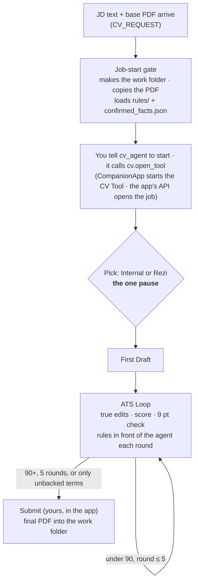

# cv module: the CV Tool is its UI

> **Status: built and tested, going live with the `cv` reload (2026-11-09).** Built: the CV Tool app in `src/cv_tool/` (pymupdf installed in `.venv` with your yes), `cv/tool.py` and the `cv.open_tool` / `cv.tool_*` / `cv.check_fonts` items, the rules folder and the facts loaded at every job, `CvRequest.tool`, the 5-step prompt. **Where the rules went (changed by [cv-agent-folders.md](cv-agent-folders.md), Option B):** not `src/assistant/modules/cv/rules/` but the module's workspace, `C:\Jobs\CV_Module\.claude\skills\cv-writing\` (`rules_dir`), and the facts in `CV_Module\data\confirmed_facts.json`; the CV Tool's data is in `CV_Module\cv_tool`. Details: the cv module's docs and [handoff-2389decf.md](handoff-2389decf.md). Earlier status: approved, building (2026-11-09). Comes after the [PDF in, PDF out](cv-pdf-only.md) change (now live). **Your answers:** the pick is option 1 (the request names `tool`, else the CV Tool waits for you); the rules and facts are **copied** into `rules/` and `confirmed_facts.json`, and the memory notes stay until you say they can go; the final PDF is `CV_Test_<Company>_final.pdf`. Build state: [handoff-cv-tool-build.md](handoff-cv-tool-build.md). **Paused 2026-11-09** for a folder layout proposal, [cv-agent-folders.md](cv-agent-folders.md), which would move the rules, the facts and the CV Tool's data into cv_agent's workspace. **The CV Tool is the cv module's own UI half;** its code stays in `src/cv_tool/`, because `CompanionApp` runs `python -m <package>` and inside `cv/` that would import the module's code into the app.

**Asked (2026-11-09):** the CV Tool (`C:\Jobs\rezi\cv_tool`) is the UI side of the `cv` module, and the module controls it. Today `cv_agent` doesn't know the app exists: its prompt runs its own 8 steps straight in Rezi, with a LibreOffice PDF and no Submit. The ExampleCorp job (2026-11-08) never showed up in the app.

## Why it ended up separate

- **2026-11-07 21:21**, `talker-cv_agent.jsonl` L418, you: "I want a UI that has these tabs 1. The JD and selected CV. 2. Optional Tab for when we use a service ... 3. The CV we recieve that updates as we edit it".
- **22:12:00**, L632, you: "I meant a completely separate UI for the cv tool". **22:12:31**, L640: "Why can't you build it yourelf? ... This is a completely separate process".
- **22:12:04**, L639, the Talker first proposed the right pattern: "separate apps that the main app launches through a thin module". Then at **22:12:36**, L648, it dropped it: "If it's a completely separate tool in cv_agent's own folder, it doesn't have to go through the Main Assistant."
- **22:39**, L828, the Talker's work order to cv_agent: "a completely separate app for the CV workflow, not a module of the AI Assistant". After **22:40:04**, L830 ("No, not the viewer. I want it as its own window"), the plan `cv_agent\docs\cv_tool_ui_plan.md` says "It is not a module of the AI Assistant".
- **Who built it:** cv_agent, in its own folder, from 2026-11-07 to 2026-11-08 03:02, over seven test rounds. Its plan says it couldn't read `app_kit` from its folders, so it copied the window idea instead of using it.
- **So:** "separate" meant its own window and process. The Talker turned that into "not part of the assistant". Nothing linked the cv module back to it afterwards.
- **The flow you set:** 2026-11-07 23:03:49 (L910): tab 2 becomes "CV Tool", listing Internal and Rezi, and "this determins what we'll use for ATS". 2026-11-08 01:02:46 (L1067): "Tab 2 should just be the place where I choose the 'model' ... Tab 3 is where we then make our first draft ... Then the fourth tab we just keep looping". It's written down in `cv_tool\README.md`, under "The flow".

## The flow cv_agent will follow

This replaces the prompt's 8 steps in `worker.py`.

1. **Job & CV:** when you tell it to, cv_agent opens the job in the CV Tool with `cv.open_tool`: the JD text and the base CV PDF (a copy in the job folder). The gate doesn't open the app.
2. **CV Tool (the pick):** Internal or Rezi, and only one. You pick it in the app, unless `CV_REQUEST` names `tool`.
3. **First Draft:**
   - Internal: the app makes its proposals itself.
   - Rezi: the app writes `rezi_requests\<id>.json`. cv_agent puts the text into a Rezi resume it made, scores it, and writes `results\<id>.json`.
   - **Where you see Rezi:** in your own Chrome, signed in. cv_agent drives it there with the Claude in Chrome extension, and the CV Tool has no live view of Rezi (agreed 2026-11-07 23:03, `talker-cv_agent.jsonl` L910 and L917; `cv_tool\README.md` L120). Proposed: cv_agent opens the job's Rezi resume in a tab of your Chrome here and keeps it through the ATS Loop.
4. **ATS Loop:** cv_agent makes true edits and sends each round to the app (`pdf`, `score`, `matched`, `missing`, `changes`, `issues`), with no Rezi PDF ever. It stops at 90 or more, at most 5 rounds, or when only unbacked terms are left. A missing term your CVs don't back comes to you as a question.
5. **Submit:** yours, in the app. The module waits for `jobs\<job_id>\ready.flag`, reads `result.json`, and returns it as the task's `CV_RESULT`. A change after Submit removes the flag, and the module waits again.

**Dropped from the prompt:** the LibreOffice `cv.build` as the final PDF, and the Rezi import check (old step 6). The app's own page, printed by Chrome, is the final PDF: that's the look you approved on Wayne and Hooli. The truth gate, `cv-writing-preferences\SKILL.md` and the job-start gate stay.

## The module launches and controls the app

This is the same pattern as `html_viewer`: `CompanionApp` from `app_kit` ([companion app checklist](../architecture/reusable-parts.md#companion-app-checklist)).

- **Start:** when cv_agent calls the new `cv.open_tool` item, which it does when you tell it to start the workflow. The gate never starts the app on its own (decided 2026-11-09). A headless CV Tool may come later, so the `cv.tool_*` items must not need a window: they use only the app's API. `ensure_running()` runs `python -m cv_tool` on a fixed port from `module.toml`, and the ping is `/api/ping` (it already answers `{"app": "cv_tool"}`).
- **Stop:** at module stop, `stop()` quits the app only if the module launched it. On a reload, the module hands the app over, or restarts it if its code changed (`code_changed()`).
- **Feed a job:** `cv.open_tool` (given the job's folder) calls the app's API with the job, instead of the app's inbox. The inbox stays for scripts. The app's job id comes back to cv_agent in the item's answer.
- **Read results:** module items, so cv_agent doesn't hand-write JSON files:
  - `cv.tool_round`: send a draft or a scored round.
  - `cv.tool_status`: the round table, the score and Submit's state.
  - `cv.tool_result`: `result.json`, only once `ready.flag` exists.

## What moves and what stays

| Part | Where |
|---|---|
| App code: `server.py`, `cvlib.py`, `static/`, `assets/` | **Moves** to `src/cv_tool/` in this repo (a `__main__.py`), next to `src/html_viewer/`. The cv module owns its docs and tests |
| The window | **Changes** to `app_kit.window` (`open_app_window`) instead of the hard-coded `msedge` path |
| Port | **Changes:** a fixed port from config instead of a random one, so `CompanionApp` can find it |
| Quit and guard | **Added:** `POST /api/quit` (JSON only), and `local_guard` on every request, as the checklist asks |
| Base CV reader | **Changes:** reads the base CV PDF with the cv module's `pdf_read.py`, not `.odt` / `.docx` |
| Data: `jobs\`, `inbox\`, `outbox\`, `rezi_requests\`, `data\confirmed_facts.json`, `cache\`, `.edge_profile\` | **Stays** in `C:\Jobs\rezi\cv_tool`, set as `data_dir` in `module.toml`. Nothing is copied or deleted |
| `cv_tool.cmd` | **Stays**, pointed at the new package, so you can still open it by hand |
| `cv_agent`'s memory note `user-wants-rezi-export-not-local-build.md` | **Removed**, with its line in that memory's `MEMORY.md`. It conflicts with "never download Rezi's PDF" |

No core, contract or `app_kit` change. It needs a `cv` reload, not an app restart. The app is its own process, started fresh.

## 9 pt minimum

**Today nothing checks it in code:**
- **The cv module:** no font-size check. `pdf_read.py` already reads each text run's `font_size`, so a check can reuse it.
- **The CV Tool (`cvlib.py`):** the job title, degree and awards lines are styled at **8.5 pt** (lines 401, 406, 408), under 9 pt. Its only check (line 586) warns when the body is under 8.5 pt.
- **cv_agent:** `cv_agent\scripts\font_sizes.py` measures sizes by hand; nothing calls it. The rule lives only in the memory note `cv-min-font-9pt-measured.md`.

**Proposed:**
- A `cv` module check, `cv.check_fonts` (or part of reading the final PDF): it reads every run's size with `pdf_read` and refuses a final PDF with any text under 9 pt, naming the lines. It runs on each ATS Loop round and before Submit's result is accepted.
- The CV Tool's 8.5 pt styles become 9 pt during the move. That may cost space on the one page; the rule is "shorten or ask, never shrink".

## Rules loaded on every job

Today `job_skills` loads only `cv-writing-preferences\SKILL.md` and `never-script-cv-folder-copy-first.md` in full. The other memory notes reach cv_agent only as their index line, and `confirmed_facts.json` not at all.

**Proposed `job_skills`,** each loaded in full by the job-start gate:
- Style and layout: `cv-style-no-parentheses-semicolons.md`, `cv-style-action-to-result.md`, `cv-min-font-9pt-measured.md`, `cv-section-order-default.md`
- Rezi: `rezi-pdf-download-auto.md`, `rezi-write-sections-scrambles-experience.md`
- CV Tool: `cv-tool-scope.md`, `cv-tool-rezi-request.md`
- Facts: `user-fact-system-design.md`, `user-facts-soylent-no-aws.md`, `user-facts-hooli-v5-confirmed.md`, and `C:\Jobs\rezi\cv_tool\data\confirmed_facts.json`

`job_start.py` already takes these: it reads any path as text, a `.json` too, and pastes it into the task, so cv_agent needs no read access to them. No code change, only `module.toml`.

**Recommendation:** gather the style, layout and Rezi rules into `cv-writing-preferences\SKILL.md`, so they live as skill rules and as general rules. Keep the facts as data: the fact notes merged into `confirmed_facts.json`. Fix the skill's step 4 ("once the service's export is downloaded") to the CV Tool's Submit, and remove `user-wants-rezi-export-not-local-build.md`.

## Folders and loading

**Asked (2026-11-09):** order the folders and instructions so cv_agent has all of them, skills included, and uses them on its own. Once the JD text and base PDF are given, the job opens in the CV Tool and the flow runs by itself. **Decided (2026-11-09):**
- The gate gives cv_agent the context: the work folder, the PDF copy, the rules and the facts.
- Then you tell cv_agent what to do. For this flow, you tell it to launch the UI and start.
- It calls `cv.open_tool`, which starts the CV Tool and opens the job. The workflow runs from there.

### Where everything lives

| Place | Holds | Loaded how |
|---|---|---|
| `src/assistant/modules/cv/` | Code, the prompt (`worker.py`), and a new **`rules/`** folder: `cv-writing-preferences.md` (today's `SKILL.md`) plus the style, layout, Rezi and 9 pt rules moved out of the memory notes | Every file in `rules/` read in full by the job-start gate on every job |
| `src/cv_tool/` | The CV Tool's code (moved, see above) | Launched and stopped by the `cv` module through `CompanionApp` |
| `C:\Jobs\rezi\cv_tool` | **Data only:** `jobs\`, `data\confirmed_facts.json`, `inbox\`, `outbox\`, `rezi_requests\`, `cache\` | `confirmed_facts.json` read in full by the gate; the rest through the app's API |
| `C:\Jobs\rezi\cv_agent\work\<date>_<Co>_<Role>\` | One job: the copied base PDF, `jd.txt`, `job_start.json`, the drafts, the final PDF | Made by the gate; cv_agent works only here |
| `C:\Jobs\CV` | Your CVs, read only | The gate copies the base PDF out; nothing runs on it |

The memory notes that move into `rules/` are removed from cv_agent's memory, so each rule has one home. The fact notes are merged into `confirmed_facts.json`.

### The automatic flow

The gate is code, so the folder, the PDF copy, the rules and the facts are in the task before cv_agent starts. Opening the CV Tool is cv_agent's one call, `cv.open_tool`, made when you tell it to. **Rules each round:** the gate's text sits in the task for the whole session, and `cv.tool_round`'s answer repeats a short checklist (each rule file's name and its one-line rule). Whether a fresh session after a handoff gets the gate's text again is still to check in `SessionTaskAgent`; if not, `handoff.py` adds it back.

**The one pause, the pick. Options:**
1. **The request names the tool** (`CV_REQUEST`'s `tool`), else the app waits for you.
2. **Default to Rezi:** no pause unless the request says Internal.
3. **Always ask** in the app.

**Recommended: 1.** The job agent can name it when it knows, and you choose otherwise.

### Checked against the code

- **Absolute paths:** `job_folders` in `module.py` takes any absolute path in `job_skills`, and `JobStart.load_skills` reads any file as text, a `.json` too. So the `rules/` files and `confirmed_facts.json` load today with full paths in `module.toml`.
- **Relative paths** are taken from cv_agent's workspace (`C:\Jobs\rezi\cv_agent`), not the module's folder. **Small code change proposed:** a `rules_dir` setting, default the module's own `rules/`, every file in it loaded. No list to keep, and a new rule file loads without a config edit.
- **cv_agent's access:** none needed for the rules or the facts, because the gate pastes their text into the task. The CV Tool's `jobs\` is reached only through the `cv.tool_*` items, so no access to `C:\Jobs\rezi\cv_tool` either.
- **Needs a settings change:** none if the above holds. Only `module.toml` (the module's own defaults) changes: `rules_dir`, `confirmed_facts.json` in `job_skills`, and the CV Tool's port and `data_dir`. If cv_agent ever has to read or write `cv_tool\jobs\` itself, that's a new `read_dirs` / write line, which asks you on the access card when `cv` turns on.
- **Outside the repo, needs your yes:** moving the notes out of `C:\Users\you\.claude\projects\C--Jobs-rezi-cv-agent\memory\` and editing that `MEMORY.md`.

## Order

1. **The PDF-only change first:** your answers to its open questions, then a `cv` reload (`cv-pdf-only.md`). Both changes edit `job_start.py` and `worker.py`, so this one builds on top of it.
2. **Move the app** into `src/cv_tool/`, with the port, quit, guard and window changes and the PDF reader. Check it on the Hooli job record, which stays read-only.
3. **The cv module:** `CompanionApp`, `cv.open_tool` (cv_agent opens the job), the `cv.tool_*` items, and the new prompt. Add `cv_tool` docs to `job_skills`.
4. **Tests and docs,** then ask before the `cv` reload.
5. **ExampleCorp** goes through it fresh as the first real job. Its old folder and Rezi resume `00000000-…` are reused or replaced, as you say.

## Open

- Is Rezi the default pick, or does the app always wait for you to choose? **Recommended:** the app waits for your pick, unless `CV_REQUEST` names `tool`.
- Does the final PDF's name stay `CV_Test_<Co>_final.pdf`? **Recommended:** yes.
