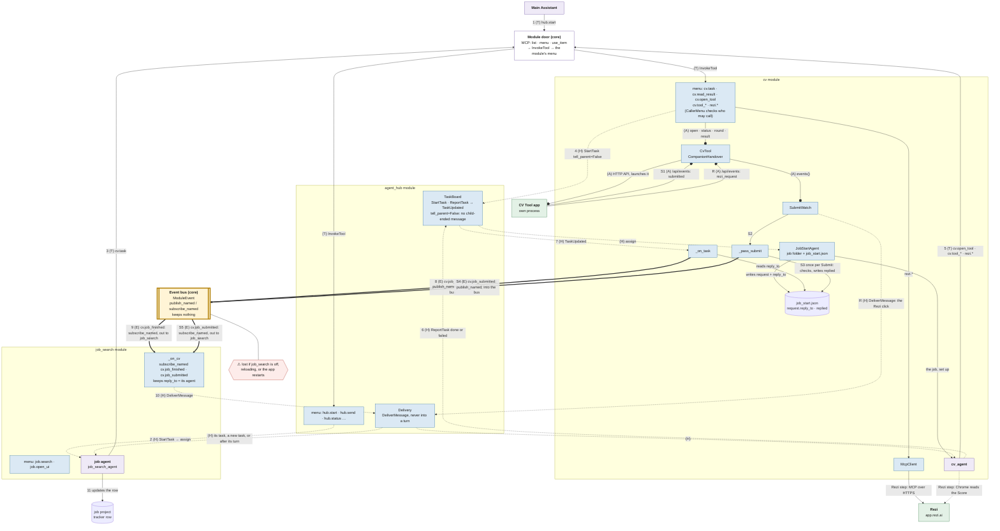

# Job ↔ cv flow: who talks to whom, and how

> Drawn 2026-11-12 from the built code (not yet loaded: the app restart is waiting on you), for [job-cv-finish-event](job-cv-finish-event.md). Every arrow's file and line is in the table under the chart.

**Line kinds:**

- **(T)** a tool call through the module door (`use_item` → `InvokeTool` → the module's menu). Solid arrow.
- **(E)** a named event (`ModuleEvent`). Thick arrow, drawn in two halves: from the publishing module into the **Event bus** block (`publish_named`), and out of it to the subscribing module (`subscribe_named`).
- **(H)** a Hub message or a Hub typed event or command (`StartTask`, `ReportTask`, `TaskUpdated`, `DeliverMessage`). Dotted arrow.
- **(A)** a companion app call, or the app's event stream (`CompanionHandover`). Arrow with a circle end.

The event bus is part of the core, not a module: no module owns it, and every module reaches it through its own context (`ctx`).

Lines with no letter are code inside one module. Numbers 1 to 11 are the job's end. S1 to S5 are your Submit, which then follows 10 and 11 again.

## Each arrow in the code

Paths are under `src/assistant/` unless they start with `src/`.

| # | Kind | What | File and line |
|---|------|------|---------------|
| 1 | T | The Main Assistant's `use_item hub.start` → `InvokeTool` → the Hub's menu | `infra/mcp_door.py:153-158`, `core/tools.py:33`, `modules/agent_hub/module.py:200-213` |
| 2 | H | The Hub starts the job agent's task | `modules/agent_hub/module.py:135` (handles `StartTask`), `modules/agent_hub/tasks.py:252` (`agent.assign`) |
| 3 | T | The job agent's `use_item cv.task` → cv's menu, caller checked | `infra/mcp_door.py:158`, `modules/cv/module.py:99-102` (`CallerMenu`), `modules/cv/module.py:383` (`cv.task`) |
| 4 | H | cv starts cv_agent as the job agent's child, `tell_parent=False` | `modules/cv/module.py:414-415`, `modules/agent_hub/tasks.py:249` (kept on the record) |
| 4 | H | The Hub gives the task to cv's gate, which sets the job up | `modules/agent_hub/tasks.py:252`, `modules/cv/job_start.py:235` (`JobStartAgent.assign`) |
| – | code | The gate writes `job_start.json` with the request and `reply_to` | `modules/cv/job_start.py:133` |
| 5 | T | cv_agent's tools: `cv.open_tool`, `cv.tool_*`, `rezi.*` | `modules/cv/module.py:537` (`cv.open_tool`), `:584` (`cv.tool_result`), `:318-377` (`rezi.*`) |
| A | A | cv → the CV Tool app: launch and HTTP calls | `modules/cv/module.py:246` (`CvTool`), `modules/cv/tool.py:128` (`CompanionHandover`), `:164` (`open`), `:230` (`result`) |
| Rezi | – | `rezi.*` through Rezi's MCP server | `modules/cv/module.py:242` (`rezi_client`), `modules/cv/mcp.py:277` (`McpClient`) |
| Rezi | – | cv_agent reads the Score in Chrome on app.rezi.ai | `modules/cv/module.toml:61` (`chrome = true`), `modules/cv/worker.py:31` (its prompt); see below |
| 6 | H | cv_agent's session reports done (or failed) to the Hub | `infra/session_agent.py:590`, `:604`, `:748` (`_report(ReportKind.DONE, …)`), `modules/agent_hub/tasks.py:337`, `:356-357` |
| – | H | No child-ended message for this task | `modules/agent_hub/tasks.py:440` (`not record.tell_parent` returns) |
| 7 | H | The Hub publishes `TaskUpdated`; cv hears it | `modules/agent_hub/tasks.py:456`, `modules/cv/module.py:249` (subscribe), `:227` (manifest `listens`), `:448` (`_on_task`) |
| 8 | E | cv publishes `cv.job_finished` | `modules/cv/module.py:464`, `modules/cv/handoff.py:73` (the data), `modules/cv/module.py:225` (manifest `publishes_named`), `core/context.py:67-76` |
| 9 | E | job_search hears it, only for its own agent | `modules/job_search/module.py:133-134`, `:114` (manifest `listens_named`), `:139` (`reply_to` check), `core/context.py:78-91` |
| 10 | H | job_search wakes its agent with a `DeliverMessage` | `modules/job_search/module.py:142`, `modules/agent_hub/module.py:143` (handler), `modules/agent_hub/delivery.py:73` (`deliver`), `:120-138` (into its task or a new task), `modules/agent_hub/module.py:146`, `:305` (after its turn) |
| 11 | – | The job agent updates the tracker row | no code line: see below |
| S1 | A | The CV Tool's Submit goes out on its event stream; cv reads it | `src/cv_tool/server.py:246-248` (`/api/submit` publishes `submitted`), `:313` (`/api/events`), `modules/cv/tool.py:136` (`events`), `modules/cv/submit_watch.py:104`, `:110` |
| S2 | – | The watch hands the Submit to `_pass_submit` | `modules/cv/submit_watch.py:162-167`, `modules/cv/module.py:253` (wired), `:486`; also from `cv.tool_result`: `:589` |
| S3 | – | Once per Submit: `pending_reply`, then `mark_replied` writes `replied` | `modules/cv/reply.py:23`, `:33`, `modules/cv/module.py:507` |
| S4 | E | cv publishes `cv.job_submitted` into the bus | `modules/cv/module.py:504`, `modules/cv/reply.py:40` (the data), `core/context.py:67-76` |
| S5 | E | job_search hears `cv.job_submitted` (same listener as 9); then 10 and 11 again | `modules/job_search/module.py:133-134`, `:139` (`reply_to` check), `core/context.py:78-91` |
| R | A, H | The Send JD and CV to Rezi click: the app's event, then a message to cv_agent | `src/cv_tool/server.py:233`, `modules/cv/submit_watch.py:112`, `:152`, `modules/cv/module.py:473-480` |
| ⚠ | E | Where an event is lost | `core/context.py:106` (a stopped module's context drops what it publishes); `core/context.py:91` (a live bus subscription only: nothing is queued for a module that's off, reloading or not started after a restart) |

## The replied record and the lost events

- **`job_start.json`** holds the request, with `reply_to` (written at step 4, read at 7 and S3), and `replied` (written at S3), so one Submit goes out once.
- **An event is lost** if job_search is off or reloading when cv publishes, or if the app restarts in between. With `tell_parent=False` nothing else wakes the job agent then. The result is still in the Hub's task record and the job folder. No fallback: decided 2026-11-13, accepted as normal at-most-once event delivery ([job-cv-finish-event](job-cv-finish-event.md#lost-events-decided-no-fallback)).

## What could not be verified

- **Step 11, the tracker update:** it's the job agent's own action. No code does it; job_search's message only asks for it (`modules/job_search/module.py`, `cv_finished_text` and `cv_submitted_text`). The job project's skills (`C:\Jobs\CV\.claude\skills\apply-session\SKILL.md`) have no step for a cv result, so no line can be named there.
- **The Rezi step in Chrome:** cv_agent reads the Score with Claude in Chrome. Only the setting and the prompt can be named; the browser calls aren't in this repo's code.
- **The module door's process side:** steps 1, 3 and 5 go from the agent's `claude` session through the stdio relay (`python -m assistant.infra.mcp_door`) to the app. The lines named are the app side of the door.
