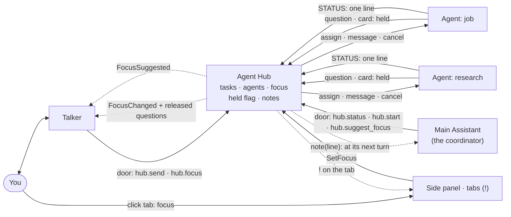

# Multi-agent: several task agents at once, each talking to you

> **Status: approved (2026-11-05); building.** The design matches the code graph (a local page in `docs/temp/`, not kept in the repo), with the fixes from its "Calls that look like bad design" list (see [Design fixes](#design-fixes-from-the-code-graph)). **Chunks 1–7 are built** (2026-11-05), with the cap counting only the extra agents (`[modules.agent_hub] max_extra_agents = 3`); contracts and infra changed, so the app needs a restart. Chunk 6 is the temp UI's tabs; chunk 7 the job agent as the `job_search` module (a stub `job.search`). Open: the job agent's access list, the real search runner, whether `--chrome` loads under `--strict-mcp-config`, and helper usage in the temp UI header ([handoffs](handoff-99c9ff7c.md), [last](handoff-d729a7ef.md)). Decided in chunk 4: the Talker keeps its tags as a shorthand, but each Hub tag runs a `hub.*` menu item through `InvokeTool` (one road); permission answers stay `AnswerPermission`, per task.

**Asked:** "a multi-agent setup where we have separate agents that can talk either directly to the Talker and then update the Main Assistant. I'm on the task continuously." Needed before the [job agent](job-agent.md). Added later: you can pick a helper agent and talk to it directly, either because the Main Assistant suggests it or because you choose it yourself. A side panel shows the big agents that are active, and you click one to talk to it. The Main Assistant window gets one tab per big agent so you can follow each one.
**Added (update):** helper agents never push questions into the main chat. Their tab shows a **!**, and the question loads into the Talker only when you click that tab, which also sets the focus. You decide what to focus on. Permission cards work the same way. The Main Assistant's tab has its own color. Big milestones from the other agents reach the Main Assistant as one short line ("the job agent finished X") and never drown out your conversation with it. Helper agents know the two kinds of message apart.
**Approved:** "The design docs is good … the concentration should be on making sure that they can work with each other."
**Why:** today one agent (the Main Assistant) does all the work, and the Talker follows one task at a time. The job helper has to run alongside it, talk with you directly, and keep the Main Assistant in the picture, without crowding the main conversation.
**Touches:** `contracts/agents.py`, `contracts/tools.py`, `contracts/menu.py`, `contracts/door.py`, `core/context.py`, `core/tools.py`, `agent_hub`, `talker`, `main_assistant`, `infra/session_agent.py`, `infra/agent_tags.py`, `infra/mcp_door.py`, new `infra/agent_profile.py` and `infra/milestone_feed.py`, `temp_ui`, `config/default.toml`; docs: [agents](../architecture/agents.md), [runtime](../agents/runtime.md), [Agents API](../api/agents.md), [Tools API](../api/tools.md), [reusable](../api/reusable.md).

## Where we are

| Part | Before | Gap |
|---|---|---|
| Hub | Keeps a table of tasks; `StartTask` gives the work to the first free agent; one task per agent | Only one agent exists; no way to name the agent; no parent task; no held questions |
| Agents | `main_assistant` only, a `SessionTaskAgent` on a `ClaudeSession` | Folder and access code sits inside `main_assistant` |
| Talker | Follows one `_current_task_id`; ignores updates from other tasks; `<<ALLOW>>` goes to that task | Must follow several tasks, and know which one you're talking to |
| Main Assistant | Can't send Hub commands; hears nothing about other tasks | Must be kept informed, and later delegate |
| Door | One token for every session; a menu item can't tell who calls it | The Hub's menu needs to know who is calling (the Talker sets the focus, the Main Assistant only suggests) |
| Temp UI | One worker pane, one permission card | A list of agents, a tab per agent with its **!**, the agent's name on cards and usage |

## Approach

**1. Parallelism comes from several agents, not several tasks per agent.** Each agent still runs one task at a time (its one `claude` session, fresh per task, as now). Running three things at once means three agents. The Hub needs more `ITaskAgent` providers and these changes:
- `StartTask.agent_id` (optional; else the first free agent) and `StartTask.parent_task_id` (optional, for a task another agent starts).
- `TaskUpdated` gets `agent_id`, `parent_task_id` and `held`; `TaskInfo` gets `parent_task_id` and `held`.
- A cap in `[modules.agent_hub]`: `max_extra_agents = 3` big agents **besides the Main Assistant** (the coordinator isn't counted) may have an open task at once; change it in your config. Every agent shares your subscription's limits, and the cap stops a runaway Main Assistant. (Changed 2026-11-05 at your request: chunk 1 first counted every open task, the coordinator included.)
- The folder-clash check: each agent says which folders it writes (`AgentInfo.write_folders`, from its profile), and the Hub refuses a task whose agent writes into a folder another open task's agent writes (the same folder, or one inside the other). Git worktrees come later.

**2. Agents are profiles, built by one module.** The agents differ only in config (prompt add-on, working folder, read and write folders, allowed commands, model, Chrome or not). So:
- **`AgentProfile`** (`infra/agent_profile.py`): the folder and access code moved out of `main_assistant` (what the job-agent note asks for). It builds the `claude` command with `claude_command` and `path_rule`, the access section of the prompt, the shared two-kinds-of-message block (section 8), and the agent's `write_folders`.
- **`task_agents` module** (chunk 3, built): one agent per `[modules.task_agents.agents.<id>]` section, each provided as `ITaskAgent`. `instances = 2` gives peer agents of the same kind (`helper`, `helper_2`; sections are now kinds of helper, renamed by [agent-names](agent-names.md)), each writing its own sub-folder of the workspace so the folder check lets them run together. The Main Assistant stays its own module. Every big agent is put together by one shared part, **`ProfileAgent`** (`infra/profile_agent.py`: profile + session + `SessionTaskAgent`, the door under its own name).
- **Decided (architecture-first, 2026-11-05): a big agent with code of its own ships bundled with its own module.** The job agent comes with its `job_search` module: that module provides both its agent (`ITaskAgent`, a `ProfileAgent`) and its menu and workers. Why: the agent and its tools are reloaded, turned off and documented together; the module's callbacks (`AgentNotice`) go to its own agent; nothing has to pair a profile with a separate module by name. Plain helpers without code stay profiles in `task_agents`. A bundled module, like `task_agents`, waits for its agent to be idle before a reload.
- **Big agents only.** The Hub tracks these top-level agents. Claude Code's own subagents inside a session (the `debugger`) stay that session's business and aren't listed.

**3. One switchboard: the Hub, with a menu, reached by one road.** The Hub's menu sits on the existing [module door](../api/tools.md#imoduledoor). Every item knows its caller (section 9):

| Item | Who may use it | Does |
|---|---|---|
| `hub.agents` | anyone | The big agents: busy, working, focused, holding something (**!**) |
| `hub.status` | anyone | Task status (`GetTaskStatus`), without disturbing the agent |
| `hub.start` | anyone | Start a task (`StartTask`); the caller's open task becomes its parent |
| `hub.send` | the Talker; others only to their child tasks | No `task_id`: your words to the **focused** agent (its task, or a new one if it's idle). With `task_id`: to that task |
| `hub.cancel` | the Talker; others only their child tasks | `CancelTask` |
| `hub.focus` | the Talker only | Move the focus (`SetFocus`), after you said so |
| `hub.suggest_focus` | the coordinator only | Publish `FocusSuggested`; the Talker asks you, and the focus moves only through `hub.focus` |

The Talker reaches the Hub only through these items: its `WORK`, `ASK`, `PAUSE` and `CANCEL` tags go in chunk 4, so there is one road, not two. Permission answers stay the `AnswerPermission` command, which no menu item offers, so no agent can answer another's card.

**4. Talking to an agent directly: the focus.**
- **The focus** is the agent you're talking to right now; the coordinator (the Main Assistant) by default. The Hub keeps only the focused agent's id (`SetFocus(agent_id)`, `FocusChanged`), so the Talker and every UI agree on it. If the focused agent is turned off, the focus falls back to the coordinator.
- **Three ways to set it:** click the agent's tab or its side-panel entry (`SetFocus`); tell the Talker ("let me talk to the job agent", `hub.focus`); or accept the Main Assistant's suggestion. The Main Assistant suggests with `hub.suggest_focus(agent_id, reason)`, which publishes `FocusSuggested`. The Talker asks you, and the focus only moves when you say yes. "Back to the main assistant" moves it back. Two items, not one item that behaves differently by caller.
- **While an agent has the focus,** the Talker passes your words on to it unchanged (`hub.send` with no task id), and says each reply with the agent's name. The Talker stays your voice in and out. It doesn't reword what you say and doesn't decide for the agent.
- **Other agents** don't get your messages while they're out of focus, and they never push anything into the main chat (see 5).

**5. Notifications instead of pushing.**
- When an agent out of focus asks a question (`NEED:`) or needs a permission, the Hub stores it **once**, on the task record (`TaskInfo.question`, as before), marks it `held`, and the task waits. `TaskUpdated(held=True)` lets the tab and side panel show a **!**. Nothing is said or shown in the main chat.
- When you focus that agent (any way), `FocusChanged.released` carries its tasks whose question was held (as `TaskInfo`s), and the flag clears. The Talker then says the question, named ("The job agent asks: …"), and the card appears, so you answer while already focused on that agent. Your answer goes only to it. The **!** clears once nothing is held.
- **You decide** which **!** to take and when. A held question never times out on the Hub's side; the agent just waits (a permission card still ends after the agent's `permission_timeout`).
- The focused agent's questions and cards come straight through, as now. The coordinator's own questions follow the same rule when you're focused elsewhere.

**6. The Main Assistant stays informed without being drowned out.**
- **Only milestones.** A helper sends a milestone as a `STATUS: <one line>` line (`agent_tags.status_lines`, reported as the `milestone` kind of `ReportTask`), for example "finished the cover letter draft". Routine progress stays in the agent's tab only. The Hub also adds a line when another agent's task ends and when the focus moves.
- **The coordinator comes from config** (`[modules.agent_hub] coordinator = "main_assistant"`); the Hub knows no agent by name in code.
- **Delivered at its next turn, any turn.** The Hub hands each line to the coordinator at once with `ITaskAgent.note(text)`. `SessionTaskAgent` keeps them in a `MilestoneFeed` and adds them, as one compact block (at most 5 lines, the oldest merged as "+N earlier"), to the end of the next message it writes to its session: a new task, a message, or its own `Continue` turn. So the feed reaches it during a long task too. Never an interrupt, and the Hub never wakes an idle coordinator (that would start paid work nobody asked for); the lines wait for its next task. It can read more with `hub.status`.
- **Never in your conversation.** The Talker doesn't say feed lines, and the main chat doesn't show them; at most a small grey line in the agent's tab (`TaskUpdated` of kind `milestone`). Questions never go into the feed.

**7. Permissions per agent.**
- Each agent has its own access list (its profile) and its own `PermissionMode`, Manual at every launch. Only you switch an agent to Auto, one agent at a time.
- Requests outside an agent's list become a card **naming the agent and the action**, answered with `AnswerPermission(task_id)` (already per task). Out of focus, the card is held behind the tab's **!** (see 5), so only the focused agent's cards are ever on screen. A spoken "yes" goes to the focused agent's card; if it has more than one open, the Talker asks which.
- The Main Assistant can start and message its own child tasks and suggest the focus. It can't answer their permission requests, change their mode, or move the focus itself.
- The planned [permissions handler](permissions-handler.md) takes over these rules later; nothing here blocks it. A `risky` flag on menu items, checked once in `MenuTools`, is left for that handler.

**8. The agents' instructions.** Every agent's prompt gets a shared block from `AgentProfile.prompt_block`, so no profile can miss it:
- **Helpers:** two kinds of message that never mix. *Status for the Main Assistant:* a `STATUS: <one line>` line, only for a big milestone (a step finished, a result ready, a blocker); one line, no detail, the work itself stays in the tab. *Questions for you:* a `NEED: <question>` last line, and the permission request; these wait behind the tab's **!** until you focus the agent, so the question must make sense on its own, possibly much later. Never a question in a `STATUS:` line, never a status as `NEED:`.
- **The coordinator:** the matching half: lines under "[Updates from the other agents]" are background to note, not requests to act on or repeat; its own `NEED:` questions may also wait behind its tab's **!**, so they stand on their own.

**9. The module door knows its caller.** One door, but each `claude` session gets its own door config:
- `IModuleDoor.mcp_config(caller)`: the Main Assistant asks with its agent id, the Talker with `talker`, each `task_agents` agent with its own id. The config carries the caller's name and a token made from the door's secret and that name (an HMAC), so the session can't claim another name, and the tokens survive a Hub reload.
- `DoorServer` checks the token and puts the caller on `InvokeTool.caller`.
- **Who may set the caller:** `ScopedContext.send` fills in the sending module's own id on every `InvokeTool`. Only the module that provides `IModuleDoor` (the door's host, `agent_hub`) may pass another name, the one its token proved. A command sent straight to the router (tests, the core) has no caller.
- The core passes the caller on: `dispatch_tool` → `IToolProvider.invoke_as(name, args, caller)` (by default `invoke`, which ignores it) → `MenuTools` → `Menu.call(module, name, args, caller)`. A menu item may list its `callers`; anyone else gets `not_available`. A method with a `caller` parameter receives it.
- **Callbacks:** a module whose menu item starts slow work (the job search) returns at once and, when the work ends, publishes `AgentNotice(agent_id = the caller, text)`. The Hub hands it to that agent with `note`, so it arrives at its next turn, the same road as the milestone feed. No module calls another module's menu by name.

## New and changed contract types

All in `assistant.contracts`; each needs the app restart.

| Type | Kind | Change |
|---|---|---|
| `StartTask` | command | `agent_id`, `parent_task_id` |
| `TaskInfo` | data | `parent_task_id`, `held` |
| `TaskUpdated` | event | `agent_id`, `parent_task_id`, `held` |
| `AgentInfo` | data | `write_folders` |
| `ReportKind.MILESTONE` | enum value | A `STATUS:` line |
| `ITaskAgent.note` | method | A line for the agent's next turn; the default drops it |
| `SetFocus` | command (new) | Move the focus; handled by the Hub |
| `FocusChanged` | event (new) | The focus moved: `agent_id`, `previous`, `released` (held tasks now released) |
| `FocusSuggested` | event (new) | The coordinator suggests a focus: `agent_id`, `reason`, `by` |
| `AgentNotice` | event (new) | A module's callback for an agent (`agent_id`, `text`, `source`) |
| `InvokeTool.caller` | field | Who uses the item; filled in by `ScopedContext` |
| `IToolProvider.invoke_as` | method | `invoke` with the caller; the default ignores it |
| `Menu.item(callers=…)`, `Menu.call(…, caller)`, `Menu.allowed` | part | Who may use an item; the caller for methods that take it |
| `IModuleDoor.mcp_config(caller)` | method | One door config per caller |

## Design fixes from the code graph

| Bad-design item | Fixed by |
|---|---|
| 1. One `hub.focus` with two jobs | Two items: `hub.focus` (Talker) and `hub.suggest_focus` (coordinator) |
| 2. The Talker has two roads to the Hub | The door only; its `WORK`/`ASK`/`PAUSE`/`CANCEL` tags go in chunk 4 |
| 3. The question held in two places | Stored once on the record (`question`), with a `held` flag; the Hub keeps only the focused id |
| 4. The Hub knows a special agent; the wake costs money | `coordinator` from config; no wake: lines wait for its next task |
| 5. The feed misses the agent's own turns | The feed lives in the agent (`note` → `MilestoneFeed`), added to every turn it writes, `Continue` included |
| 6. Hub ↔ agent loop | Kept safe: reports still go through the agent's queue and the router |
| 7. The suggestion as a `TaskUpdated` | Its own event, `FocusSuggested` |
| 8. More contract types than the note said | Listed above |
| 9. Trusting the caller | `ScopedContext` fills it in; only the door's host may pass another, proved by its token |
| 10. The permission check is scattered | Left for the permissions handler (a `risky` flag on items) |

## Reused as is

| Part | Used for |
|---|---|
| `ITaskAgent`, `Task`, `TaskState`, `ListAgents` | Every agent and the side panel; no new agent contract |
| `SessionTaskAgent`, `ClaudeSession`, `claude_command`, `path_rule` | Each agent's session, handoffs, mode, context reminder |
| `ReportTask`, `GetTaskStatus`, `SendToTask`, `CancelTask`, `AnswerPermission`, `SetPermissionMode` | The whole message flow |
| `AgentActivity`, `AgentStateChanged`, `SessionUsage`, `PermissionModeChanged` | Tabs and the panel; they already name the agent |
| `Menu`, `IModuleDoor`, `DoorServer` | The Hub's menu, used by the Talker and the Main Assistant |
| `agent_tags` | `NEED:` / `HANDOFF:` lines, plus the new `STATUS:` line, the same for every agent |

## What the job app helper needs from this

A job agent, now `job_search_agent` (folder `C:\Jobs\CV`, its access list, Chrome tools, Manual mode), which you can focus and talk to directly while the Main Assistant keeps working. It also needs its own tab with its **!**, its held questions and cards, and its milestones reaching the Main Assistant through the feed. `instances` allows one agent per job later. The [job-agent note](job-agent.md) then shrinks to the profile and its menu.

## Risks

- **The Talker can misroute.** Following many tasks in one prompt is where routing mistakes happen. The focus limits this: your words go only to the focused agent, and other agents' questions only reach the Talker when you focus them.
- **Held questions stall agents.** An agent with a **!** waits until you click it. That's your choice by design, but a forgotten **!** means a stuck agent; the side panel's count of waiting agents keeps them visible.
- **Stale questions.** A question read an hour later may be out of date; the agents' instructions ask for questions that stand on their own.
- **Helpers mislabel messages.** A helper may send detail as `STATUS:` or a question as status. The prompt block and the one-line cap (longer lines are cut) limit the damage; it's checked in the tests with `fake_claude`.
- **The Main Assistant's view lags.** It hears at its next turn, so it may briefly act on old plans. Focus changes in the feed make this smaller.
- **Cost.** Every agent uses your subscription's limits; hence the cap.
- **The folder-clash rule is coarse.** The Main Assistant and a coding helper can't both write this repo until worktrees exist. The job agent isn't affected, since it works in its own folder.
- **One module for all agents.** Reloading it restarts every agent in it; it refuses while one is busy.
- **Until chunk 4,** today's Talker still follows only its own task and speaks its updates; nothing is held in practice, since only the Main Assistant runs and it holds the focus.

## Decisions (the open questions, as approved)

1. One `task_agents` module building agents from config; an agent with its own code (the job agent with `job_search`, a cloud agent) is bundled with its own module, on the shared `ProfileAgent`.
2. The Main Assistant may start and message its own child tasks through `hub.start` / `hub.send`, and suggest the focus. It never handles permissions or mode.
3. The Main Assistant hears milestone lines only, at its next turn, never as an interrupt.
4. The focus survives a finished task; it stays until you move it back or the agent is turned off.
5. `max_extra_agents = 3`: at most three big agents besides the Main Assistant at once, overridable in config.
6. Same-folder writes: the second writer is refused in v1; worktrees later.
7. The Main Assistant's own questions while you're focused elsewhere: a **!** on its tab, like any agent.
8. A spoken "show me what's waiting": the Talker may list which agents have a **!** (names only, never the questions) when you ask. Nothing unprompted.

## Build plan (one chunk per session, architecture check after each)

1. **Contracts, door and Hub** (built): the new fields and types above; the caller on the door (`mcp_config(caller)`, `InvokeTool.caller`, `ScopedContext`, `invoke_as`, `Menu` callers); the Hub's focus, held flag, cap, folder-clash check, menu, milestone lines to the coordinator, `AgentNotice`. Tests with two fake agents, including a held question released on focus. *Restart.*
2. **Agent profile** (built): `infra/agent_profile.py` with the folder and access code from `main_assistant` and the shared prompt block (section 8); `status_lines` in `agent_tags`; `SessionTaskAgent` reads `STATUS:` lines, keeps the notes (`MilestoneFeed`) and reports `write_folders`. No other change in behaviour.
3. **`task_agents` module** (built): agents from `[modules.task_agents.agents.<id>]` through `ProfileAgent`; a small `helper` profile (off at launch, working in `../assistant-helper`, outside the repo the Main Assistant writes). Tests against `fake_claude`: two agents at once, `STATUS:` to the coordinator, `NEED:` held until focused, the cap refusing a fourth extra agent, the door under each agent's name.
4. **Talker:** the open-tasks table, the focus (your words pass through `hub.send` unchanged, replies named), held questions said only on `FocusChanged`, feed lines never said, `FocusSuggested` asked as a yes or no, the Hub's menu instead of the work tags (one road), permission answers by task.
5. **Main Assistant:** its use of `hub.start` to delegate and `hub.suggest_focus`, with the prompt lines for them (the feed and its prompt half are in from chunk 2).
6. **Temp UI:** the side panel (active big agents, **!**, click to focus), one tab per agent on the Main Assistant pane (**!**, click to focus, the Main Assistant's tab in its own color), held cards shown only for the focused agent, the agent's name on cards and usage. Kept minimal.
7. **Then the job agent** as a profile, per its own note, with its `job.search` callback through `AgentNotice`.
