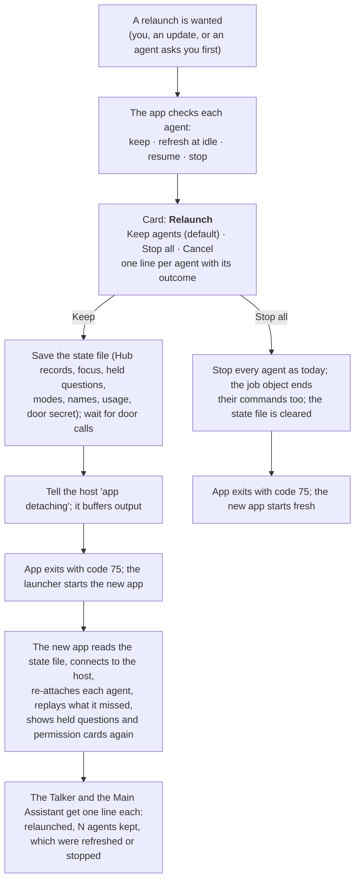

# Restarts that keep the agents running

> **Status: proposed (2026-11-06).** Waiting for the user's check. No code is changed until then.

**Asked:** "When restarting (esp. for updates) there should be an option to keep the agents running and hook them back up on restart. Or to kill all of them." Added later: module reloads and app relaunches should **keep the agents and re-hook them automatically whenever that is harmless**, so the app can be relaunched for updates without losing agents' work. Stopping all agents stays an option. The note says what makes a keep harmful, and what happens then.

**Why:** today a relaunch stops every agent (`ClaudeSession.close`: stdin closed, 3 s, then killed). A helper's running task is lost, and only the Main Assistant carries on, from its restart note. A crash is worse: nothing stops the `claude.exe` programs, so they run on with nobody listening.

## How it works today (read from the code)

| Part | Today | Effect on a restart |
|---|---|---|
| Agent ↔ app link | Each agent is a `claude -p` stream-json process with **stdin/stdout/stderr pipes** to the app process (`infra/claude_session.py:242`) | The pipes belong to the app process. When it ends, they break, and nothing else can take them over |
| Clean stop | `close()`: close stdin, wait 3 s, kill (`claude_session.py:299`) | The turn in progress is lost |
| Crash | Nothing ties `claude.exe` to the app. Killing `claude.exe` doesn't kill what it started (PowerShell, pytest, the door relay) | Orphans: agents and their commands keep running with nobody listening |
| Launcher | `python -m assistant` is a small parent that restarts the app child on exit code 75 (`__main__.py:35`) | **It survives every restart already.** It's the one process that lives across app launches |
| Module door | `DoorServer` on `127.0.0.1`, **a random port and a random secret each launch** (`mcp_door.py:112`, `:134`). Each session's relay gets the URL and its token in its env | A kept session's relay would point at a dead port with an old token |
| Hub task records | In memory only (`agent_hub/module.py:191`): tasks, held questions, focus, parent tasks | Lost on a restart |
| Permission mode | Held by `SessionTaskAgent`, set on the running process with `set_permission_mode` | Lost (every launch starts in Manual) |
| Open permission request | A `can_use_tool` control request waiting on stdin for its answer | Lost with the pipe |
| Talker's restart note | `talker/module.py:446`: written before `ShutdownRequested(restart=True)`, read once on the next launch | The only thing carried over today |

**The claude CLI (from its documentation, not yet tried here):** each session has an id. The first stream-json line (`system`/`init`) carries `session_id`, and the conversation is saved under `~/.claude/projects/<cwd>/<id>.jsonl`. `claude -p --resume <id>` starts a new process on that conversation, `--session-id <uuid>` sets the id up front, and `--fork-session` branches it. A resume brings back the **conversation**, not a turn in progress: a turn cut off mid-tool-call is gone, and the resumed session has to be told to carry on. What `claude -p` does when its stdin closes mid-turn (finish the turn, or stop) also isn't confirmed. A short spike checks all of this first (step 0 below).

## Three designs

### A. Resume each session by id

On a relaunch the app saves every session's id, mode and the Hub's records to a state file, closes the sessions as today, and starts each one again with `--resume <id>`. The agent is told: "the app restarted; your last turn was cut off at …; carry on."

- **Simple:** infra plus the Hub. No new process.
- **It doesn't really keep them running:** every agent stops for the restart, and a turn in progress is cut off, which can leave a half-done edit or test run.
- **Crash:** good. The ids are saved at every turn's start, so the next launch can resume them all.

### B. An agent host that survives the app restart

A small separate process, the **agent host**, owns the `claude.exe` pipes. The app talks to it over a local socket. `ClaudeSession` keeps its interface but gets a transport to the host instead of its own pipes. When the app goes away, the host keeps the agents running, buffers their output and holds any open permission request. The new app connects back, re-attaches each agent and replays what it missed.

- **Really keeps them running,** turn in progress included.
- **The door moves into the host** (a stable port and secret for the launch chain) and forwards calls to the app. While the app is gone it answers "the app is restarting, try again in a moment".
- **Big:** a new process and protocol, and the launcher starts the host.
- **Crash of the app:** the agents keep going, and the new app re-hooks them. **Crash of the host:** everything under it dies (job object), and nothing is resumed unless A is there too.

### C. B for keeping, A as the fallback (recommended)

The host keeps the agents across app relaunches, the default. Resume by id covers the cases where the host itself can't keep them: a host crash, a host or protocol update, a `claude` upgrade, the PC rebooting. Built in two phases, so the first is useful on its own:

1. **Phase 1:** the job object, session ids saved, resume by id, the Hub's state file, a stable door. Restarts and crashes then lose only the turn in progress.
2. **Phase 2:** the agent host. Relaunches then lose nothing.

### What each keeps

| | A: resume by id | B: host only | C: host + resume |
|---|---|---|---|
| Turn in progress | lost (told to carry on) | **kept** | **kept** (lost only on the fallback) |
| Conversation | kept | kept | kept |
| Permission mode | kept (state file) | kept (the process has it) | kept |
| Door token | new; the session gets a new relay env on resume | kept (door in the host) | kept |
| Held questions (**!**), pending `NEED:` | kept (state file) | kept (state file) | kept |
| Open permission request | lost; denied with "app restarted, ask again" | **kept**, shown again | kept (lost on the fallback) |
| Hub task records, focus, names | kept (state file) | kept (state file) | kept |
| Usage tallies | kept (state file) | kept (state file) | kept |
| App crash | resumed on the next launch | kept, re-hooked | kept, re-hooked |
| Host crash | n/a | all lost | resumed by id |
| Core change + restart | yes, once | yes, once | yes, once per phase |

## When keeping is harmless, and when it isn't

**Default:** a relaunch or module reload keeps every agent and re-hooks it automatically. Before the relaunch the app checks each agent and gives it one of four outcomes:

| Outcome | When | What happens |
|---|---|---|
| **Keep** | Nothing the session depends on changed | Re-hooked as is. The agent gets one line: "the app was relaunched" |
| **Keep, refresh at idle** | Its prompt, rules, tools or `AgentProfile` changed (an update to `infra/agent_profile.py`, its module's prompt, a new grant) | Keeps running on the old setup. At its next idle point it restarts on the new one with its conversation (`--resume`), using the existing stale-session path in `SessionTaskAgent._fresh_session` |
| **Resume by id** | The host can't keep it: a host or protocol update, a `claude` upgrade, a host crash | Its turn in progress is lost; it's resumed and told to carry on |
| **Stop** | It can't be kept safely (below) | Stopped as today; the user is told which agents and why |

**Not harmless, and what to do:**
- **A change to what the running agents depend on:** the host ↔ app protocol, `ITaskAgent` or the agent contracts, `ClaudeSession`'s event format. The protocol has a version number. If it changed, the host restarts and every agent is resumed by id. If an agent contract changed but the protocol didn't, the agents are kept and the new `SessionTaskAgent` re-attaches them.
- **A changed door or token:** the stable door in the host avoids this. If the door's own protocol changed, the session is refreshed at idle, so its relay gets the new door.
- **Mid-permission-request:** with the host, the request is held and shown again after the re-hook (harmless). Without it (A, or the fallback), the relaunch waits up to 60 s for an answer. After that the request is denied with "the app restarted; ask again".
- **Mid-door call** (an agent's `use_item` in flight, such as `hub.start` or `agents.launch`): the relaunch waits up to 30 s for in-flight calls to finish. Later calls get "the app is restarting, try again", so nothing runs twice.
- **Access revoked, or its module removed or turned off in the new config:** **Stop** that agent. Running on rules you've taken back isn't harmless.
- **A module reload** of the module that owns an agent (`task_agents`, `job_search`, `main_assistant`): the same check runs. The module's new code re-attaches its agents from the host instead of starting new ones. A reload that only changes `temp_ui` touches no agent (as today).

## The restart flow

- **The card always comes first.** You've asked to be asked before any shutdown, restart or reload, so nothing relaunches without it. The default choice is Keep.
- **The re-hooking is done by the app, not by the Main Assistant.** The Hub's records are in the state file and the agents are in the host, so the new app re-hooks every agent by itself. The Main Assistant only gets the summary line, which is safer: if it were the one tracking the agents, losing it would lose them all.
- **When the Main Assistant itself restarts:** it's one agent in the host like any other, so a relaunch keeps it too. Its own session is restarted only if its outcome is "refresh at idle" or "resume", and then it resumes its conversation by id. The `HANDOFF:` note stays for when its context is full, not for restarts. The Talker's sessions are kept the same way, and its restart note becomes a fallback for when the host isn't there.

## Crashes, and tying the agents to the app

**The gap today:** after a crash, the `claude.exe` programs and their commands run on with nobody listening.

**Fix: a Windows job object** (`JOB_OBJECT_LIMIT_KILL_ON_JOB_CLOSE`, through `ctypes`, so nothing to install). Every process put in the job, and everything it starts later (PowerShell, pytest, the door relay), ends when the job's last handle closes, that is, when its owner dies however it dies. On Linux the same part uses a process group and `PR_SET_PDEATHSIG`. It goes in `infra/` as one reusable part (`ProcessJob`) and is added to the reusable parts index.

**Who owns the job decides what a crash does:**
- **Phase 1 (no host):** the app owns it. An app crash ends every agent cleanly, nothing is orphaned, and the next launch resumes them by id.
- **Phase 2 (host):** the host owns it and the launcher owns the host's. An **app** crash leaves the agents running in the host. The launcher sees an exit code other than 0 or 75, starts the app once more by itself, and the new app re-hooks them. If it crashes again within 5 minutes, the launcher stops all agents and stops. A **host** crash ends the agents, and the next launch resumes them by id. Closing the console ends the launcher, so everything ends with it.

## Touches

- **Core and contracts (restart needed):** `ShutdownRequested` gets `keep_agents: bool = True` (and the relaunch card, through the permissions handler's card); `__main__.py` (the launcher starts the host, and the one-time restart after a crash).
- **Infra:** `ClaudeSession` (records `session_id`, starts with `--resume`, a host transport in phase 2), `claude_command` (`resume=`), new `ProcessJob`, `DoorServer` (a stable port and secret for the launch chain, moved into the host in phase 2), `SessionTaskAgent` (re-attach, and "carry on" after a resume).
- **Modules:** `agent_hub` (writes and reads the state file), `task_agents`, `job_search`, `main_assistant`, `talker` (re-attach instead of starting new sessions).
- **New (phase 2):** `src/agent_host/`, its own small app like `voice_service`.
- **Config:** `[core] state_dir` (default `state/`, gitignored) and `[core] keep_agents_on_restart = true`.
- **Docs:** core (lifecycle, restarts), agents, agent runtime, infra API, reusable index, decisions.
- **Reused:** `ClaudeSession` (same interface), `SessionTaskAgent`'s stale and `restart_session` path, `DoorServer`, `agent_tags`, `LogSink`, `load_layered`, the permissions card. Nothing in the reusable index already holds processes across launches or ties them to an owner, so `ProcessJob` and the host are new.

## Steps

0. **Spike (read-only on the app, a throwaway `claude` session):** check `session_id` in `init`, `--resume <id>` with stream-json, what `claude -p` does when its stdin closes mid-turn, and whether a job object ends `claude.exe`'s children. Write the findings into this note.
1. **Phase 1:** `ProcessJob`, session ids, resume by id, the state file, the stable door, the relaunch card with Keep / Stop all. One restart.
2. **Phase 2:** the agent host, the re-attach, the one-time restart after a crash. One restart.

## Open questions (recommended answers first)

1. **Which design?** C, in two phases: phase 1 (job object and resume by id) first, then the host.
2. **Where does the host run?** As its own process, started by the launcher, so the launcher stays tiny. The other option is inside the launcher itself.
3. **After an app crash:** restart once by itself and re-hook the agents. A second crash within 5 minutes stops everything. The other option is to always ask in the console.
4. **The Talkers' sessions:** kept in the host like the workers, one way for every session. The other option is to resume them by id each time.
5. **An agent whose prompt or rules changed in the update:** keep it running and refresh it at its next idle point. A revoked grant or a removed module: stop it at once.
6. **Waits before a relaunch:** up to 30 s for in-flight door calls, and up to 60 s for an open permission request without the host. Then go ahead.
7. **Log folders:** a relaunch that keeps the agents keeps writing to the same launch folder, so a kept agent's transcript stays in one file. A "Stop all" relaunch starts a new folder as today.
8. **Where the state file lives:** `state/agents.json` under `[core] state_dir`, gitignored, deleted after a Stop all.
