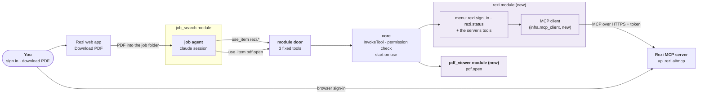

# Rezi: a module for Rezi's MCP, the job agent tailoring through it, and a PDF viewer

**Status:** approved (2026-11-06), building. Replaced by one module, `cv`; see ["Decided 2026-11-06"](#decided-2026-11-06-one-cv-module-with-its-worker) below. Its docs pages are in; no code yet.

You plan to buy Rezi's lifetime plan and asked for three pieces, built in this order:

1. **A `rezi` module:** a thin module that is an MCP client of Rezi's remote server (`https://api.rezi.ai/mcp`). It builds its menu from the server's tool list, refreshes it on `list_changed`, and handles the browser sign-in.
2. **The chain:** when the job agent picks a job, it tailors the resume through the `rezi` module instead of editing files itself.
3. **A `pdf_viewer` module:** a thin module that opens a PDF.

## Checked first (2026-11-05)

### Does the lifetime plan include MCP?

**Not confirmed.** Rezi's MCP setup page says the feature is for "any Rezi user with a Rezi **Pro** subscription" and doesn't mention Lifetime. Rezi's pricing FAQ says Lifetime ($149, one payment) gives all of Pro's features except the free monthly expert review. So it probably includes MCP, but no page says so. **Before you buy, ask Rezi support** whether Lifetime includes the Resume MCP server. The $149 price is on Rezi's own MCP page, so that part is confirmed.

### How does a finished resume get out as a PDF?

**Not through MCP.** The tools in Rezi's docs (GitHub `rezi-io/rezi-mcp`, the Rezi docs page) are `list_resumes`, `read_resume`, `get_resume_format`, `write_resume`, `search_jobs`, `get_job_details`. None of them exports, downloads or gives a share link. PDF and Word downloads are a web-app feature (Lifetime: unlimited downloads).

If the server really has no export tool, we have three options:

| Option | How | Cost |
|--------|-----|------|
| **A. You download it (recommended for v1)** | The tailored resume shows up in Rezi's web app. You click Download PDF and save it into the job's folder. The job agent then opens it with `pdf.open` | One click per job. Nothing fragile |
| B. The job agent clicks Download | Its session already runs with `--chrome`: it opens the Rezi editor and presses Download. In Manual mode, each step asks you first | Breaks when Rezi changes its page. Its first try needs you watching |
| C. We make the PDF ourselves | Turn `read_resume`'s JSON into a PDF with our own template | Loses Rezi's templates, the main reason to pay |

Because the menu is built from the server's list, an export tool Rezi adds later shows up as a menu item with no code change. After you sign in, the first thing we do is list the live tools to check for one.

### Two more findings that change what you might expect

- **Rezi's MCP doesn't tailor on its own.** Its tools read and write resume data. The tailoring is done by the AI that calls them (here, the job agent): it reads the base resume and the posting, writes a new version, and saves it in Rezi's format. Rezi adds the templates, the editor, the score and the PDF, all in its web app. So the wording still comes from our agent, and Rezi stores and formats it.
- **`write_resume` with a `resume_id` changes that resume in place.** Only the fields sent change. Without an id it makes a new resume. **Rule:** the job agent never writes to the base resume. Each job gets a new resume, named for the company and role.

Sign-in, from Rezi's GitHub docs: OAuth in the browser (dynamic client registration, PKCE). The client keeps the access token. **It lasts 30 days, with no refresh token,** so you sign in again when it runs out.

## Decided 2026-11-06: one `cv` module with its worker

The user approved a new plan that replaces the three pieces below. The rest of this note is the earlier proposal, kept for its findings.

- **One module, id `cv`**, in `src/assistant/modules/cv/`, in the self-contained layout ([module-self-contained.md](module-self-contained.md)): its docs in `cv/docs/` with the three standard pages ([overview](../../src/assistant/modules/cv/docs/README.md), [architecture](../../src/assistant/modules/cv/docs/architecture.md), [tools](../../src/assistant/modules/cv/docs/tools.md)) and `docs.toml`, defaults in `cv/module.toml` (`[modules.cv]` in `config/default.toml` only overrides), its own tests in `cv/tests/`, a link in `docs/modules/README.md`, and a library row generated by the build.
- **Its worker inside it**: `cv_agent`, a `ProfileAgent` like `job_search`'s agent. It runs the 8 steps, is the truth gate, formats the one page, and is the only part that uses Chrome (only app.rezi.ai, with the user's login): Keyword Targeting, the Rezi Score and the PDF import happen there, not as menu items.
- **The Rezi MCP client lives inside the module**, not as a shared part. A fixed menu (`rezi.*`, `cv.*`), not the server's tool list. No restart needed.
- **Jobs sent through the Hub**: the job agent sends one job to `cv_agent` with `hub.start`; no `rezi.tailor_cv` item.
- **No Rezi AI writer for now.**
- **No fixed base Rezi resume**: the base is always the `CV_Test_*.odt` and the JD the job agent passes in. The guard refuses writes to any Rezi resume not created in the run.
- **US Letter by default** (`paper` in `module.toml`), A4 later.
- **The PDF viewer** (piece 3): try `viewer.open` on the PDF first; a separate `pdf_viewer` module only if that fails.
- **The CV workflow page** (`cv_module_workflow.html`) is folded into the three pages (the 8 steps and who does what in the overview, the loops in the architecture page) and removed from `cv/docs/`; the original stays in `C:\Chang\Jobs\CV\Recruiters\docs\`.
- **The separate Rezi helper agent** (the `rezi` kind in `task_agents`) is retired once the worker runs.

**Build order** (tests, ruff and the architecture check after each): 0 the docs pages; 1 skeleton, `module.toml`, CV content and section order; 2 `.odt`, PDF export, page check → `cv.build`; 3 `cv.compare`, `cv.report`; 4 the MCP client and token store against a fake server; 5 the `rezi.*` items and guard, live tool list after the user's Rezi sign-in; 6 the worker with Chrome; 7 the job agent's hand-off, one real job end to end; 8 the modules-page note on the MCP exception, final docs check; 9 the end-to-end test: a random job-radar job plus one `CV_Test_*.odt` go through the whole workflow, and a CV is output.

### Progress (2026-11-06, task fb5181fb, session reset)

- **Done:** chunk 0 (the docs pages in `cv/docs/`). Chunk 1 is started, but only the reading is done; **no chunk 1 files are written yet**. Read so far: rezi's handoff note (`C:\Chang\Jobs\rezi\rezi\handoff-d21df25f.md`), the plan page (`C:\Chang\Jobs\rezi\rezi\cv_module_plan.html`), the three cv pages, `docs/api/reusable.md`, the `usage` module (`module.py`, `__init__.py`, `tests/test_usage.py`), and the architecture-first and architecture-check skills.
- **Pattern found:** `__init__.py` re-exports the module class. `module.py` has a module-level `menu = Menu()` and a class with `manifest = Manifest(id=..., description=...)` and `menu = menu`, plus async `init(ctx)` / `start()` and an optional `export_state()` for the reload handover. Tests build `App([CvModule], {"modules": {"enabled": [...]}, "core": {}})` and use `tests.support.wait_until`. The only module with a `module.toml` so far is `console_io`, so copy its shape. `App` merges a module's `module.toml` under its config section.
- **Next (chunk 1, write only inside `src/assistant/modules/cv/`):**
  1. Read `console_io/module.toml`, `principles.md`, and the swap and reload tests (`tests/test_swap_every_module.py`, `tests/test_reload.py`, `tests/test_module_layout.py`) to see how load, on/off and swap in place are tested.
  2. Write `__init__.py` and `module.py` (`CvModule`, an empty menu, reading `ctx.config`).
  3. Write `module.toml` with these defaults: `section_order`, `degree_first_order`, `drop_first = ["publications", "awards"]`, `target_score = 90`, `max_rounds = 5`, `paper = "letter"`, `output_dir`, `soffice`.
  4. Write `content.py` (`CvContent`, plain sections; `from_odt` and `from_rezi` can come later) and `order.py` (`SectionOrder`). The default order is Contact, Summary, Skills, Experience, Projects, Education, Awards, Publications. Education moves under Skills only when the JD requires or prefers a master's. When space is tight, Publications drops first, then Awards.
  5. Write `types.py` with the request and result data types (fields as on the tools page).
  6. Write `tests/__init__.py` and `tests/test_cv.py`: order rules, data types, and that the module loads, turns on and off, and swaps in place.
  7. Do the architecture check by reading. Then the Main Assistant runs `pytest src/assistant/modules/cv/tests`, the full `pytest`, `ruff check`, and `scripts/build_docs.py`. The tools page then shows the empty menu. After that comes `modules.add assistant.modules.cv`.
- **Don't touch:** `config/default.toml`, `scripts/build_docs.py`, or other modules. Never `git push`. Rezi still has no shell tool, so the Main Assistant runs the tests.

## Use-case

- **Who calls:** the job agent (and the Main Assistant or Talker) through the module door (`use_item rezi.*`, `use_item pdf.open`), and you through the temp UI.
- **Problem:** tailor one resume per job with Rezi's templates instead of the agent editing files, then look at the PDF.
- **In:** the posting (from the job project, or `rezi.search_jobs` / `rezi.get_job_details`), the base resume's id. **Out:** a new Rezi resume per job, and its PDF in the job's folder.
- **Edge cases:** signed out or token expired; Rezi down; the tool list changes; Rezi called while the module is off; the base resume overwritten by mistake.

## Where it fits

Purple: new. Every call goes through the door and the core, so there's one permission check (in Manual, each `use_item` asks with the card). The door keeps its three fixed tools. Neither new module is an MCP server.

## Piece 1: the `rezi` module

### The menu comes from the server: a change to `Menu` (needs a restart)

Today a `Menu` is fixed when the module's file is imported (`src/assistant/contracts/menu.py`). The core reads it for the directory, `GetMenu`, the argument check and start-on-use. A menu filled from a server's list needs one addition to that contract:

- **New on `Menu`:** `menu.remote(prefix, method)` declares a part of the menu that is filled while the app runs, and the module method that runs its items as `(name, args)`. `menu.set_remote(prefix, specs)` replaces that part's items. The fixed items (`rezi.sign_in`, `rezi.status`) stay ordinary `@menu.item`s.
- **The core needs no other change:** `specs()`, `check()`, `allowed()` and `call()` already go through the `Menu`, so the directory, `GetMenu`, the argument check and start-on-use see the new items.
- **When the module is off:** the last list is cached in a file, so the menu still shows and start-on-use still finds `rezi.read_resume`. Before the first sign-in, the menu has only `sign_in` and `status`.
- **`list_changed`:** the module asks for the list again and calls `set_remote`. Agents always ask with `show_menu`, so no notice to them is needed. Unity's future module would reuse the same thing.

This changes `contracts`, so **the app needs a restart once**. Server tools appear as `rezi.<tool>` (for example `rezi.write_resume`), with the server's `inputSchema`. `Menu.check` checks the top-level types, and Rezi checks the rest.

### A shared MCP client (new reusable part)

`assistant.infra.mcp_client`: one client for a remote MCP server. It handles streamable HTTP, the OAuth sign-in (dynamic registration, PKCE, a loopback redirect on `127.0.0.1`), `tools/list`, `tools/call`, and `list_changed`. Modules use this part and never import an MCP library themselves. That keeps the rule in [modules](../architecture/modules.md#why-not-plain-mcp); that page's wording changes to "never import an MCP library directly". It's built on the official `mcp` Python SDK, as an optional extra (`pip install -e .[mcp]`). **Installing it is your step, or your yes.** Writing OAuth and streamable HTTP ourselves would be about 300 lines to maintain. It goes into the [reusable index](../api/reusable.md), used by `rezi` and later Unity.

### Sign-in and the 30 days

- `rezi.sign_in`: opens Rezi's consent page in your browser (a Rezi web page, not one of our HTML files), waits for the redirect, and saves the token and its date. The token is a secret, so it's saved outside the repo in the app's user data folder, never in `config/`. The path is set in config. It asks `ctx.permissions` for `account.rezi` first.
- `rezi.status`: signed in or not, and the days left.
- **When the token expires** (or Rezi revokes it): calls return `not_available: "Rezi sign-in expired; run rezi.sign_in"`, so the job agent asks you through `NEED:`. Within 3 days of the end, `rezi.status` and the first call of each day say how many days are left. Nothing else breaks: the cached menu stays, and calls work again once you sign in.
- **Rezi down:** `failed` with Rezi's error. No retry loop.

### The `rezi` module page (`docs/modules/rezi.md`, the standard template)

| Section | Content |
|---------|---------|
| Purpose | Rezi's resume tools as a menu, through its MCP server. Off at launch, `start_on_use = true` |
| Wrapper | id `rezi`. Provides / requires / optional: none. Permissions: `account.rezi` |
| Interface: actions (menu) | `rezi.sign_in`, `rezi.status`, plus the server's tools: `rezi.list_resumes`, `rezi.read_resume`, `rezi.get_resume_format`, `rezi.write_resume`, `rezi.search_jobs`, `rezi.get_job_details` |
| Inputs | Each tool's arguments, from the server's schema (for example `resume_id`, the resume JSON, `role` and `location`) |
| Outputs | A `Result` with the tool's content (JSON or text). `not_available` when signed out |
| Handles / calls / publishes / listens | nothing / `ctx.permissions` / nothing / nothing |
| Rules | Never an MCP server. All calls go through the core (one check). The menu follows the server's list. Never writes to the configured `base_resume_id` (refused in the module, not only in the prompt) |
| Needs | Your Rezi plan with MCP, your sign-in every 30 days, the `mcp` extra installed |
| Owns | The MCP connection (opened on first use, closed on stop), the token file, the cached tool list |
| Config | `[modules.rezi]`: `url`, `token_file`, `base_resume_id`, `start_on_use = true`, `timeout` |

## The Rezi helper agent (added 2026-11-05, at your request)

You asked for a helper agent of its own for Rezi, like the job agent, so the Main Assistant doesn't drive Rezi itself. It's **created now** and opened with your yes on the cards.

- **What it is:** a helper *kind* `rezi` in `config/default.toml` (`[modules.task_agents.agents.rezi]`), launched by name through `task_agents` as **`rezi_agent`**. A launched helper ends with the app, so after a restart it's opened again with `agents.launch` or the temp UI's **+**. It has no code of its own. If it later needs a menu or workers, it moves into its own module, as the job agent did.
- **Working folder:** `C:/Chang/Jobs/rezi`, and the helper's own folder is `C:/Chang/Jobs/rezi/rezi_agent`. It's not inside `C:/Chang/Jobs/CV`, because the job agent writes all of that folder and the Hub won't run two agents whose write folders overlap. That would block the hand-off while the job agent has a task.
- **Access list (one card, saved for the `rezi` kind):**
  - Write: its own folder.
  - Read: `C:/Chang/Jobs/CV` (postings, the job folders) and this repo's `docs/`.
  - Tools: `Read, Write, Edit, Glob, Grep, WebSearch, WebFetch`. No Chrome, Python or shell.
- **Instructions:** tailor one posting per task. Reach Rezi **only** through the `rezi.*` items on the module door, never any other way. Until the `rezi` module exists, read this note and research. Never change the base resume: each job gets a new one, and it reports the new resume's name.
- **How it relates to the `rezi` module:** the module stays the thin MCP client wrapper (piece 1). The helper is one caller of its menu, through the door → core → `rezi`, with the same single permission check. The job agent and the Main Assistant could call the same menu, but by design only the helper writes resumes.

## Piece 2: the chain from the job agent to Rezi

**Proposed: the job agent hands the posting to the Rezi helper through the Agent Hub. The helper calls the `rezi` module through the door. No new contract.**

- **The hand-off:** when you pick a job, the job agent saves the posting in that job's folder under `C:/Chang/Jobs/CV` (which the helper can read). It then calls `hub.start(text, agent_id="rezi_agent")`, where the text has the posting's path, the company and role, and anything it wants stressed. That becomes the job agent's child task. It can follow it with `hub.status`, `hub.send` or `hub.cancel`, and gets the outcome (the new resume's name) when the child task ends. If `rezi_agent` isn't open, the job agent asks you through `NEED:` to open it. It doesn't launch helpers itself.
- **The helper's steps:** `rezi.get_resume_format`, then `rezi.read_resume(base)`, then `rezi.write_resume` **with no id** (a new resume named "Company – Role"). It reports the name. The job agent no longer edits resume files itself. The cover letter stays in the job project for now.
- **Linking:** `rezi` has `start_on_use = true`, so the helper's first `rezi.*` call turns it on. That's the same as the HTML viewer and needs no `requires`.
- **Where each part sits:** `job_search` (the module) owns the job agent (a `ProfileAgent`). `task_agents` owns `rezi_agent`. The two talk only through the Hub. The helper calls `rezi` through the door → core → `rezi`. Neither module imports or requires `rezi`.
- **Restart:** this piece needs none. It's a prompt change to `job_search` (the hand-off) plus `RELOAD: job_search`. The helper's kind is already in config.

**Considered: a contract `IResumeService`** (read, write, format, export), provided by `rezi` and optionally required by `job_search`, which would offer `job.tailor`. It would let another resume service replace Rezi without changing the agent's prompt. (Reactive Resume, for example, has a PDF download tool in its MCP.) The cost is a new contract (**an app restart**) and code in `job_search` for something the agent already does through the door. **Proposal: not now.** Add it if a second resume service or a code-only caller appears.

## Piece 3: the `pdf_viewer` module

- **Menu:** `pdf.open(path)` (an absolute `.pdf` path that exists) and `pdf.close()`. Off at launch, `start_on_use = true`.
- **How it shows the PDF (proposed):** in an Edge app window with Edge's own PDF viewer, using [`app_kit.window`](../api/app_kit.md#window): `open_app_window("file:///…pdf", profile)`, and `close_app_windows` on stop. No companion app, no new package, no contract. It's added with `ADD_MODULE`, with no restart.
- **Alternatives:** the system's default PDF app (`os.startfile`), where we can't close or track the window; or a PDF tab in the HTML viewer app, which changes that app.
- **Page:** `docs/modules/pdf_viewer.md` with the same template (actions `pdf.open` / `pdf.close`; input a path; output `ok` or the reason; rule: opens only existing `.pdf` files and reads no folders outside your grant list; needs nothing from you).

## API changes

| Item | Group | Change | Restart |
|------|-------|--------|---------|
| `Menu.remote`, `Menu.set_remote` | [Modules](../api/modules.md#menu) | new | yes (contracts) |
| `mcp_client` (`McpClient`, sign-in, token file) | [Infrastructure](../api/infra.md) | new, reusable | yes (infra) |
| `rezi` module, menu `rezi.*` | [module library](../architecture/module-library.md), [tools](../api/tools.md#tools-offered-today) | new | no (`ADD_MODULE`) |
| `pdf_viewer` module, menu `pdf.*` | same | new | no (`ADD_MODULE`) |
| `job_search` prompt and config | [job_search](../modules/job_search.md) | changed | no (`RELOAD`) |

Docs updated when built: the two module pages, the module library, `modules.md` (the MCP-client wording), the overview's Parts row for modules, `api/modules.md`, `api/infra.md`, `api/reusable.md`, `api/tools.md`, `job_search.md`.

## Order and what each piece needs from you

| # | Piece | Built by us | Your steps |
|---|-------|-------------|------------|
| 0 | Before anything | — | Ask Rezi whether Lifetime includes MCP, then buy. OK the `mcp` package install |
| 1 | `rezi` module + `Menu` change + `mcp_client` | Code, tests against a fake MCP server (no Rezi in CI), docs | App restart. Run `rezi.sign_in` and approve in the browser. Tell us your base resume (we list them) |
| 2 | The chain | `job_search` prompt and config, test | `RELOAD: job_search`. Try one job: check the new resume in Rezi, then download its PDF |
| 3 | `pdf_viewer` | Module, test, docs | `ADD_MODULE`, then open one PDF |

Piece 3 doesn't depend on Rezi, so it could be built first while you wait on Rezi's answer.

## Open questions

1. **MCP on Lifetime:** waiting on Rezi's answer (above).
2. **PDF out:** A (you download) for v1, B later? And where the PDFs go: the job's folder under `C:/Chang/Jobs/CV`?
3. **The `mcp` package:** OK to add it as an optional extra? The other way is our own client, which is more code.
4. **Token file location:** the app's user data folder (proposed) or Windows Credential Manager (needs `keyring`, another package)?
5. **PDF viewer:** an Edge app window (proposed), the system viewer, or a tab in the HTML viewer?
6. **Search:** use `rezi.search_jobs` alongside the job project's own search, or ignore it for now?

## Recommendation

Ask Rezi about MCP on Lifetime before paying. Build in the order above, with the chain through the door (no new contract), a `Menu` that can be filled at runtime, and one shared MCP client. That means one restart for piece 1, and none for pieces 2 and 3. For v1, you click Download PDF in Rezi and the job agent opens the file with `pdf.open`. If Rezi adds an export tool later, it shows up in the menu on its own.

**Sources:** [Rezi MCP docs (GitHub)](https://github.com/rezi-io/rezi-mcp) · [Rezi docs: Resume MCP server](https://www.rezi.ai/rezi-docs/resume-mcp-server) · [Rezi Resume MCP page and pricing FAQ](https://www.rezi.ai/resume-mcp)
