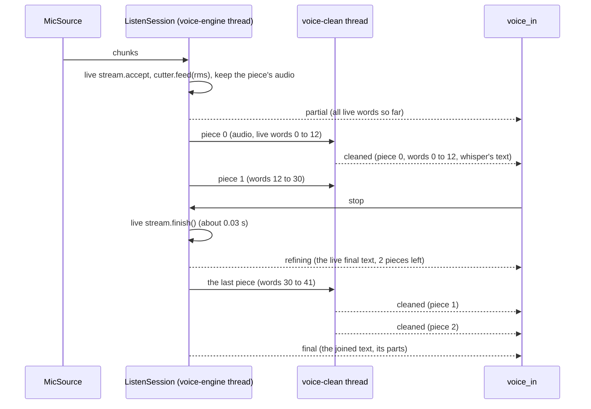

# Voice: two passes (live text while you talk, whisper cleans it piece by piece)

> **Status: built (waiting on you), 2026-11-03.** Loaded at the relaunch of 2026-11-03 16:02. You approved every recommendation in the [open questions](#open-questions); the answers are recorded there. The real check passed ([Results](#results)). The design now lives on the voice page: [Two passes](../../src/assistant/modules/voice_in/docs/voice-service.md#two-passes-live-text-cleaned-piece-by-piece). Then your check (step 3.5).
>
> **Revised:** whisper now works on pieces while you talk ("chunked whisper"), instead of only once after you stop. This replaces the earlier answer to open question 9 ("no background decoding"). It's now [decided](#decided-in-this-revision).

**Asked (in your words, spoken):** "I want the first pass to show the words as I talk, and then I want whisper to clean up when I press the mic button, so that it cleans it up and sends." Then: "a real-time update, since it does show my words going up, but that whisper replaces the parts as it goes, and when I press the send button it just finishes the task of sending the entire message."

**What you get:**
- While you talk, the live engine (the Zipformer) shows your words in the live line, as it does now.
- At each natural pause, the service cuts the audio so far into a **piece** and hands that piece to whisper in the background.
- When a piece's whisper text arrives, it **replaces the matching rough Zipformer words** in the live line. The line cleans itself up, piece by piece, while you keep talking.
- When you press stop, the Zipformer finishes as now. Only the **last piece** still goes to whisper. Then the joined whisper text of all pieces is sent to the Talker.
- If whisper fails or is slow on a piece, that part keeps the Zipformer words. The 20 s timeout after stop falls back to the live text for anything still not cleaned.

**Why:** each engine alone falls short. The Zipformer gives words as you speak but in capitals with no punctuation, and it makes more mistakes on long talk. Whisper is more accurate and comes cased and punctuated, but it gives nothing until it has the audio. Pieces give both: live words at once, clean text a second or two later, and a short wait after stop however long you talked.

**What changes from the whisper build:** decision 4 on the [voice page](../../src/assistant/modules/voice_in/docs/voice-service.md#hot-swappable-engines) ("whisper is used for the live mic too, with the text on send") becomes "the live engine listens, the final engine cleans each piece and writes the text you send". One-engine mode stays: leave the final engine empty and the service behaves exactly as today.

## Touches

- **`src/voice_service/`** (still never imports `assistant`):
  - `config.py`: `[engine] final`, `[engine] final_timeout_seconds`, and a new `[pieces]` section (`pause_seconds`, `min_seconds`, `max_seconds`, `cut_search_seconds`).
  - `pieces.py` (new): `PieceCutter`, which decides where pieces end, from each chunk's level. Pure, no threads, easy to test.
  - `session.py`: `ListenSession` feeds the cutter, keeps the current piece's audio, records each piece's span of live words, and runs a **`voice-clean`** worker thread that sends pieces to the final engine in order. On stop: the last piece, the timeout, the fallbacks. A second `EngineLoader` for the final engine. Reuses `rms` and `speech_rms`.
  - `engines/__init__.py`: an optional `SttStream.cancel()` (default: does nothing), so a dropped piece stops early.
  - `engines/whisper.py`: `_WhisperStream.cancel()`, checked between segments; an optional `prompt` for the previous piece's text ([question 13](#open-questions)).
  - `protocol.py`: `Started.clean_pieces`, a new `Cleaned` message, a new `Refining` message, and `Final.parts`. All optional, with defaults that mean "as today".
  - `server.py`: build and load both engines; `/health` reports the final engine too.
  - `__main__.py`: build the final engine from config and pass it to `create_app`.
- **`src/assistant/contracts/voice.py`** (a contract change, so **the app needs a restart**):
  - `ListeningState.FINISHING`: the mic is off, and the last piece is being cleaned.
  - `VoiceTranscript.settled_chars`: how much of the line, from the start, is settled (cleaned, or given up on). The rest is rough live text. Default 0, as today.
- **`src/assistant/modules/voice_in/`**:
  - `line.py` (new): `LiveLine`, which builds the line from the live words and the cleaned spans. Pure, easy to test.
  - `module.py`: reads `started.clean_pieces`; handles `Cleaned` and `Refining`; publishes `FINISHING`; cleans each part of the final and joins them; uses `final_timeout_on_send` for the wait.
  - `cleanup.py`: ~~no change~~ **as built:** one flag, `clean_text(..., capitalize=True)`: a part that carries on a sentence keeps a small first letter. It already leaves cased text alone and cleans all-caps text, and it's now called per part.
- **`src/assistant/modules/temp_ui/`** (`module.py`, `page.html`): the settled part of the line in normal text, the rough tail dimmed, and the finishing look.
- **`config/voice_service.toml`**: `final = "whisper"` and the new settings. Config files, so the build asks you before editing.
- **No new packages:** faster-whisper and both models are already installed.

## Approach

### 1. The config

```toml
# config/voice_service.toml
[engine]
name = "zipformer"            # the live engine: listens, fills the live line
final = "whisper"             # the final engine: cleans each piece; "" = one engine (as today)
final_timeout_seconds = 20.0  # after stop: what isn't cleaned by then keeps the live words

[pieces]
pause_seconds = 0.7           # this long below speech_rms ends a piece
min_seconds = 4.0             # a pause before this doesn't cut (short pieces cost almost as much as long ones)
max_seconds = 20.0            # no pause by then: cut anyway, at the quietest point
cut_search_seconds = 3.0      # a forced cut looks this far back for the quietest chunk
```

- **`name` keeps its meaning and its name** (the engine that listens), so existing `.local` files still work. `final` is new. `[engine.whisper]` and `[engine.zipformer]` configure each engine whichever role it has.
- **The combinations:**

  | `name` | `final` | What you get |
  |---|---|---|
  | `zipformer` | `whisper` | **Two passes** (this note): live line, cleaned piece by piece, whisper's text is sent |
  | `zipformer` | `""` | Today's live mode: the Zipformer's text is sent |
  | `whisper` | `""` | Today's on-send mode: no live line, whisper's text |
  | same as `name` | | Treated as `""` (one engine) |
  | `whisper` | `zipformer` | Refused with a log line and run as one engine: an engine with no live text can't be the live one |

- **`load_engine` stays the only place that knows engine names**, called once per role. The server and the session see two `SttEngine`s and nothing else.
- **The swap still works:** `final` is in `[engine]` and `[pieces]` is read per session, so changing `final` restarts an idle service, as changing `name` does.
- **Dropped from the first version of this note:** `[audio] keep_max_seconds` and the `too_long` fallback. The session no longer keeps the whole recording: each piece's audio is freed once whisper has read it.

### 2. Cutting pieces at pauses

`PieceCutter` sees every chunk's level (`rms`, the same one the silence stop uses for engines with no live text) and says when the current piece ends. The silence stop itself (`silence_stop_seconds`) is unchanged.

- **A pause** is `pause_seconds` (0.7 s) of chunks in a row below `speech_rms` (300), after some speech in the piece.
- **A cut at a pause** happens at the end of that quiet stretch, once the piece is at least `min_seconds` (4 s) long. A pause before 4 s doesn't cut; the piece carries on to the next pause. The trailing quiet stays in the piece, and whisper's VAD skips it.
- **No pause by `max_seconds`** (20 s, below whisper's 30 s window, so a piece is always one window): a **forced cut** at the quietest chunk in the last `cut_search_seconds` (3 s). The audio after that chunk starts the next piece.
- **A mic drop** also ends the piece: the audio before the drop is a piece. The next piece starts when the mic is back.
- **Stop or a silence stop** ends the last piece.
- **No overlap** between pieces ([question 12](#open-questions)): a pause cut falls in quiet, where there's nothing to lose. A forced cut falls at the quietest point near the end, which is usually between words.
- **A piece with no speech at all** (no chunk at or above `speech_rms`) is never cut; quiet only adds to the current piece. So a long silence doesn't make empty pieces.

### 3. Matching the Zipformer words to a piece

The live line is the Zipformer's text so far, as a list of words (`partial().split()`). With `greedy_search` (the config's decoding), words it has given out don't change, apart from the last word still growing.

- **At each cut**, the session notes how many live words there are. Piece *k* covers live words `[start, end)`: `start` is the previous cut's count, `end` is this cut's count. So the spans run back to back from word 0, in order.
- **Why this works:** a pause cut comes after 0.7 s of quiet, and the Zipformer gives a word out a few hundred milliseconds after it's said. By the cut it has caught up, and the last word is finished.
- **When it's off by a word** (the Zipformer gives a word just after the cut), that word falls into the next piece's span. The line shows it twice for a second or two: once in piece *k*'s whisper text, and once rough, until piece *k+1* is cleaned. **The text that's sent never has it twice**, because it's whisper's text, not the spans.
- **The matching only matters for the live line and for fallbacks.** A failed piece keeps exactly the words of its span.
- **The last piece** covers from the last cut to the end of the Zipformer's final text after stop.
- **A sharper option, if the build sees doubled words often:** sherpa-onnx can report a time for each token. Words would then be matched to a piece by time, not by count ([question 10](#open-questions)).

### 4. Cleaning pieces in the background



- **The `voice-clean` thread**, one per session, takes pieces from a queue **in order**, one at a time. For each: `final_engine.new_stream()`, `accept` the piece's audio, `finish()`. These are the same three calls `transcribe()` makes. Then it posts `Cleaned`.
- **Results come in piece order**, since there's one worker. A slow piece holds the ones behind it. Out-of-order results can't happen.
- **The final engine still loading** when you start talking: pieces wait in the queue until it's ready.
- **Whisper falling behind** (pieces arrive faster than it cleans them): they keep queueing, nothing is dropped, and the log shows the queue length. At 20 s per piece at most, a waiting piece is under 0.7 MB. The build measures whether this happens at all ([section 9](#9-cpu-load-while-you-talk)).
- **On stop:** the engine thread drains the chunk queue and calls the live stream's `finish()` as today. It posts `Refining`, cuts the last piece, and queues it. Then it waits for the worker to empty the queue, up to `final_timeout_seconds` from the stop. Then it posts `Final`.
- **The same after a silence stop** (`ended_by: "silence"`).
- **The session ended early** (`complete: false`, the mic was lost): no last piece, and queued pieces are dropped. `voice_in` drops that text anyway.
- **The log:** each piece's audio length, its live words, whisper's text, its time, and the queue length. Also the wait after stop. The engine comparison (step 7 of the voice roadmap) can use these lines too.

### 5. Whisper failing or slow on a piece

| What happens to a piece | What it becomes | `fallback` |
|---|---|---|
| Whisper's text arrives | Whisper's text | `""` |
| The final engine raises on it | Its live words | `"failed"` |
| Whisper gives `""` but the span has live words (its VAD cut quiet speech) | Its live words | `"empty"` |
| Still waiting or running at stop + `final_timeout_seconds` | Its live words; the running one is cancelled | `"timed_out"` |

- **A failed piece during talk** still sends `Cleaned`, with `fallback` set and no text, so the client settles that span on the live words. The pieces after it are cleaned as usual.
- **A piece with no live words** but whisper text (the Zipformer missed quiet speech): whisper's text is inserted at that point. The span is empty (`start == end`).
- **The timeout:** 20 s from the stop, for the last piece and anything still queued. Normally only the last piece is left, about 1 to 1.5 s.
- **Cancelling:** a running whisper call can't be killed. ~~`stream.cancel()` sets a flag that `_WhisperStream` checks between segments, so it stops soon after~~ **As built:** faster-whisper decodes a piece's whole 30 s window in one call, so `cancel()` can't cut it short; it only throws the text away, and the session doesn't wait for it (at most one 20 s piece runs on in the background).
- **The final engine didn't load** (model missing, say): the service still starts and runs as one engine. `started.clean_pieces` is false, nothing is cut, and the final is the Zipformer's text as today. `/health` says `final_ready: false` with the error, and the log says it once. The mic button never fails because of the final engine.

### 6. Protocol changes (`voice_service/protocol.py`)

| Message | Change | Default (older client, or one engine) |
|---|---|---|
| `started` | `clean_pieces: bool`: this session's live text is cleaned piece by piece, and its final is whisper's text | `false` |
| `partial` | No change: all live words so far, rough, as now | |
| `cleaned` (new, service → app) | `piece: int`, `start: int`, `end: int`, `text: str`, `fallback: str`. **Live words `[start, end)` are replaced by `text`.** With `fallback` set (`failed`, `empty`, `timed_out`), `text` is empty and the span keeps its live words. Sent in piece order | not sent |
| `refining` (new, service → app) | `text: str`: the live engine's final text (empty when `partials` is off). `pending: int`: pieces still to clean. Sent once, after stop, when `clean_pieces` is true | not sent |
| `final` | `text`: all parts joined with spaces. New `parts: list` of `{text, cleaned, fallback}`, one per piece, in order. `cleaned` is false for a part that kept its live words | `parts: []` |

- **Spans count words in the `partial` text**, split on spaces, from the start of the session. They never change once sent, so a client can build the line from the latest `partial` and the `cleaned` spans so far.
- **Still no model names:** a client learns "pieces are cleaned", never which engine does it.
- **No client switch** to turn cleaning off ([question 5](#open-questions)). The service config decides.
- **An older `voice_in`** would skip `cleaned` and `refining` as unknown frames, with a warning, and read `final.text` as usual. Both sides change in this build anyway.

### 7. `voice_in`

- **Reads `started.clean_pieces`** (with `getattr`, as for `partials`).
- **`LiveLine`** keeps the latest live words and the spans cleaned so far. Its `text()` is: each settled span's text (whisper's, or the span's own live words when it fell back), then the live words after the last settled span. `settled_chars` is the length of the settled part. Spans settle in order, so the settled part is always at the start of the line.
- **Cleaning the line:** whisper's spans keep their case (`clean_text` leaves cased text alone, apart from `terms`). Fallback spans and the rough tail go through `clean_text` as all-caps text, as today.
- **On `partial` and on `cleaned`:** publishes `VoiceTranscript(text=line, settled_chars=n, final=False)`.
- **On `refining`:** updates the line with the live final text, then publishes `VoiceState(FINISHING, detail="cleaning up…")`.
- **The wait after `stop`:** `final_timeout_on_send` (90 s) when `clean_pieces` or not `partials`, otherwise `reply_timeout` (10 s), as today. The service's 20 s comes first; the 90 s only catches a stuck service.
- **On `final`:** cleans each part (a whisper part kept as it is; a fallback part as all-caps text), joins them, and gives the last part its end mark. Logs the parts and their fallbacks with the raw text. The Talker still gets one `InputReceived(source="voice")`. With no `parts` (an older service, or one engine), it cleans `final.text` as today.
- **Discard while talking or finishing:** `_discard` already ends the session and closes the socket. A late `cleaned` or `final` is dropped, as now.

### 8. What you see

1. **While you talk:** the live line fills with your words as now, dimmed (rough). After each pause, a second or two later, the part you said before the pause turns into whisper's text, cased and punctuated, in normal text. The rough tail carries on after it. The swap is instant, with no animation ([question 11](#open-questions)).
2. **You press stop.** The mic closes. The button shows **finishing** (a spinner; clicks are ignored). The rough tail gets the Zipformer's last word or two, with "cleaning up…" after it.
3. **About 1 to 1.5 s later** (the last piece on `small.en`), the line clears and the joined text appears in the chat as your message, marked spoken, as sent messages already do. The button goes back to idle.
4. **On a fallback**, that part of the message is the live words, cleaned as today. The chat message gets no extra mark; the reason is in the log.

**Temp UI** (`temp_ui` is throwaway, so this is the minimum; the real UI handler gets its own design):
- `module.py`: passes `settled_chars` to the page. `FINISHING` keeps the line's text; the final clears it as now.
- `page.html`: the line's first `settled_chars` characters in normal text, the rest dimmed. The finishing look: a spinner on the button, which ignores clicks; the ✕ stays; "cleaning up…" after the line.

### 9. CPU load while you talk

Whisper `small.en` now runs **while the Zipformer is listening**. Estimates from last build's numbers; **the build must measure them** (step 3).

- **The PC:** an Ultra 9 275HX, 24 cores (8 performance, 16 efficient), no hyperthreading.
- **The Zipformer:** 2 threads, the whole time you talk, as today.
- **Whisper per piece:** 8 threads (`cpu_threads`) for about **1 to 1.5 s**. Whisper pads every piece to its 30 s window, so a short piece costs nearly as much as a long one: measured 1.19 s for 6.6 s of speech and 1.62 s for 16.7 s. That's why pieces have a 4 s minimum.
- **While you talk:** with a piece every 5 to 10 s, whisper is busy about 15 to 30 % of the time, in bursts of 8 of the 24 cores. On average, about 2 cores.
- **What could go wrong:** the bursts slow the Zipformer, so live words lag. Or Windows puts whisper on the efficient cores and pieces take longer than expected. Or it's on battery and everything is slower.
- **The build measures**, with both real models over test recordings fed in real time (`FileSource`, `realtime=True`): CPU use, each piece's whisper time, the queue length, how late the Zipformer's partials come during a burst compared with no whisper, and the wait after stop. **Pass:** partials stay within about 100 ms of their usual timing, the queue never holds more than one piece, and the wait after stop is under 2 s. If not: fewer whisper threads, a longer `min_seconds`, or `base.en` (0.4 to 0.6 s per piece), and the build reports which.
- **Memory:** both models loaded, under 1 GB of the 31 GB (Zipformer about 150 to 300 MB, `small.en` about 400 to 600 MB). Pieces waiting: under 0.7 MB each. Loading both at start: about 2 to 3 s on two background threads. Also measured.

### 10. The clear button (✕) and the force-on-send setting

- **✕ while you talk:** the socket closes and the session aborts, as today. That also stops the `voice-clean` thread: queued pieces are dropped and the running one is cancelled (`stream.cancel()`). Nothing is sent. The temp UI's ✕ then starts a new session, as now. If whisper is still finishing a segment of the old piece, the new session's live text may lag for a moment.
- **✕ while finishing:** the same.
- **`live_text = false` (force on send) with two passes:** `start.partials: false`, so no `partial` and no `cleaned` messages go out, and the line shows "text appears when you stop", as today. Inside the service, pieces are still cut and cleaned in the background, so the wait after stop is still only the last piece. On stop, `refining` comes with empty text, then whisper's joined text is sent. So the setting still means "no words on screen while I talk", and the text sent is whisper's either way.

## Steps

Each step ends with `pytest` and `ruff`. Steps 1 and 2 are one chunk each. The [architecture-check](../../.claude/skills/architecture-check/SKILL.md) runs after each chunk and before the final report.

1. **The service** (testable with fake engines):
   1. Config: `[engine] final`, `final_timeout_seconds`, `[pieces]`.
   2. `PieceCutter` and its tests.
   3. `SttStream.cancel()` and whisper's flag (and the `prompt`, if question 13 is yes).
   4. The protocol: `Started.clean_pieces`, `Cleaned`, `Refining`, `Final.parts`.
   5. `ListenSession`: the cutter, the spans, the `voice-clean` thread, stop and the last piece, the timeout and the fallbacks, abort.
   6. `create_app(…, final_engine=…)` with a second loader and the `/health` fields; `__main__.py`.
2. **The main app:** `ListeningState.FINISHING` and `VoiceTranscript.settled_chars`; `LiveLine` and its tests; `voice_in` (`clean_pieces`, `Cleaned`, `Refining`, the final's parts, the wait); the temp UI's settled and rough text and the finishing look.
3. **Real check, then docs:**
   1. Ask you before editing `config/voice_service.toml` (`NEED: Risky`).
   2. Run the service with both real models over last build's test recordings (6.6, 16.7 and 46.7 s), fed in real time. Measure what [section 9](#9-cpu-load-while-you-talk) lists. Also count the pieces and doubled words, and compare the joined text with whisper on the whole recording, to see whether cutting costs accuracy.
   3. Tune the `[pieces]` defaults from what it finds, and report.
   4. Update the docs below, rebuild, run the architecture check, and hand over. **The app needs a restart** (contract and protocol changes).
   5. Your check: talk with a few pauses, watch the line clean up behind you, stop, and see the clean text arrive in the chat at once.

## Tests

- **Config:** `final = ""` and `final = name` give one engine. `name = "whisper", final = "zipformer"` logs and gives one engine. Changing `final` restarts an idle service (the existing watch test, with `final`).
- **`PieceCutter`** (levels in, cuts out):
  - A pause of `pause_seconds` after speech cuts; a shorter one doesn't.
  - No cut before `min_seconds`, even at a long pause.
  - Talk with no pause cuts at `max_seconds`, at the quietest chunk of the last `cut_search_seconds`.
  - Quiet with no speech never cuts.
- **Two passes, with fakes** (a live `FakeEngine` that gives words per chunk, and a final fake that returns a marked text per piece):
  - `started.clean_pieces` is true, then partials, then `cleaned` for each piece in order with back-to-back spans, then `refining`, then the last `cleaned`, then `final` with the parts joined.
  - The pieces' audio, joined, is exactly the audio the live engine got, with nothing lost or doubled at a cut, across a mic drop and back too.
- **Fallbacks:** a raising final engine gives `fallback: "failed"` and the span's live words, and later pieces still get cleaned. One returning `""` gives `"empty"`. A slow one past a short `final_timeout_seconds` gives `"timed_out"`, and its `cancel()` was called. A final engine that fails to load: `clean_pieces` false, the session works as one engine, and `/health` shows `final_ready: false`.
- **Order:** a final fake that's slow on piece 0 only. Piece 1's `cleaned` still comes after piece 0's.
- **No pieces:** a one-engine config sends no `cleaned` or `refining`. A mic lost for good (`complete: false`) drops the queue.
- **Discard:** closing the socket while talking, or while finishing, cancels the running piece, drops the queue, frees the slot, and a new `start` works.
- **`partials: false` with two passes:** no partials and no `cleaned` go out, pieces are still cleaned inside, `refining` has empty text, and the final is whisper's.
- **`LiveLine`:** the spans replace the right words; a fallback span keeps its words; an empty span inserts text; `settled_chars` is right; a late live word shows up again in the rough tail.
- **`voice_in`:** `cleaned` publishes the new line with `settled_chars`. `refining` publishes `FINISHING`. The longer wait is used. A final's parts are cleaned per part and joined. An older service (no `clean_pieces`, no `parts`) works as today.
- **Temp UI:** `FINISHING` keeps the line's text, the final clears it, and `settled_chars` reaches the page.
- **Whisper's `cancel`:** with the real model, marked to skip when the model folder is missing. A cancel during `finish` returns soon after.

## Docs to update

- **[Voice](../../src/assistant/modules/voice_in/docs/voice-service.md):**
  - Layers: the session connects a source to a live engine and an optional final engine, with the piece cutter. The diagram gets both.
  - Hot-swappable engines: decision 4 revised (two passes with pieces; one engine still possible). `final` is in the swap.
  - Threads: the `voice-clean` thread and the piece queue. Files and classes: `pieces.py`, `SttStream.cancel`, `ListenSession`'s two engines, in the class diagram.
  - Config (`final`, `final_timeout_seconds`, `[pieces]`), the protocol table (`started.clean_pieces`, `cleaned`, `refining`, `final.parts`), errors (the per-piece fallbacks), the `voice_in` section (`LiveLine`, `FINISHING`, the wait).
- **[Messaging API](../api/messaging.md):** `ListeningState.FINISHING`, `VoiceTranscript.settled_chars`, the protocol's new fields and messages, `SttStream.cancel`, `PieceCutter`.
- **[API index](../api/README.md):** the `ListeningState` line gets `finishing`; the voice service parts line gets `PieceCutter`.
- **[Reusable parts index](../api/reusable.md):** `SttStream`'s line mentions `cancel`. `PieceCutter` is added if another part could use it (a later whisper-only live mode could); otherwise it stays internal.
- **Overview [Parts table](../architecture/README.md#parts):** the Voice handler row says live and final engines, cleaned piece by piece.
- **[Runtime](../agents/runtime.md#temp-ui) page:** the temp UI's settled and rough text and the finishing look.
- **[The whisper note](voice-layers-whisper.md):** one line pointing here, since its decision 4 is revised. Then this note and the [next-steps list](README.md): the status.

## Results

Built 2026-11-03 as above. Tests: 341 passed, ruff clean. `config/voice_service.toml` now has `final`, `final_timeout_seconds` and `[pieces]` (with `prompt_previous`), the code's defaults (asked and approved). The real check is `scripts/voice_two_pass_check.py` (kept, for the engine comparison too): the service in-process with the real models, the test recordings fed at speech speed, config overrides in memory.

| Run (49.8 s of speech, 4 pieces) | CPU avg / peak (cores of 24) | Live-word lag, max | Whisper per piece | Most waiting | Wait after stop | Text vs whisper on the whole |
|---|---|---|---|---|---|---|
| Zipformer alone | 2.84 / 3.25 | | | | 0.08 s | |
| `small.en`, prompt on (default) | 3.54 / 10.6 | 47 ms | 1.14 to 1.80 s | 1 | **1.74 s** | 0.977 |
| `small.en`, prompt off | 3.49 / 10.8 | 63 ms | 1.14 to 1.45 s | 1 | 1.48 s | 0.977 |
| `base.en`, prompt on | 3.11 / 10.9 | 32 ms | 0.44 to 0.59 s | 1 | 0.69 s | 1.000 |

- **Pass test: passed** on every run: live words on time, at most one piece waiting, wait after stop under 2 s. One-piece recordings waited 1.17 to 1.48 s on `small.en`, 0.45 to 0.61 s on `base.en`.
- **CPU:** whisper adds about 0.7 cores on average (estimated 2), in bursts to about 11 cores.
- **Accuracy:** no fallbacks, no doubled words; the only differences from whisper on the whole recording were "for ever" for "forever" and one comma.
- **The prompt (question 13):** no difference in the text, slightly slower long pieces. Every cut fell at a sentence end, so mid-sentence joins weren't tested; it stays on. Defaults not changed.
- **Built differently from the note:** `cancel()` only throws the text away (see section 5); `clean_text` gained `capitalize`; the finishing look is a pulsing button, not a spinner.

## Decided in this revision

- **Whisper works while you talk** (was question 9, "no background decoding"): you chose chunked whisper for this build. Pieces are cut at pauses and cleaned in the background, and the line updates as they come back.

## Open questions

**Answered (2026-11-03): you approved every recommendation.** In short:

1. Keep `name` for the live engine and add `final`.
2. Two passes are the default, with `final = "whisper"`.
3. A fixed 20 s timeout after stop.
4. Mic clicks while finishing are ignored.
5. No client switch to turn cleaning off.
6. The text is sent at once after stop.
7. A new `FINISHING` mic state.
8. No saved recordings.
9. A 0.7 s pause, pieces of 4 to 20 s, tuned after the real check.
10. Live words are matched to a piece by the word count at the cut.
11. Cleaned text normal, rough text dimmed, the swap instant.
12. No overlap at cuts for now.
13. Whisper gets the previous piece's text as its prompt, behind a setting; the real check compares with and without it.
14. Pieces keep queueing if whisper falls behind.
15. With force-on-send, pieces are still cleaned in the background.

The questions as asked, each with its recommendation. Questions 1 to 8 are from the first version, reworded where pieces change them. Questions 9 to 15 are new.

1. **The config names:** keep `[engine] name` as the live engine and add `final`? Or rename to `live` / `final`? **Recommended: keep `name`, add `final`.** Existing `.local` files keep working, and the swap watch needs no change.
2. **The default:** make two passes (`final = "whisper"`) the default in `config/voice_service.toml`? **Recommended: yes**, since it's how you want to use it. One-engine mode stays one line away (`final = ""`).
3. **The timeout:** a fixed 20 s after stop for the last piece and anything still queued, or one that grows with the queue? **Recommended: fixed 20 s.** With pieces, normally only the last one is left (about 1 to 1.5 s), so 20 s is a wide margin.
4. **Clicking the mic while finishing:** ignore it (the spinner shows for about a second), or start a new session at once while whisper finishes the old one? **Recommended: ignore it for now.** Starting at once needs two sessions in flight in both the service and `voice_in`, for a wait of about a second.
5. **A client switch to turn cleaning off** (`start.clean_pieces: false`, for speed): **Recommended: not now.** The service config decides, and no client needs anything else yet.
6. **After stop, sending at once or waiting for you to confirm:** **Recommended: at once**, as now. You've already watched the line clean up while you talked. A "check before sending" mode would be its own change.
7. **A new `FINISHING` state** in the voice contract, or reuse `LISTENING` with a "cleaning up…" detail? **Recommended: the new state.** The mic is off, so "listening" would be wrong for the button and for any later UI. The contract changes anyway (`settled_chars`), so it costs no extra restart.
8. **Keeping session recordings** (WAVs of what you said, for the engine comparison): **Recommended: not in this change.** Pieces now free their audio as they go; saving a session is a small change later, once we decide where and for how long.
9. **Pause and piece lengths:** a pause of 0.7 s, pieces at least 4 s and at most 20 s? **Recommended: yes, then tuned in step 3.** Short pauses inside a sentence are usually under half a second, so 0.7 s mostly cuts between sentences or thoughts. The 4 s minimum is about cost: a short piece costs whisper nearly as much as a long one. The 20 s maximum keeps each piece inside whisper's 30 s window, and the wait for a forced last piece short.
10. **Matching live words to a piece:** by the word count at the cut, or by the Zipformer's token times? **Recommended: the word count**, which is simple and right after a 0.7 s pause. A late word only shows twice on the line for a second or two, never in the sent text. Switch to token times only if step 3 sees it often.
11. **What the line shows when a piece is replaced:** **Recommended:** the settled part in normal text and the rough tail dimmed, with the swap instant and no animation. The text may get shorter or longer, and the tail moves with it. A fade or a highlight on the new text is easy to add later in the real UI.
12. **Overlap at cuts**, so no word is lost at a cut: **Recommended: no overlap.** Pause cuts fall in quiet; forced cuts fall at the quietest chunk of the last 3 s. Overlap would make whisper write the words at the join twice, and then the service has to find and remove the repeat, which is error-prone. If step 3 finds words lost at forced cuts, add 0.5 s overlap with the repeat removed then.
13. **Joins between pieces:** whisper writes each piece as if it were a whole message, so a piece cut mid-sentence may start with a capital or end with a full stop. Give whisper the previous piece's text as its prompt (faster-whisper's `initial_prompt`), so it carries on in the same style? **Recommended: yes, behind a setting**, and step 3 compares the joined text with and without it. It costs almost nothing.
14. **Whisper falling behind** (more than one piece waiting): keep queueing, or drop pieces so they keep their live words? **Recommended: keep queueing** and log it. Dropping would make the sent text worse to save a few seconds, and step 3 checks it doesn't happen on this PC.
15. **Cleaning pieces with force-on-send on** (`live_text = false`): clean in the background even though nothing is shown, or clean the whole recording after stop as in the first version? **Recommended: in the background**, so the wait after stop stays about a second there too. Nothing on screen changes.
