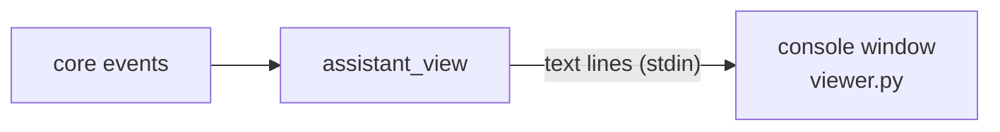

# assistant_view: architecture

## Interface

| | |
|---|---|
| Tools · Handles · Calls · Publishes | none |
| Listens to | [`AgentActivity`](../../../../../docs/api/agents.md#agentactivity), [`AgentStateChanged`](../../../../../docs/api/agents.md#agentstatechanged), [`TaskUpdated`](../../../../../docs/api/agents.md#taskupdated) |

## Owns and launches

- **A new console window** running `viewer.py`, fed text lines on its stdin. Closing the window only stops the view; deactivating the module closes it.

## Inner workings

## Planned

Nothing specific. A core module: part of the main app.
