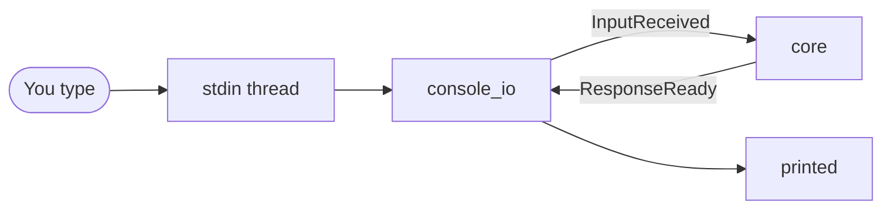

# console_io: architecture

## Interface

| | |
|---|---|
| Tools · Handles · Calls | none |
| Publishes | [`InputReceived`](../../../../../docs/api/messaging.md#inputreceived), [`ShutdownRequested`](../../../../../docs/api/messaging.md#shutdownrequested) (`reason="console exit"`) |
| Listens to | [`ResponseReady`](../../../../../docs/api/messaging.md#responseready): replies to its inputs, and uncorrelated ones |

## Owns and launches

- **One stdin reader thread per process.** A blocking `input()` can't be cancelled, so the thread outlives a deactivated module and is reused when it's activated again; lines typed while it's off are dropped.

## Inner workings

## Planned

Nothing specific. A core module: part of the main app.
