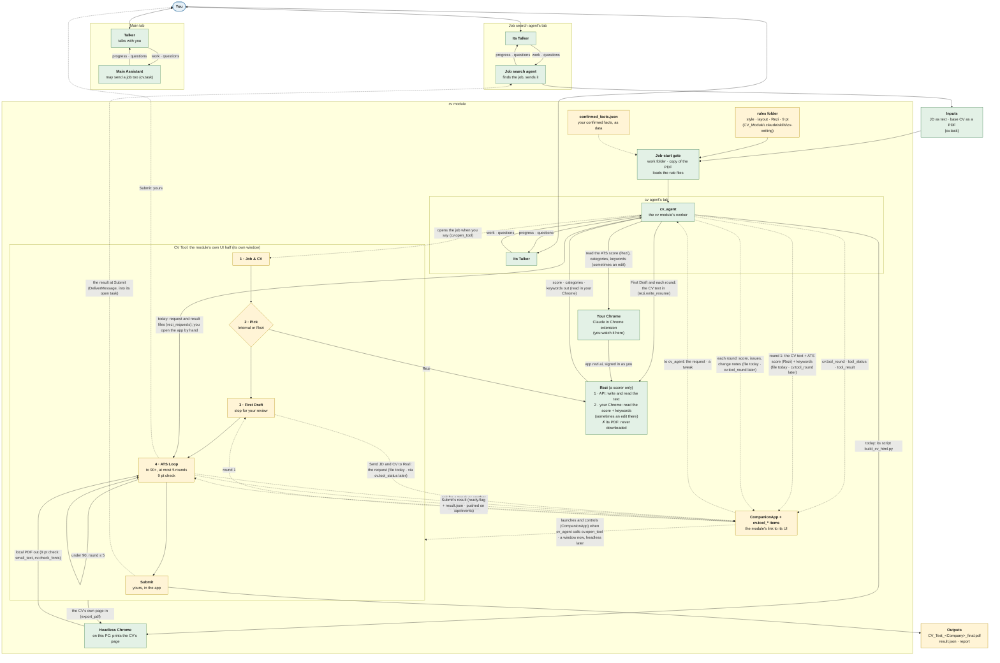
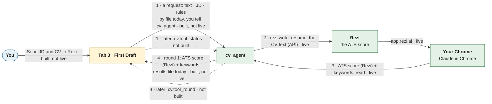
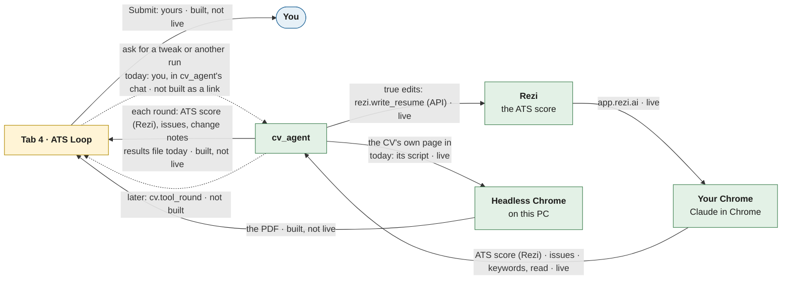
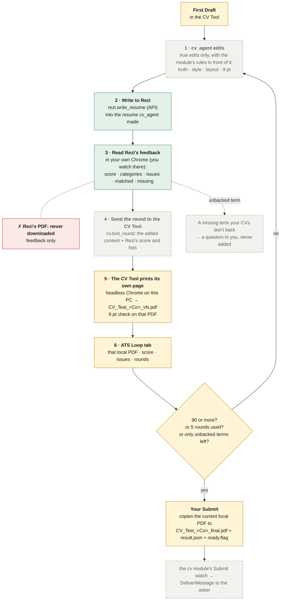

# cv: tailor a CV for one job with Rezi, one clean page, your yes

## Purpose

Takes a CV as a PDF (`CV_Test_*.pdf`) and a job description (JD) as text. Rezi edits and scores a new copy for that JD. The module's worker reformats it to one clean page (US Letter by default), has Rezi check that page, and returns the one-page PDF you approved, with the scores, keywords and checks that led to it. One module with its worker inside; it stands alone, and other modules (the job agent) connect to it later through `cv.task`.

**Status (2026-11-07):** built and tested, chunks 1 to 8. That covers the menu (`rezi.*`, `cv.*`), the Rezi connection with its resume guard, the one-page build and checks, the worker `cv_agent`, and the in-and-out contract below. Everything is tested against a fake Rezi and a fake `claude`. Chunk 9, the real run, is under way: the real Rezi sign-in, live tool list and reads work, and the module now reads and writes Rezi's real resume format. Off by default; turning it on asks for the worker's access on one card.

**PDF in, PDF out (2026-11-09, built, waiting on a `cv` reload):** the base CV comes in as a `CV_Test_*.pdf` and an `.odt` is refused everywhere; the JD stays text; `cv.build` exports the final PDF into the job's folder, and no `.odt` comes out (`odt_path` is gone from the result). The plan: `docs/next-steps/cv-pdf-only.md`. Left out at your request: cutting the worker's read access to `C:\Chang\Jobs\CV`.

**The CV Tool build (2026-11-09, building):** the module side is built and tested, but not live yet: `cv.open_tool`, `cv.tool_status`, `cv.tool_round`, `cv.check_fonts` and `cv.tool_result`, the CV Tool launched through `CompanionHandover` (`tool.py`), the rules folder loaded at every job, `CvRequest.tool`, and the 5-step prompt. They go live with a `cv` reload. The app itself (`src/cv_tool/`) runs and is tested; `pymupdf` 1.28.2 is in the repo's `.venv` (installed 2026-11-09 with your yes). The plan: `docs/next-steps/cv-uses-cv-tool.md`.

How it works inside: [Architecture](architecture.md). Its menu, and what a job sends in and gets back: [Tools](tools.md).

## In and out

- **In** (`cv.task`): the job's company and role, the job description as text or as a `.txt`, `.md` or `.html` file, and the CV file (`CV_Test_*.pdf` in `C:\Chang\Jobs\CV`; an `.odt` is refused). Optional: the posting's URL, Education first, a target score, notes.
- **Out** (`cv.read_result` on the task's result): the new one-page PDF and `report.md` (in the job's folder), and with them the Rezi Score after each round against the target, the keywords still missing and those left out because you don't have them, recommendations, the one-page check, and the compare of what Rezi read. Also the new Rezi resume and its check copy, and whether you approved it.

The calls and every field: [Tools](tools.md#the-hand-off-cvtask-and-cvread_result).

## Design: the CV Tool flow

> **The design:** how the module works once the CV Tool build is in. What is live today is in [Build state](#build-state) at the end. The colours in the diagrams mark the same state (2026-11-09): green built and live, yellow built but not live, grey dashed not built.

The CV Tool is the cv module's own UI half. The module owns it: it launches the app, feeds it jobs and stops it. It isn't part of the Main Assistant or the core. The app's code sits in `src/cv_tool/`, not in the module's folder: `CompanionApp` starts it with `python -m <package>`, and from inside `cv/` that would import the module's code into the app.

**Green: built and live. Yellow: built, not live. Grey, dashed: not built.** Dotted arrows are the new links: built and tested, live after the `cv` reload. The arrows marked "today" are the old path, used until then. The gate and cv_agent are live with the old flow; their new parts (the rules folder, the 5-step prompt) come with the reload.

**Rezi's PDF is never downloaded.** This is your rule (2026-11-08 03:01, memory note `rezi-pdf-download-auto.md`), and the CV Tool ignores a Rezi PDF if one is sent. Rezi only scores the text; the PDF is always the CV's own page. In the Hooli run, Rezi's PDF was downloaded in rounds 2–4, before the rule.

**The ATS score comes from Rezi,** read in your Chrome. The CV Tool only shows it. With the Internal pick, the CV Tool's own estimate is used instead.

### The First Draft and ATS Loop tabs, close up

These are the same boxes as above, with the arrows between the tabs, cv_agent and Rezi. Each label ends with its state. Dotted arrows aren't built.

**First Draft (Rezi picked)**

**One ATS Loop round**

### How cv_agent reaches Rezi today

There are two ways, and both are live:
- **Rezi's MCP API, through the cv module.** The `rezi.*` items (`mcp.py`) call `https://api.rezi.ai/mcp` with your OAuth sign-in token. That covers `rezi.write_resume` (make or update a resume this module made), `rezi.read_resume`, `rezi.generate_keywords`, and `rezi.list_resumes`. No browser is involved.
- **Chrome, through the Claude in Chrome extension** (`chrome = true` in `module.toml`). The prompt allows it only on app.rezi.ai, signed in as you. cv_agent uses it to read the **Rezi Score**, its categories, and the matched and missing keywords (prompt step 4), and for AI Keyword Targeting.

The CV Tool app never talks to Rezi itself (memory note `cv-tool-rezi-request.md`).

**You watch Rezi in your own Chrome.** cv_agent drives Rezi through the Claude in Chrome extension, in your normal Chrome, where you're signed in to Rezi. You look at that Chrome window to see what it's doing. The CV Tool shows no live view of Rezi.
- **Your words (2026-11-07, `logs\2026-11-06_04-28-55_open-two-extra-helpers-one\talker-cv_agent.jsonl`):**
  - L418, 21:21: tab 2 was first to have "A live view in chrome of the CV rezi is editying".
  - L874, 22:47: "Why not just embed a chrome window into the UI?"
  - L886, 22:47: "When it needs to, I can just sign in onto the chrome window on the app when you need me."
  - L910, 23:03: "Then the Rezy UX, I'll just look at the chrome broswer. It's cleaner anyway."
- **Agreed:** the Talker (L917, 23:03: "You'll watch Rezi in your own Chrome"), and cv_agent (L923, 23:07), which dropped "Arrange windows". It's written in `cv_tool\README.md` L120 and memory note `cv-tool-scope.md`. The embedded view in `cv_tool_ui_plan.md` (its own Chrome over DevTools) is out of date.
- **Signing in to Rezi (checked 2026-11-09):** there are two sign-ins, and cv_agent asks for and checks both itself, with no other agent in between:
  - **The API's** (OAuth, a 30-day token): `rezi.status` says whether it's signed in. cv_agent asks you with `NEED:`, then runs `rezi.sign_in`, which opens your browser, and checks `rezi.status` again.
  - **Chrome's** (app.rezi.ai, for reading the score): when the page shows it signed out, cv_agent asks you with `NEED:` to sign in, as you said ("I can just sign in onto the chrome window", L886). Your answer goes back to cv_agent's own task on its tab, and it reloads the page to check.
  - **The bug in the ExampleCorp run:** your answer bounced because the Hub sent tab messages to cv_agent's oldest open task, a stale record left by a reload (20c1d08e), not the live one. Fixed in `agent_hub/tasks.py`: the newest open task wins, and a stale record is closed when the agent says it doesn't hold it. Live after an `agent_hub` reload.
- **When Rezi opens in Chrome:** no log, note or README says. **Proposed:** with the Rezi pick, cv_agent opens the job's Rezi resume in a tab of your Chrome at First Draft and keeps that tab through the ATS Loop. When it writes through the API, it reloads the tab, so you see the same text it scores.

### The ATS loop, round by round

**Where the PDF comes from:** at every round, and for the final PDF, it's the CV Tool's own page. The app's code (`export_pdf` in `cvlib.py`) prints it with headless Chrome on this PC. Submit copies that local PDF to `_final.pdf`. Rezi only scores the text. Its PDF is never downloaded (the rule in memory note `rezi-pdf-download-auto.md`, 2026-11-08), and the app ignores a Rezi PDF if one is sent (`apply_result`).

**What each colour means here:**
- **Green:** writing to Rezi and reading its feedback are live today.
- **Yellow:** the First Draft, the printing of the app's own page, the ATS Loop tab and Submit work in the old standalone app, driven by hand through result files.
- **Grey, not built:** sending a round with `cv.tool_round`, `cv.tool_result`, the 9 pt check, the rules in front of cv_agent each round (the `rules/` folder), and the prompt that runs this loop.

**The prompt that runs this loop is built (`worker.py`, the 5 steps below) and goes live with the `cv` reload.** Until then the live prompt runs the old 8 steps: edit in Rezi, score in Chrome, the final PDF from LibreOffice (`cv.build`), a Rezi import check, and no Submit.

## The 5 steps

The worker's prompt (`worker.py`) follows the CV Tool's tabs. They replace the old 8 steps (built; live with the `cv` reload).

0. **Set up, in code:** a job comes in through the Hub (`cv.task`, then `hub.start` to `cv_agent`). Before the worker sees it, the gate makes `work\<date>_<Company>_<Role>` in the worker's workspace, copies the base CV and the JD into it, and puts the rules folder and the confirmed facts into the task in full. The worker says the job is set up and waits until you tell it to start.
1. **Job & CV:** `cv.open_tool` starts the CV Tool, opens the job in it (the JD, and the base CV's content read from the copy) and gives the app's job id. Text the reader couldn't place goes to you as a question.
2. **Pick:** Internal or Rezi, only one. The request's `tool` decides; else you pick in the CV Tool's tab 2.
3. **First Draft:** the worker makes true edits to the CV's content and sends them with `cv.tool_round`, which prints the local PDF and checks it against 9 pt. With Rezi, it writes the job's Rezi resume, opens it in your Chrome and keeps that tab, reads the score and keywords, and sends them in the same way. Then it stops for your review.
4. **ATS Loop:** true edits each round, a new local PDF, the score read again. It stops at 90 or more, after at most 5 rounds, or when only terms your CVs don't back are left. Such a term comes to you as a question. Text under 9 pt is shortened or asked about, never shrunk.
5. **Submit:** yours, in the CV Tool. It writes `CV_Test_<Company>_final.pdf` and `result.json`. A Submit is never refused: text under 9 pt only shows a warning on screen and in the message. The cv module sees the Submit on the CV Tool's event stream and tells the job's asker itself (`DeliverMessage`), in the same second. The worker doesn't wait for it: when the CV is ready it tells you so and ends its task with `CV_RESULT` status `ready` (everything but your Submit), and hears of your Submit from one `[cv]` line at its next task (design A, 2026-11-10).

The code behind it is drawn on the [Architecture](architecture.md#the-cv-tool-code-as-built) page.

## Who does what

| Who | Does |
|-----|------|
| **Rezi** (MCP + web app) | A scorer only, with the Rezi pick: holds a new resume for each job (the base is never changed), and its score, categories and matched and missing keywords are read in your Chrome. Its PDF is never downloaded, and its AI writer isn't used. |
| **The CV Tool** (`src/cv_tool`, its own window) | Shows the four tabs, prints the CV's own page as the local PDF, scores it with the Internal pick, keeps the rounds, and holds your Submit. |
| **The worker** (`cv_agent`) | The editor and the truth gate: keeps only wording backed by facts on your CVs or the confirmed facts, adds no skill, title, tool or number you don't have, no keyword stuffing. Drives the CV Tool through the `cv.open_tool` / `cv.tool_*` items and Rezi through the `rezi.*` items and Chrome. Asks you before starting and after the First Draft; tells you when it's ready for your Submit and ends its task. Never uploads or submits anything outside Rezi. |
| **You** | Say when to start, pick the tool if the request didn't, review the First Draft, and press Submit. |

## Wrapper

| Field | Value |
|-------|-------|
| id | `cv` |
| provides | `ITaskAgent`: its worker `cv_agent`, so the Hub lists it and starts its tasks |
| requires / optional | nothing; its worker claims its agent id `cv_agent` from the Hub, the way `job_search`'s agent does (`ProfileAgent`) |
| permissions | `agent.access`: the worker's access list on one card when cv turns on (its workspace, read `C:\Chang\Jobs\CV` and the output folder, Chrome only for app.rezi.ai). cv turns on when you allow. A later grant reaches the worker live |

## Config

Defaults in `module.toml` in this module's folder; `[modules.cv]` in the app's config only overrides them.

| Key | Default | Meaning |
|-----|---------|---------|
| `section_order` | Contact, Summary, Skills, Experience, Projects, Education, Awards, Publications | The usual order |
| `degree_first_order` | Education right under Skills | Used when the JD requires or prefers a master's |
| `drop_first` | `publications`, `awards` | What goes first when the page is too long |
| `target_score` | 90 | The ATS score to reach in the ATS Loop (aim 100) |
| `max_rounds` | 5 | ATS Loop rounds before it stops and reports |
| `paper` | `letter` | US Letter; `a4` later |
| `output_dir` | `C:\Chang\Jobs\rezi\rezi\out` | Where each job's folder goes |
| `cv_dir` | `C:\Chang\Jobs\CV` | Your CVs, read only: `cv.read` reads `CV_Test_*.pdf` files here, in `output_dir` and in `work_dir`; never an `.odt` |
| `work_dir` | `""`: `<agent.workspace>\work` | Where each job's folder is made, `<date>_<Company>_<Role>` (folder-safe), with its copy of the base CV, `jd.txt` and `job_start.json`. Must be in the workspace, never in `cv_dir` or the repo |
| `rules_dir` | `.claude/skills/cv-writing` (in the workspace) | The cv module's general rules: `SKILL.md`, then every `rules/*.md`, read in full into every job's task. Listed at each job, so a new rule file needs no reload. No `SKILL.md` refuses the job; `""` loads none |
| `job_skills` | `data/confirmed_facts.json` | More files read in full into every job, after the rules: your confirmed facts, kept as data. A missing or empty one refuses the job. Relative paths are from the workspace; `~` is your home folder |
| `[tool]` | `host` 127.0.0.1, `port` 8771, `data_dir` `<workspace>\cv_tool`, `facts` `<workspace>\data\confirmed_facts.json` | The CV Tool: where it listens (this machine only) and the folders it's given at launch. It also gets `cv_dir`, `rules_dir` and `work_dir` |
| `soffice` | `C:\Program Files\LibreOffice\program\soffice.exe` | LibreOffice, for the PDF export |
| `rezi_url` | `https://api.rezi.ai/mcp` | Rezi's MCP server (`https://` only; `http://` only on this machine) |
| `token_file` | `""`: `%LOCALAPPDATA%\assistant\cv\rezi_token.json` | Where the 30-day Rezi token is kept; refused inside the repo |
| `callback_port` | 33418 | The sign-in comes back to `http://127.0.0.1:<port>/callback` |

The worker's table, `[agent]`, takes the same keys as `job_search`'s agent. They are its access list:

| Key | Default | Meaning |
|-----|---------|---------|
| `enabled` | `true` | `false`: the menu only, with no worker and no card |
| `agent_id` | `cv_agent` | Its id in the Hub |
| `workspace` | `C:\Chang\Jobs\CV_Module` | Its working folder and home (the only one it writes): `work\`, `applied\`, `data\`, `cv_tool\`, `.claude\skills\cv-writing\`. A change here asks you again on the access card |
| `read_dirs` | `C:\Chang\Jobs\CV` | Folders it reads; the output folder is added |
| `tools`, `chrome` | `default`, `true` | Its tools; Claude in Chrome, only for app.rezi.ai |
| `permission_mode` | `acceptEdits` | Sessions start in Manual |
| `transcript` | `cv_agent.jsonl` | Its session's log |

## Code and tests

Everything is in this module's folder, `src/assistant/modules/cv/`:

- Built: `module.py` (the wrapper, its config check, the worker's wiring, the `rezi.*` items, `cv.task`, `cv.read_result`, `cv.read`, `cv.build`, `cv.compare`, `cv.report`), `module.toml` (the defaults), `worker.py` (the worker's prompt and its `[agent]` check), `job_start.py` (`JobStart`: the job's folder, the copy and the rules; `JobStartAgent`: the gate the Hub reaches the worker through), `handoff.py` (the `CV_REQUEST` and `CV_RESULT` lines, `read_jd_file`, `result_view`), `content.py` (`CvContent`, the eight sections; `from_pdf`), `pdf_read.py` (`read_pdf`: a CV PDF as sections, with the read check), `rezi.py` (`ReziTools`: the `rezi.*` items' work, `check_tools`, the error mapping), `guard.py` (`ResumeGuard`), `rezi_json.py` (`read_rezi`: Rezi's resume JSON as sections; `write_rezi`: sections into Rezi's real format), `order.py` (`SectionOrder`, `wants_masters`), `data.py` (`CvRequest`, `CvResult`, `Round`, `ResumeRef`), `odt.py` (`OdtWriter`, `LAYOUTS`; `read_odt` only for the writer's own tests), `pdf.py` (`PdfExport`, `PageCheck`), `build.py` (`build_cv`: write, export, check, fit to one page; the `.odt` stays in a temporary folder, only the PDF comes out), `compare.py` (`FieldCompare`, `Comparison`), `report.py` (`ReportWriter`), `mcp.py` (the Rezi connection: `McpClient`, `TokenStore`, `LoopbackCallback`), `tool.py` (the CV Tool's side: `tool_settings`, `tool_content`, `CvTool` on `CompanionHandover`)
- The CV Tool app, the module's UI half: `src/cv_tool/` (`server.py`, `cvlib.py`, `static/`, `assets/`, `cv_tool.toml`; `python -m cv_tool`). It sits outside the module's folder because `CompanionApp` runs `python -m <package>`, and inside `cv/` that would import the module's code into the app
- Planned: the real run end to end (chunk 9, with your yes); after it passes, as a separate step, retiring the separate Rezi helper. Other modules (the job agent) connect through `cv.task` later; cv doesn't change them
- Needs: LibreOffice (`soffice`) for `cv.build`, the `pypdf` package for the page check and for reading the base CV, the `mcp` package for Rezi, and for the CV Tool app the `pymupdf` package (the `cv` extra in `pyproject.toml`; in `.venv`) and Chrome for printing
- `docs/`: this page, [Architecture](architecture.md), [Tools](tools.md) and `docs.toml`. These are the module's docs; the old plan page `cv_module_workflow.html` in `C:\Chang\Jobs\CV\Recruiters\docs` is left as it was
- `tests/`: its own tests, run with `pytest src/assistant/modules/cv/tests`. `fake_rezi.py` is a fake Rezi: the `mcp` package's own server with an in-memory OAuth sign-in and Rezi's tools in its real format, reached without the network. `test_cv.py` covers the config, order and data; `test_build.py` the one page (one test uses real LibreOffice); `test_compare_report.py` the compare and the report; `test_rezi_mcp.py` the connection; `test_rezi_items.py` the `rezi.*` items and the guard; `test_worker.py` the worker and `cv.read`; `test_pdf_read.py` the PDF reader (lines, joins, small caps, the read check, real PDFs; one test uses LibreOffice); `pdf_fixture.py` writes a test CV as a real text PDF; `test_handoff.py` the contract, end to end through the Hub with a fake `claude`; `test_job_start.py` the job start: names, copy, refusals, the gate, end to end through the Hub; `test_tool.py` the CV Tool's side: the content in the app's shape, the rules folder, the pick, and the five items against a fake CV Tool; `test_cv_tool.py` the CV Tool app itself: a job from the module, a round, Submit's final PDF, every style at 9 pt or more, the 9 pt measure, and the server's guard, JSON-only posts and quit

## Build state

_As of 2026-11-09; update this table as parts go live._

| Box | State | What the code shows |
|---|---|---|
| Main tab: Talker and Main Assistant | Built, live | `talker` and `main_assistant` are on; `hub.agents` lists `main_assistant`. It no longer starts cv_agent: `cv.task` starts it itself, as the caller's child task, and the result goes back at Submit with `DeliverMessage` (built 2026-11-10, live after the app restart) |
| Each agent's own Talker (job search agent, cv agent) | Built, live | Every agent tab is a pair, its own Talker and its own worker (`talker`: "one Talker per agent tab"). A tab's Talker starts the first time you use the tab |
| Job search agent | Built, live | `job_search` is on; `hub.agents` lists `job_search_agent`. Its `save_jd.py` names the base CV as a `.pdf` |
| Inputs (cv.task) | Built, live | `cv.task` takes the JD as text and a `CV_Test_*.pdf`; `cv` is on |
| Job-start gate | Built, live (old rules); new rules built, not live | Live: loads `job_skills` from the old folders. Built: `rules_dir` (`SKILL.md` + `rules/*.md`) and the facts, live with the `cv` reload |
| Rules folder | Built, not live | Copied into `C:\Chang\Jobs\CV_Module\.claude\skills\cv-writing\` (the originals stay); loaded by the gate after the reload |
| confirmed_facts.json | Built, not live | A copy in `C:\Chang\Jobs\CV_Module\data\`, in `job_skills`; loaded after the reload |
| cv_agent | Live with the old flow; the 5-step prompt built, not live | The new prompt is in `worker.py` and tested; the running worker has the old 8 steps until the reload |
| Rezi | Built, live | The `rezi.*` items |
| CV Tool, four tabs, the pick, First Draft, ATS Loop, Submit | Built, not live | `src/cv_tool/` has the server (port 8771, the local-only guard, JSON-only posts, `/api/quit`, the `app_kit` window) and the engine; it runs and is tested (`test_cv_tool.py`, a real Chrome print included). The module starts it after the reload |
| Links: open the job, `cv.tool_*` items | Built, not live | `tool.py` (`CvTool` on `CompanionHandover`) and the items in `module.py`, tested against a fake CV Tool; live with the reload |
| 9 pt check | Built, not live | The app measures every text span (`font_sizes`); `cv.tool_round` and `cv.check_fonts` give it back; at Submit it's a warning only (`small_text` in `result.json`, on screen and in the message), never a refusal |
| Outputs: final PDF, result.json | Built, not live | Submit writes `CV_Test_<Company>_final.pdf`, `result.json` and `ready.flag`; the module's Submit watch delivers them to the asker at once, and `cv.tool_result` returns them. The old `cv.build` and `cv.report` are still on the menu |

