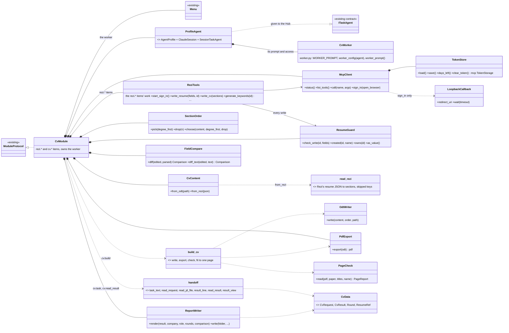
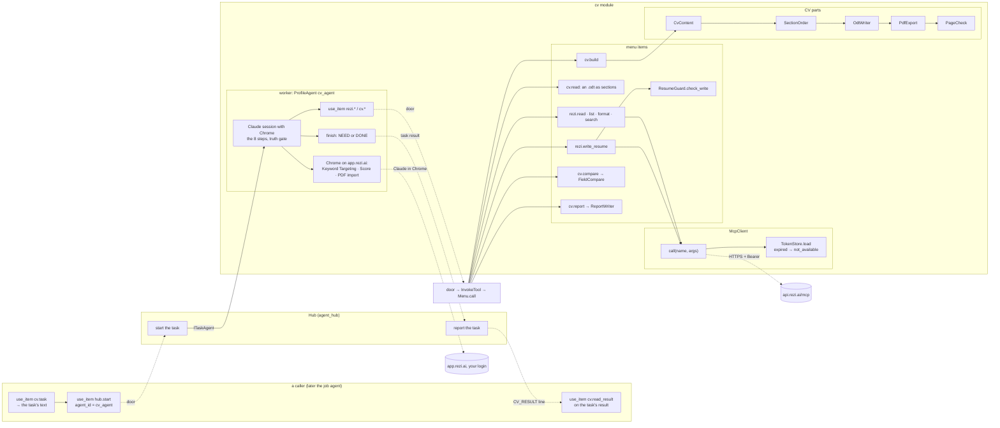
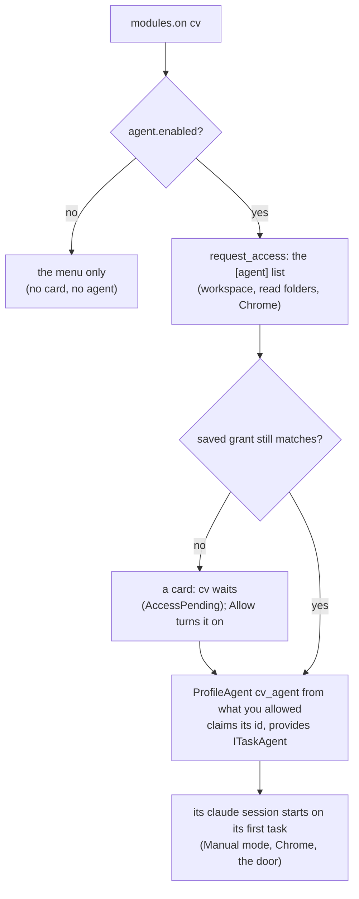
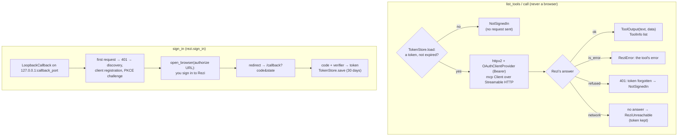
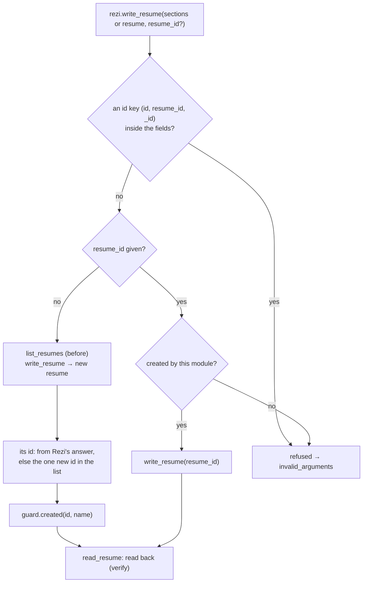
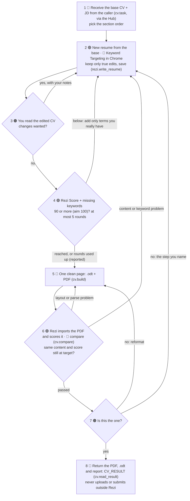

# cv: architecture

How the `cv` module works inside. What it is and the 8 steps: [Overview](README.md). Its menu: [Tools](tools.md).

## One module with its worker inside

- **One module, id `cv`**, holds everything it needs: the Rezi connection, the CV output side, and its worker.
- **Its worker, `cv_agent`**, is a `ProfileAgent` (a Claude session with its own access card), the way `job_search` bundles its agent. It runs the 8 steps, is the truth gate and formats the one page.
- **Chrome only in the worker:** only this worker's session uses Chrome, only on app.rezi.ai, with your Rezi login. Keyword Targeting, the Rezi Score and the PDF import happen there, not as menu items.
- **Jobs sent through the Hub:** a caller gets the task's text from `cv.task` and sends it to `cv_agent` with `hub.start`. The result comes back as the task's result, read with `cv.read_result`. There is no `rezi.tailor_cv` item.
- **It stands alone:** no other module is changed for it. The job agent (or any caller) connects later through those three calls.
- **The worker uses its own module's menu through the door**, like any caller, so every call gets the one permission check and the resume guard stays in code.

## Interface

| | |
|---|---|
| Tools | the `rezi.*` and `cv.*` items: see [Tools](tools.md) |
| Its worker | `cv_agent`: one job per task through the Hub (`cv.task` gives the text, then `hub.start`); the task's result ends with a `CV_RESULT` line (`cv.read_result`) |
| Provides | `ITaskAgent`: the worker, so the Hub lists it and starts its tasks |
| Handles | nothing beyond its menu |
| Sends | `ReportTask` (the worker's task reports) and `InvokeTool` (its SHOW tags), as every `ProfileAgent` does |
| Publishes | the worker's agent events: `AgentActivity`, `AgentStateChanged`, `SessionUsage`, `PermissionModeChanged`, `AgentNotice` |
| Listens to | `ResetRequested` (resets `cv_agent`), `PermissionChanged` (a new grant reaches the worker live) |
| Permissions | `agent.access`: the worker's access list on one card |

## Class chart

Everything on the chart is built (chunks 1 to 8) and tested against a fake Rezi and a fake `claude` only. Still to do: the real run (chunk 9, with your yes), then retiring the separate Rezi helper as its own step.

| Class | Its one job | Reuse or new |
|-------|-------------|--------------|
| `ModuleProtocol`, `Manifest`, `Menu`, `Result`, `ctx.permissions`, `ctx.logs` | The wrapper, the menu, permission asks, logs | Reuse |
| `ProfileAgent` (`AgentProfile`, `ClaudeSession`, `SessionTaskAgent`) | The worker: its Claude session with Chrome, its access card, its id, its tasks | Reuse |
| `ITaskAgent`, the Hub (`hub.start`, `hub.status`) | A caller hands a job to `cv_agent` and reads its result | Reuse |
| `request_access`, `granted_config`, `watch_grant` | The worker's access card, and grants taken live | Reuse |
| `viewer.open` | Shows HTML at steps 3 and 7; it refuses a PDF, so the worker gives you the PDF's path | Reuse (HTML only) |
| `handoff.py` | The contract: `task_text` / `read_request` (`CV_REQUEST`), `result_line` / `read_result` (`CV_RESULT`), `read_jd_file` (`.txt`, `.md`, `.html`), `result_view` (what `cv.read_result` returns) | New (standard library) |
| `CvRequest`, `CvResult`, `Round` (`data.py`) | One job in; its outcome out, with rounds, target, keywords, recommendations, compare and files; refuses a result that contradicts itself | New (pydantic) |
| `McpClient` (`mcp.py`) | Rezi's MCP server: Streamable HTTP, OAuth with PKCE (the `mcp` package's `Client` and `OAuthClientProvider`), list and call tools, sign in | New, in this module only |
| `TokenStore` (`mcp.py`) | Keeps the 30-day token and the registered client in one file outside the repo; days left; the `mcp` package's `TokenStorage` | New |
| `LoopbackCallback` (`mcp.py`) | Catches the browser's redirect after the sign-in on `127.0.0.1` | New (standard library) |
| `CvModule` | The menu, and the owner of the worker | New |
| `CvWorker` (`worker.py`) | The worker's prompt (the 8 steps, the truth gate, the never list, the config's target, rounds, paper and folders) and its checked `[agent]` table (output folder added to `read_dirs`) | New (prompt + config) |
| `ReziTools` (`rezi.py`) | The `rezi.*` items' work: Rezi's seven tools used here, one write at a time, the new resume's id, the read-back, `check_tools` against the live list, the error mapping (`run`) | New |
| `ResumeGuard` (`guard.py`) | Refuses writes to any Rezi resume not created by this module; handed over on a reload | New |
| `CvContent` | The base `.odt` and Rezi's resume JSON (`read_rezi` in `rezi_json.py`) as plain sections | New |
| `SectionOrder` | Default or degree-first order; drops Publications, then Awards | New |
| `OdtWriter` | One column, standard headings, no tables, text boxes or images | New (standard library) |
| `PdfExport` | `.odt` to PDF with headless LibreOffice | New |
| `PageCheck` | Page count, page size and clean text (`assess` holds the rules, tested without a PDF) | New (`pypdf`) |
| `build_cv` (`build.py`) | The fit: roomy to tight layouts, then the drop list, first one-page result wins | New |
| `FieldCompare` (`compare.py`) | What Rezi read from the PDF against the edited resume: missing sections, missing, moved and extra lines (`Comparison`, `Issue`) | New (standard library) |
| `ReportWriter` (`report.py`) | `report.md`: result, files, score rounds, keywords still missing and left out, recommendations, the compare; refuses a report that contradicts itself | New |

## Code flow

## The worker (`worker.py`)

- **Built like `job_search`'s agent.** One `ProfileAgent` with `subject` = its id, so it can ask for more access itself with `permissions.request`. `watch_grant` passes a widened grant to it live (`set_access`), and `ResetRequested` resets it.
- **A reload** waits while the worker has a task (`busy`). The new copy claims the id again, and the guard's ids come over through the handover.
- **Its prompt** is `WORKER_PROMPT` with the config's target, rounds, paper and folders filled in. It names the items for each step: `cv.read` (step 1), `rezi.get_resume_format` and `rezi.write_resume` with `sections` and no id (step 2), `cv.build` (step 5), `rezi.read_resume` with `cv.compare` (`parsed_resume`, step 6), and `cv.report` (step 8). Steps 3 and 7 are `NEED:` questions to you. It also asks with `NEED:` before `rezi.sign_in` opens your browser.
- **Tested with a fake `claude`** (`tests/test_agents.FAKE`) and a pre-saved grant. No session ran against Rezi.

## The hand-off (`handoff.py`)

A Hub task is plain text, so each direction is one marked line of JSON. Newlines in the JD are escaped, and the last marked line counts.

- **In:** a caller calls `cv.task` with the job: the JD as `jd_text`, or as `jd_file` (`read_jd_file`: `.txt`, `.md` or `.html` in `cv_dir` or `output_dir`), plus the CV file. It checks the job (`CvRequest`, the base CV in `cv_dir`, the worker on) and gives `text`: a first line saying what to do, then `CV_REQUEST: <json>`. The caller sends that text with `hub.start` to `cv_agent`. A `CV_RESULT:` inside the JD can't be mistaken for a result: it's inside the JSON string, not at the start of a line.
- **Out:** the worker ends its task with `CV_RESULT: <json>` as the very last line, a `CvResult` whose status is `approved` or `stopped`. The caller reads it with `cv.read_result` (`result_view`). That gives the files with whether each exists, the score per round against the target (`vs_target`), the keywords still missing and left out, the recommendations, the one-page check and the compare. It refuses a missing line, bad JSON, or a result that contradicts itself: `approved` without your yes, scores that aren't the rounds', or `match_ok` with compare issues.
- **`CvResult` holds the metadata**: `target_score`, `rounds` (`Round`, moved to `data.py`; `scores` filled from them), `missing_keywords`, `recommendations`, `compare` (checked as a `Comparison`) and `report_path`. `cv.report` uses the result's own rounds, compare and target when none are given.
- **Tested end to end through the real Hub** with a fake `claude` that echoes its task. A caller sends `cv.task` with a JD file and the CV's path, then `hub.start` to `cv_agent`. The job arrives intact, and `cv.read_result` on the task's result gives the whole view.

## The Rezi connection (`mcp.py`)

Every `list_tools` or `call` opens one connection with the stored token and closes it again. Only `sign_in` opens a browser.

- **Errors for the items** (`rezi.run`): `NotSignedIn` → `not_available` ("use rezi.sign_in"), a guard refusal → `invalid_arguments`, `ReziError` → `failed`, `ReziUnreachable` → `failed`, retryable.
- **The token file** (`token_file`, by default `%LOCALAPPDATA%\assistant\cv\rezi_token.json`) holds `token`, `saved_at`, `expires_at` and `client`. It is written through a temporary file. A config that puts it inside the repo is refused.
- **Tested against a fake Rezi** (`tests/fake_rezi.py`): the `mcp` package's own server with an in-memory OAuth provider and Rezi's tools over in-memory resumes in Rezi's real shape, reached through `httpx2.ASGITransport`.
- **The live tool list.** `rezi.sign_in` lists the live tools (12 seen on 2026-11-07) and their `schemas`, and `check_tools` reports a tool missing, a new one, or an argument we send that it doesn't take. The read items take `extra` arguments, passed through.
- **Rezi's real format** (`rezi_json.py`): `read_real` reads a live resume exactly (sections keyed by id, in `index` order, hidden entries skipped), and `write_rezi` writes the CV's sections into the same shape, `{name, jobTitle, jobCompany, jobDescription, data}`. `ReziTools.write_cv` uses it for `rezi.write_resume` with `sections`. The round trip from an `.odt` is exact except the contact headline, which Rezi has no field for (`left_out`).
- **Started in the background:** a sign-in that waits on the browser outlives the module door's 30-second limit, so `start_sign_in` runs it as a task and `rezi.status` reports it.

## The resume guard (`guard.py`) and writes

- **Every resume already in your Rezi account is protected.** There's no fixed base resume; only ids this module made can be updated.
- **An id Rezi gives back that was already in the list** isn't taken as made here (a warning comes back instead), and neither is a new resume whose id can't be found.
- **Writes run one at a time** (a lock), so the before/after lists can't mix two writes.
- **A reload keeps the ids** (`export_state` → the handover); a restart forgets them, so the worker makes a new resume rather than touching one it can no longer prove it made.

## Conceptual flow: the 8 steps

Rezi green, the worker blue, you orange.

- **The one page.** Single column, standard headings, no tables, text boxes or images. Order: Contact, Summary, Skills, Experience, Projects, Education, Awards, Publications. Education moves up under Skills only when the JD requires or prefers a master's. When space is tight, Publications goes first, then Awards, then older bullets are tightened.
- **Score loops.** A score held down by terms you don't have is reported as "not on CV, left out", not chased.
- **Passing.** The returned PDF is exactly the file that passed step 6.
- **The compare (step 6).** Rezi splits an entry line into its own fields and order, so each `|` part of a line is checked on its own: found when 90% of its words are there (any order) and every number is. A line under another section is `moved`; text Rezi shows that isn't on the CV is `extra`. Every issue is a parse problem: back to step 5. What Rezi read comes in as `rezi.read_resume`'s data (`parsed_resume`, read by `from_rezi`), as sections, or as one text.
- **The report (step 8).** `report.md` sits next to the PDF in the job's folder, never outside `output_dir`. It's refused if the result's scores aren't the rounds' scores, or if the result says `match_ok` and the compare found issues.
- **Imports into Rezi** take PDF or DOCX; check copies are named "<Company> – check". Rezi's free formatting review stays off.

## Owns and launches

- **Its worker**, `cv_agent`: a Claude session with Chrome, started on its first task, working in its own workspace (`C:\Chang\Jobs\rezi\cv_agent` by default, made when cv turns on).
- **The Rezi connection**: an MCP client of `https://api.rezi.ai/mcp` (OAuth with PKCE, a 30-day token kept outside the repo). It connects on each use and never on load. During a sign-in it listens briefly on `127.0.0.1:callback_port`.
- **LibreOffice** runs headless for each `.odt` → PDF export.
- **Files**: `<output_dir>\<date>_<Company>\` with `CV_Test_<Company>.odt`, `.pdf` and `report.md`. The base CV and every Rezi resume it didn't create are never changed.

## Decisions (2026-11-06 and 07)

- **One module with its worker inside**, not a module plus a separate helper. The separate Rezi helper agent is retired only after the real run passes, as its own step.
- **It stands alone.** No other module (not the job agent's prompt) is changed for it; they connect later through `cv.task`, `hub.start` and `cv.read_result`.
- **The contract:** in, the JD as text or a file plus the CV file; out, the new CV and PDF with the score per round against the target, the missing keywords, recommendations, the one-page check and the compare.
- **Chrome only in the worker**, only on app.rezi.ai. Keyword Targeting, the Score and the PDF import are done there, not as menu items.
- **No Rezi AI writer for now.** The worker edits; Rezi targets, scores and checks.
- **Jobs sent through the Hub** (`hub.start` to `cv_agent`), not a `rezi.tailor_cv` item.
- **No fixed base Rezi resume.** The base is always the `CV_Test_*.odt` and the JD the caller passes in; the guard refuses writes to every Rezi resume not created in the run.
- **US Letter by default** (`paper`), A4 later.
- **A fixed menu**, not the server's tool list passed through.
- **The MCP client lives in this module only**, an exception to "modules never import MCP", until a second module needs one.
- **PDFs shown with `viewer.open`** first; a separate PDF viewer only if that fails. Tried in chunk 2: the viewer opens HTML only, so for now the worker gives you the PDF's path at steps 3 and 7. A PDF view is still open for you or the Main Assistant to decide.
- **Real runs only with your yes.** Chunks 1 to 8 touch no real Rezi account; chunk 9 is the first real run.
- **These pages are the module's docs.** The old plan page `C:\Chang\Jobs\CV\Recruiters\docs\cv_module_workflow.html` is left as it was, as the history of the design; these three pages replace it (2026-11-07).
