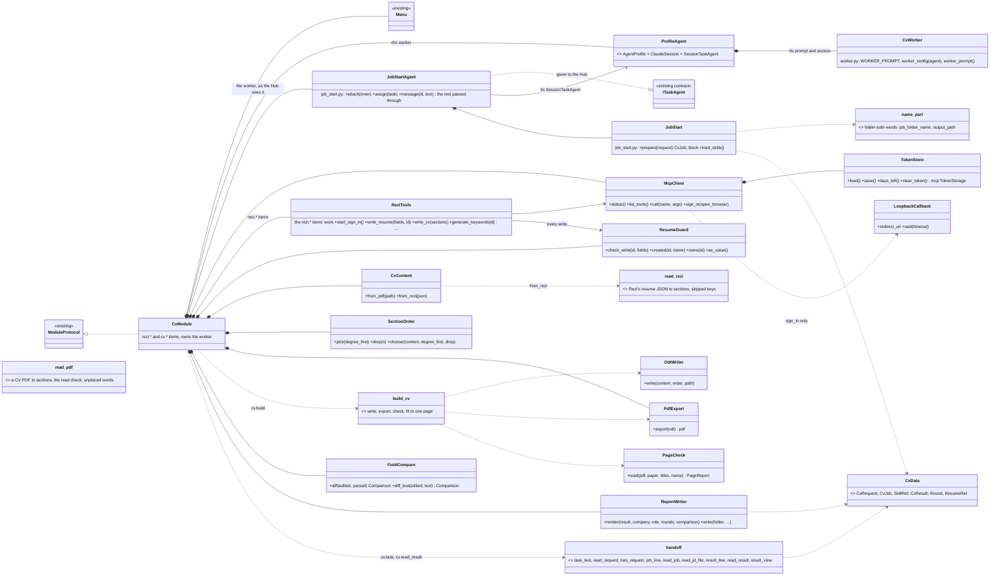
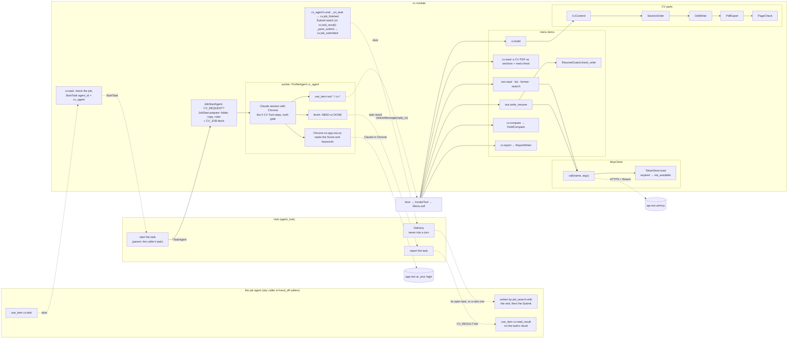
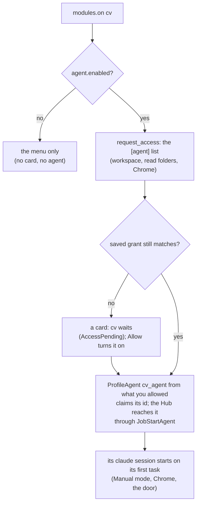
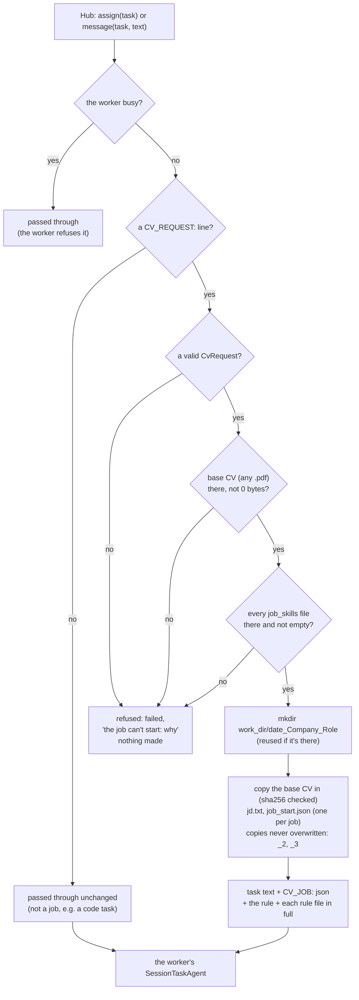
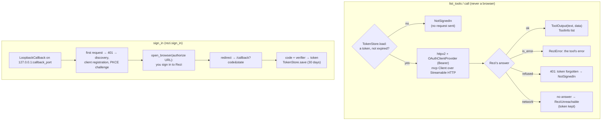
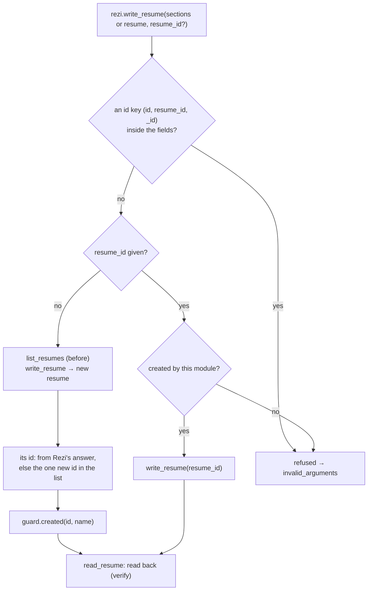
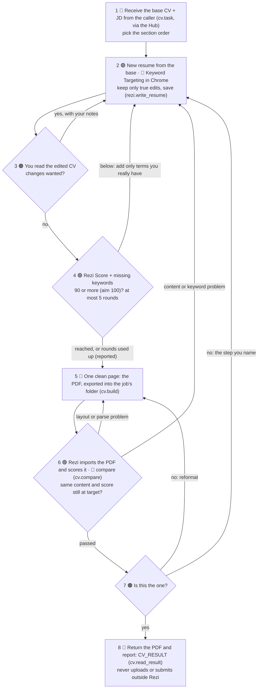
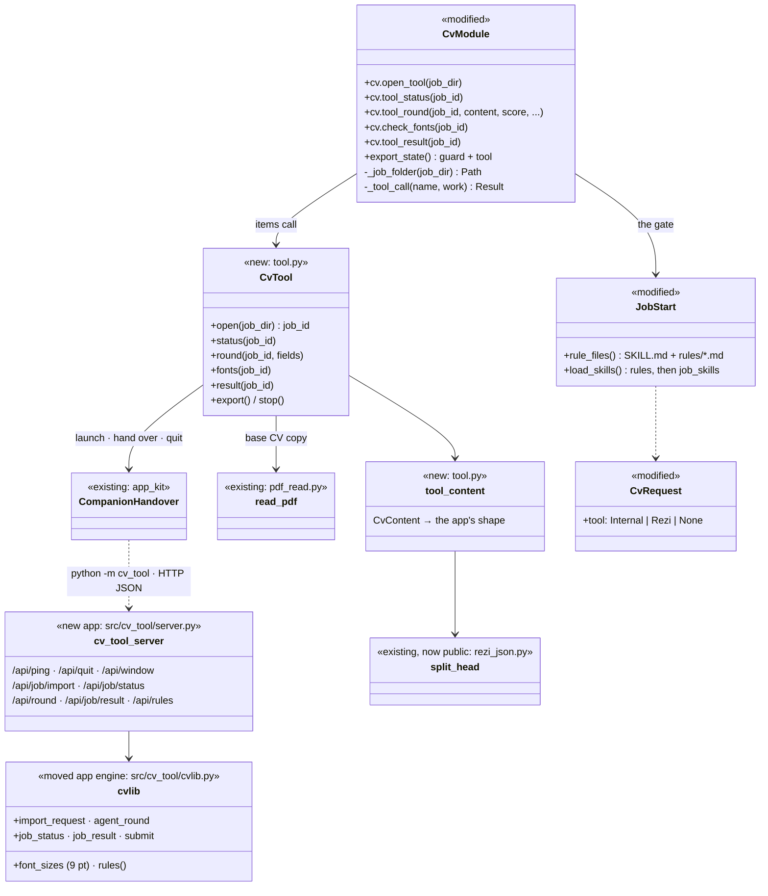

# cv: architecture

How the `cv` module works inside. What it is, the CV Tool flow and the 5 steps: [Overview](README.md). The CV Tool's code as built: [below](#the-cv-tool-code-as-built). Its menu: [Tools](tools.md).

## One module with its worker inside

- **One module, id `cv`**, holds everything it needs: the Rezi connection, the CV output side, and its worker.
- **Its worker, `cv_agent`**, is a `ProfileAgent` (a Claude session with its own access card), the way `job_search` bundles its agent. It runs the CV Tool's 5 steps (the old 8 until the `cv` reload) and is the truth gate.
- **Its UI half, the CV Tool**, is its own app in `src/cv_tool/`, launched and called by the module through `CompanionHandover` (`tool.py`), the way `html_viewer` runs its viewer.
- **Chrome only in the worker:** only this worker's session uses Chrome, only on app.rezi.ai, with your Rezi login. Keyword Targeting, the Rezi Score and the PDF import happen there, not as menu items.
- **Jobs sent through the Hub:** the job agent calls `cv.task`, and cv starts `cv_agent` on the job itself (`StartTask`, the caller's open task as parent; no coordinator in between, changed 2026-11-10). If `cv_agent` is busy on another job, `cv.task` says which job and who it's for; nothing is queued. At your Submit the result goes back to the caller as a message (`DeliverMessage`). The task's own result is read with `cv.read_result`. There is no `rezi.tailor_cv` item.
- **Who may call what** (`[hand_off]` in `module.toml`, checked by `CallerMenu` on every call; the core sets the caller, so it can't be faked): `cv.task` and `cv.read_result` only for `hand_off.callers` (the job agent and the Main Assistant); `rezi.status` for anyone; every other item (`cv.open_tool`, `cv.tool_*`, `cv.build`, `cv.read`, `rezi.*`) only for the worker. The Hub's `named_only = ["cv_agent"]` keeps free picks (`hub.start` with no agent) off `cv_agent`; anyone may still name it.
- **It stands alone:** no other module is changed for it. The job agent (or any caller) reaches it through `cv.task` and `cv.read_result`, and the Hub's `StartTask` and `DeliverMessage` contracts.
- **The worker uses its own module's menu through the door**, like any caller, so every call gets the one permission check and the resume guard stays in code.
- **Each job starts in code** ([Job start](#job-start-job_startpy)): before the worker sees a job, the module makes the job's own folder, copies the base CV into it, and loads the job's rules into the task. The worker doesn't have to remember to do it.

## Interface

| | |
|---|---|
| Tools | the `rezi.*` and `cv.*` items: see [Tools](tools.md) |
| Its worker | `cv_agent`: one job per task through the Hub (`cv.task` starts it as the caller's child task); the task's result ends with a `CV_RESULT` line (`cv.read_result`) |
| Provides | `ITaskAgent`: the worker behind `JobStartAgent`, so the Hub lists it and starts its tasks, each job set up first |
| Handles | nothing beyond its menu |
| Sends | `ReportTask` (the worker's task reports) and `InvokeTool` (its SHOW tags), as every `ProfileAgent` does; `GetTaskStatus` and `StartTask` (`cv.task`, with `tell_parent=False`); [`DeliverMessage`](../../../../../docs/api/agents.md#delivermessage) only to cv_agent (the Rezi click); never to the asker |
| Publishes | the worker's agent events (`AGENT_PUBLISHES`): `AgentActivity`, `AgentStateChanged`, `SessionUsage`, `PermissionModeChanged`; `ResponseReady`, the one plain reminder of a Submit pressed while cv was down; `AgentNotice` to cv_agent. Named events ([`ModuleEvent`](../../../../../docs/api/messaging.md#moduleevent)), cv's only way back to the asker: `cv.job_finished` when cv_agent's job task ends (`_on_task`, data from `handoff.job_finished`) and `cv.job_submitted` at the user's Submit (`_pass_submit`, data from `reply.job_submitted`), each with `reply_to` |
| Listens to | `ResetRequested` (resets `cv_agent`), `PermissionChanged` (a new grant reaches the worker live), `TaskUpdated` (cv_agent's own `done` or `failed` → `cv.job_finished`) |
| Permissions | `agent.access`: the worker's access list on one card |

## Class chart



Everything on the chart is built (chunks 1 to 8) and tested against a fake Rezi and a fake `claude` only. Still to do: the real run (chunk 9, with your yes), then retiring the separate Rezi helper as its own step.

| Class | Its one job | Reuse or new |
|-------|-------------|--------------|
| `ModuleProtocol`, `Manifest`, `Menu`, `Result`, `ctx.permissions`, `ctx.logs` | The wrapper, the menu, permission asks, logs | Reuse |
| `ProfileAgent` (`AgentProfile`, `ClaudeSession`, `SessionTaskAgent`) | The worker: its Claude session with Chrome, its access card, its id, its tasks | Reuse |
| `ITaskAgent`, the Hub (`hub.start`, `hub.status`) | A caller hands a job to `cv_agent` and reads its result | Reuse |
| `request_access`, `granted_config`, `watch_grant` | The worker's access card, and grants taken live | Reuse |
| `viewer.open` | Shows HTML at steps 3 and 7; it refuses a PDF, so the worker gives you the PDF's path | Reuse (HTML only) |
| `handoff.py` | The contract: `task_text` / `read_request` (`CV_REQUEST`), `result_line` / `read_result` (`CV_RESULT`), `read_jd_file` (`.txt`, `.md`, `.html`), `result_view` (what `cv.read_result` returns) | New (standard library) |
| `CvRequest`, `CvJob`, `SkillRef`, `CvResult`, `Round` (`data.py`) | One job in; what the job start set up (folder, copy, its sha256, the JD file, the rules loaded); its outcome out, with rounds, target, keywords, recommendations, compare and files; refuses a result that contradicts itself | New (pydantic) |
| `JobStart`, `start_block`, `name_part`, `job_folder_name` (`job_start.py`) | A job's folder `<date>_<Company>_<Role>`, the checked copy of the base CV, `jd.txt`, `job_start.json`, and its rule files read in full; refuses an unsafe start | New (standard library) |
| `JobStartAgent` (`job_start.py`) | The worker as the Hub sees it: sets up each job before passing it on, refuses a job it can't set up, passes everything else through | New, composes the worker's `SessionTaskAgent` (principle 12) |
| `McpClient` (`mcp.py`) | Rezi's MCP server: Streamable HTTP, OAuth with PKCE (the `mcp` package's `Client` and `OAuthClientProvider`), list and call tools, sign in | New, in this module only |
| `TokenStore` (`mcp.py`) | Keeps the 30-day token and the registered client in one file outside the repo; days left; the `mcp` package's `TokenStorage` | New |
| `LoopbackCallback` (`mcp.py`) | Catches the browser's redirect after the sign-in on `127.0.0.1` | New (standard library) |
| `CvModule` | The menu, and the owner of the worker | New |
| `CvWorker` (`worker.py`) | The worker's prompt (the CV Tool's 5 steps, the truth gate, the never list, the config's target, rounds and folders) and its checked `[agent]` table (output folder added to `read_dirs`) | New (prompt + config) |
| `ReziTools` (`rezi.py`) | The `rezi.*` items' work: Rezi's seven tools used here, one write at a time, the new resume's id, the read-back, `check_tools` against the live list, the error mapping (`run`) | New |
| `ResumeGuard` (`guard.py`) | Refuses writes to any Rezi resume not created by this module; handed over on a reload | New |
| `CvContent` | The base CV `.pdf` (`from_pdf`, refused unless every word is placed) and Rezi's resume JSON (`read_rezi` in `rezi_json.py`) as plain sections | New |
| `read_pdf` (`pdf_read.py`) | A CV PDF as sections: pypdf's layout runs into lines (small caps, bullet glyphs, the entry's ` \| ` gap), wrapped lines joined, headings mapped as on the CVs; the read check lists every word not placed (`PdfCv.unplaced`). Built on pypdf's `_layout_mode` internals: a change there gives a RuntimeError (`cv.read` → `not_available`) | New (`pypdf`) |
| `SectionOrder` | Default or degree-first order; drops Publications, then Awards | New |
| `OdtWriter` | One column, standard headings, no tables, text boxes or images | New (standard library) |
| `PdfExport` | `.odt` to PDF with headless LibreOffice, inside `build_cv`'s temporary folder only | New |
| `PageCheck` | Page count, page size and clean text (`assess` holds the rules, tested without a PDF) | New (`pypdf`) |
| `build_cv` (`build.py`) | The fit: roomy to tight layouts, then the drop list, first one-page result wins. The `.odt` and each export stay in a temporary folder; only the checked PDF is copied to its target | New |
| `FieldCompare` (`compare.py`) | What Rezi read from the PDF against the edited resume: missing sections, missing, moved and extra lines (`Comparison`, `Issue`) | New (standard library) |
| `ReportWriter` (`report.py`) | `report.md`: result, files, score rounds, keywords still missing and left out, recommendations, the compare; refuses a report that contradicts itself | New |

## Code flow



## The worker (`worker.py`)



- **Built like `job_search`'s agent.** One `ProfileAgent` with `subject` = its id, so it can ask for more access itself with `permissions.request`. `watch_grant` passes a widened grant to it live (`set_access`), and `ResetRequested` resets it.
- **A reload** waits while the worker has a task (`busy`; a question waiting on you doesn't count). The new copy claims the id again, and the guard's ids come over through the handover.
- **Questions are messages** (2026-11-10): a `NEED:` ends the worker's turn and frees it for another job. The question's key is the job's folder (`JobStartAgent.question_key`, from `_jobs`: task id → job folder), set with `SessionTaskAgent.set_context(gate.question_key, job_notes)` in `cv/module.py`. When your answer comes and the session no longer has the question, `job_notes(key)` (`job_start.py`) adds the job's `job_start.json` in brief (company, role, folder, the base CV copy and JD, the files there, where the result went) and points it at the folder's `*handoff*.md` notes; a key that isn't a job folder gets the default (`default_context`: the handoff note).
- **Its prompt** is `WORKER_PROMPT` with the config's target, rounds, paper and folders filled in. It names the items for each step: `cv.read` (step 1), `rezi.get_resume_format` and `rezi.write_resume` with `sections` and no id (step 2), `cv.build` (step 5), `rezi.read_resume` with `cv.compare` (`parsed_resume`, step 6), and `cv.report` (step 8). Steps 3 and 7 are `NEED:` questions to you. It also asks with `NEED:` before `rezi.sign_in` opens your browser.
- **Tested with a fake `claude`** (`tests/test_agents.FAKE`) and a pre-saved grant. No session ran against Rezi.

## The hand-off (`handoff.py`)

A Hub task is plain text, so each direction is one marked line of JSON. Newlines in the JD are escaped, and the last marked line counts.

- **In:** a caller calls `cv.task` with the job: the JD as `jd_text`, or as `jd_file` (`read_jd_file`: `.txt`, `.md` or `.html` in `cv_dir`, `output_dir` or `work_dir`), plus the CV file. It checks the job (`CvRequest`, the base CV: any `.pdf` that exists, the worker on), makes `text` (a first line saying what to do, then `CV_REQUEST: <json>`) and starts `cv_agent` with it: `StartTask(agent_id=cv_agent, parent_task_id=<the caller's newest open task>)`, found with `GetTaskStatus`, and `tell_parent=False`, so the Hub sends the caller no message at the end: cv publishes `cv.job_finished` instead (below). The parent lets the caller `hub.send` to the job as its own child. A refusal (the worker busy on another job) names that job and its asker (`_on_job`): "Nothing was queued; try again when it's free". A `CV_RESULT:` inside the JD can't be mistaken for a result: it's inside the JSON string, not at the start of a line.
- **Out:** the worker ends its task with `CV_RESULT: <json>` as the very last line, a `CvResult` whose status is `ready` (everything but your Submit: one page and the PDF, `approved_by_user` false) or `stopped`; `approved` stays valid for older results. The worker ends it before your Submit, with no NEED for it (design A, 2026-11-10): your Submit reaches the caller later (`cv.job_submitted`), which is the yes. When the task ends `done` or `failed`, cv (`_on_task`, listening to `TaskUpdated`) reads the job's `job_start.json` for its `reply_to` and publishes `cv.job_finished` (`handoff.job_finished`: the asker, the task, the job, the parsed `CV_RESULT` and a one-line `summary`). The caller's module (job_search) hears it and wakes its agent. The caller reads the line with `cv.read_result` (`result_view`), giving the task's id (`task_id`: cv fetches the ended task's whole result with `GetTaskStatus`) or the result's text, one of them. That gives the files with whether each exists, the score per round against the target (`vs_target`), the keywords still missing and left out, the recommendations, the one-page check and the compare. It refuses a missing line, bad JSON, or a result that contradicts itself: `approved` without your yes, scores that aren't the rounds', or `match_ok` with compare issues.
- **`CvResult` holds the metadata**: `target_score`, `rounds` (`Round`, moved to `data.py`; `scores` filled from them), `missing_keywords`, `recommendations`, `compare` (checked as a `Comparison`) and `report_path`. `cv.report` uses the result's own rounds, compare and target when none are given.
- **Tested end to end through the real Hub** with a fake `claude` that echoes its task. A caller sends `cv.task` with a JD file and the CV's path, which starts `cv_agent`. The job arrives intact, and `cv.read_result` on the task's result gives the whole view. Also tested: `test_callers.py` (a free pick skips `cv_agent`; a second job while it's busy is refused naming the first) and `test_reply_delivery.py` (the Submit waits for the asker's turn to end, goes into its open task, is recorded, and is told once).

## Job start (`job_start.py`)

A job's folder and rules are set up in code, every time, before the worker sees the job. The Hub reaches `cv_agent` only through `JobStartAgent`, which holds the worker's own `SessionTaskAgent` and passes every call through, with one difference: a task that holds a job is set up first.



- **The folder's name:** `<work_dir>\<YYYY-MM-DD>_<Company>_<Role>`, e.g. `2026-11-09_ExampleCorp_StaffEngineerWidgetDesign`. `name_part` drops accents and keeps only letters and digits, upper-casing each word's first letter: the company's first 3 words, the role's first 4, at most 40 characters each, `Company` / `Role` if none are left. `output_path` names the output folder with the same `name_part`.
- **In the folder:** the copy of the base CV as `base_<its name>`, e.g. `base_CV_Test_ExampleCorp.pdf`, so no agent takes it for a tailored CV (since 2026-11-13; older job folders hold it under the base CV's own name). It's read once, written with `open("xb")`, its sha256 checked against the original), `jd.txt` (the JD) and `job_start.json` (the request without the JD, with its `reply_to`; the `CvJob`; the first `started` and the last `set_up`). Nothing else is ever overwritten: a same-bytes file is reused, a different one gets `_2`, `_3`. `job_start.json` is the job's one record, replaced at a second set-up. A second start of the same job on the same day reuses the folder (`created` false).
- **The rules:** the cv module's general rules from `rules_dir` (`SKILL.md`, then every `rules/*.md`, listed at each job so a new file needs no reload), then every file in `job_skills` (by default the confirmed facts, `data\confirmed_facts.json`), each read in full into the task under a `--- <path> ---` header, with its sha256 in `CV_JOB`. They hold for every cv job, through the CV Tool or not. A missing `SKILL.md` or a missing or empty file refuses the job, before anything is made.
- **Refused, with nothing made:** a base CV that's missing or 0 bytes (any `.pdf` path is taken as given; the old "must be in `cv_dir`" and `<cv_prefix>*.pdf` name rules were removed 2026-11-13) (the 2026-11-08 incident); a missing or empty rule file; a `CV_REQUEST:` line that isn't a valid job. The starter (`cv.task`'s `StartTask`, or a `hub.start`) gets `failed` with the reason.
- **The block survives handoffs:** the session agent keeps the task's text it was given, and a handoff resends that text, so a fresh session gets the folder and the rules again.
- **A job given later:** a message with a `CV_REQUEST:` line to a task that has no job yet is set up once, the same way.
- **The wiring:** `start` provides the gate before `AgentKit.open` and takes the worker's own agent back after, so the Hub, which uses the first provider per id, only ever reaches the gate. While the worker opens, the gate says busy and refuses tasks. If the Hub happens to look during that moment, it logs "two agents share the id" once.
- **The config:** `work_dir` (unset: `<agent.workspace>\work`) must be in the worker's workspace, so it can write its drafts, and never in `cv_dir` or the repo. `job_skills` can't be empty while the worker is on. A relative path is taken from the workspace; `~` is expanded. `cv.read` reads any existing `.pdf` (since 2026-11-13), so the worker reads the `base_…` copy, and `cv.build` with `job_dir` exports the final PDF into the job's folder as `CV_Test_<Company>.pdf` (named `…_tailored.pdf` only if that name is the job's base copy, as in a job folder made before the `base_` prefix).
- **Tested** (`tests/test_job_start.py`): the names; the copy, its hash and never overwriting; each refusal making nothing; the config; the gate on its own (pass-through, a job by message once, a busy worker left alone); and through the real Hub with a fake `claude`. The real ExampleCorp CV PDF is a case (the reader check's copy in `work\pdf-reader-check\cvs`, never the one in `cv_dir`): it starts, its copy matches by hash, and it reads with every word placed; that folder is hashed before and after to prove it's unchanged.

**What code can't enforce:** that the worker follows the rules it was given, which is model behaviour. Whether a shell or Python command writes into `cv_dir`: `Edit` and `Write` are read-only there through the grant, but a PowerShell or Python command can write wherever the Windows user can. Closing that needs a settings or system change: a `PreToolUse` hook that blocks commands naming the CV folder, or read-only attributes or ACLs on the CV files. A job given in prose, without a `CV_REQUEST:` line, gets no folder: the prompt tells the worker to ask for `cv.task`'s text instead. The final copy to an "applied" folder and the clean-up are still done by the worker.

## The Rezi connection (`mcp.py`)

Every `list_tools` or `call` opens one connection with the stored token and closes it again. Only `sign_in` opens a browser.



- **Errors for the items** (`rezi.run`): `NotSignedIn` → `not_available` ("use rezi.sign_in"), a guard refusal → `invalid_arguments`, `ReziError` → `failed`, `ReziUnreachable` → `failed`, retryable.
- **The token file** (`token_file`, by default `%LOCALAPPDATA%\assistant\cv\rezi_token.json`) holds `token`, `saved_at`, `expires_at` and `client`. It is written through a temporary file. A config that puts it inside the repo is refused.
- **Tested against a fake Rezi** (`tests/fake_rezi.py`): the `mcp` package's own server with an in-memory OAuth provider and Rezi's tools over in-memory resumes in Rezi's real shape, reached through `httpx2.ASGITransport`.
- **The live tool list.** `rezi.sign_in` lists the live tools (12 seen on 2026-11-07) and their `schemas`, and `check_tools` reports a tool missing, a new one, or an argument we send that it doesn't take. The read items take `extra` arguments, passed through.
- **Rezi's real format** (`rezi_json.py`): `read_real` reads a live resume exactly (sections keyed by id, in `index` order, hidden entries skipped), and `write_rezi` writes the CV's sections into the same shape, `{name, jobTitle, jobCompany, jobDescription, data}`. `ReziTools.write_cv` uses it for `rezi.write_resume` with `sections`. The round trip of a CV's sections is exact except the contact headline, which Rezi has no field for (`left_out`).
- **Started in the background:** a sign-in that waits on the browser outlives the module door's 30-second limit, so `start_sign_in` runs it as a task and `rezi.status` reports it.

## The resume guard (`guard.py`) and writes



- **Every resume already in your Rezi account is protected.** There's no fixed base resume; only ids this module made can be updated.
- **An id Rezi gives back that was already in the list** isn't taken as made here (a warning comes back instead), and neither is a new resume whose id can't be found.
- **Writes run one at a time** (a lock), so the before/after lists can't mix two writes.
- **A reload keeps the ids** (`export_state` → the handover); a restart forgets them, so the worker makes a new resume rather than touching one it can no longer prove it made.

## Conceptual flow: the old 8 steps

The live prompt's steps until the `cv` reload; the 5 CV Tool steps replace them ([Overview](README.md#the-5-steps)). `cv.build`, `cv.compare` and `cv.report` stay on the menu. Rezi green, the worker blue, you orange.



- **The one page.** Single column, standard headings, no tables, text boxes or images. Order: Contact, Summary, Skills, Experience, Projects, Education, Awards, Publications. Education moves up under Skills only when the JD requires or prefers a master's. When space is tight, Publications goes first, then Awards, then older bullets are tightened.
- **Score loops.** A score held down by terms you don't have is reported as "not on CV, left out", not chased.
- **Passing.** The returned PDF is exactly the file that passed step 6.
- **The compare (step 6).** Rezi splits an entry line into its own fields and order, so each `|` part of a line is checked on its own: found when 90% of its words are there (any order) and every number is. A line under another section is `moved`; text Rezi shows that isn't on the CV is `extra`. Every issue is a parse problem: back to step 5. What Rezi read comes in as `rezi.read_resume`'s data (`parsed_resume`, read by `from_rezi`), as sections, or as one text.
- **The report (step 8).** `report.md` sits next to the PDF in the job's folder, never outside `output_dir`. It's refused if the result's scores aren't the rounds' scores, or if the result says `match_ok` and the compare found issues.
- **Imports into Rezi** take PDF or DOCX; check copies are named "<Company> – check". Rezi's free formatting review stays off.

## The CV Tool: code as built

This follows the [main flow](README.md#design-the-cv-tool-flow): the links between cv_agent and the CV Tool's tabs are these classes and calls. **Built and tested, not live** until the `cv` reload. The app runs on its own (`pymupdf` is in `.venv`).



```mermaid
sequenceDiagram
    participant A as cv_agent
    participant M as cv module (CvTool)
    participant T as CV Tool (src/cv_tool)
    participant Y as You
    Note over A: the gate already made the job's folder and loaded the rules + facts
    A->>Y: NEED: open the CV Tool and start?
    Y->>A: start
    A->>M: cv.open_tool(job_dir)
    M->>M: job_start.json · read_pdf(copy) · tool_content
    M->>T: ensure_running (python -m cv_tool --window none, port 8771)
    M->>T: POST /api/job/import · POST /api/window
    T-->>A: job_id, tool (from the request, or "")
    A->>M: cv.tool_status → the pick, the content
    opt Rezi: Send JD and CV to Rezi (the pick alone sends no event)
        Y->>T: click: rezi_requests\<id>.json, rezi_pending
        T-->>M: GET /api/events: rezi_request {job_id, request_id, at} (SubmitWatch)
        M->>A: DeliverMessage(cv_agent, the click is the yes: start the First Draft, sender cv)
    end
    A->>M: cv.tool_round(content, score...) → PDF, small_text, rules
    A->>Y: NEED: review the First Draft
    loop ATS Loop: to 90, at most 5 rounds
        A->>M: cv.tool_round
    end
    A->>Y: the CV is ready for your Submit (no NEED)
    A-->>M: task ends: CV_RESULT status "ready" (the Hub messages the asker its child task's end, with the job and cv.read_result task_id)
    Y->>T: Submit (CV_Test_<Company>_final.pdf, result.json, ready.flag; never refused, small text only warns)
    T->>T: older unsubmitted jobs of the same work folder → jobs\_archive
    T-->>M: GET /api/events: submitted {job_id} (SubmitWatch)
    M->>M: job_start.json: reply_to, not told for this Submit yet
    M->>M: DeliverMessage(job_search_agent, the result + small-text note, sender cv)
    M-->>A: AgentNotice: one [cv] line for cv_agent's next task (the job, the time, who got it, the note); no wake
```

- **The return address** (`reply.py`, built 2026-11-09; delivery changed 2026-11-10): `cv.task` puts its caller in the request (`CvRequest.reply_to`), and the gate saves the request in the job's `job_start.json`. The module notices each Submit itself (`submit_watch.py`, `SubmitWatch`, built 2026-11-10): it follows the CV Tool's `GET /api/events` stream through `CompanionApp.events` while the app runs, and each live Submit is delivered by itself. A Submit pressed while cv was down is **never delivered by itself** (your rule, 2026-11-10): on start (and when the app comes up) the watch looks once at `GET /api/submitted`, and for each Submit it hasn't seen it sends you one plain notice (`ResponseReady` to the tab in focus, naming the job and the time, and that `cv.tool_result` on the job would send it), then leaves it to you. What it has seen is in `<data_dir>\submits_seen.json` (one `job_id@submitted_at` key per Submit); when that file doesn't exist yet (the first start), every Submit already there is marked seen and nothing is reminded or sent. For a live Submit or a `cv.tool_result` call, whichever comes first publishes the named event `cv.job_submitted` once (`_pass_submit`; an `asyncio.Lock` keeps the two from doing it at once), with the asker's id as `reply_to` and `summary` (`reply_text`). cv sends the asker no message: the asker's module (job_search) hears the event and wakes its agent with a [`DeliverMessage`](../../../../../docs/api/agents.md#delivermessage). cv_agent gets an [`AgentNotice`](../../../../../docs/api/agents.md#agentnotice) when the watch passed a Submit on (not when its own `cv.tool_result` did, since that call already says `told`): `submit_notice` in `reply.py`, one plain line naming the job, the time, who it's for, and the small-text note if any. The Hub hands it over with cv_agent's next turn and never wakes it; if cv_agent isn't running, the Hub drops and logs it. The text has the PDF, the score, where `result.json` is, and a note when text prints under 9 pt (a warning only: a Submit is never refused). `job_start.json` then holds `replied` (that Submit's time, who, and how: `published cv.job_submitted`), so a second look tells nobody, and a second Submit tells again. No task id, no worker memory and no reload is involved, so a relaunch on either side loses nothing.
- **The Send JD and CV to Rezi click** (built 2026-11-10, change note `docs/next-steps/cv-rezi-click-signal.md`): the CV Tool's `/api/draft/rezi` writes the request and publishes `{"kind": "rezi_request", "job_id", "request_id", "at", "company", "role"}` on `GET /api/events`, as `/api/submit` does. The same watch (`SubmitWatch`, its `on_rezi`) hands each live one, once per request id, to `_tell_worker_rezi`, which sends cv_agent one `DeliverMessage` (`rezi_click_text` in `reply.py`, `sender="cv"`): the click is the user's yes for the Rezi write, so it starts the First Draft by itself. Never into a turn: it answers an open NEED or waits for the turn's end. With the worker off, nobody is told (logged). A click made while cv was down sends nothing; the request stays pending on the job, and `cv.tool_status` shows it. The Internal or Rezi pick in tab 2 is only saved on the job and sends no event. Submit is unchanged.
- **One `job_start.json` per job:** a second set-up of the same job replaces it (written whole, beside it then moved), keeping the first `started` and adding `set_up`; the newest request, with its `reply_to`, wins.
- **The round cap in code:** `CvTool` refuses a score round (a `score` or a `request_id`; on an Internal job also a content round, which it scores) and `cv.tool_internal_round` once the job has `max_rounds` rounds (`invalid_arguments`, telling the worker to stop and report). A print without a score and `cv.check_fonts` still work, so text under 9 pt can still be fixed.
- **Archive at Submit** (`cvlib.archive_older`): the CV Tool's other jobs for the same work folder that were never submitted move to `cv_tool\jobs\_archive\` (moved, never deleted; a failure leaves them and the Submit stands).

- **Why the app isn't in the module's folder:** `CompanionApp` runs `python -m <package>`, and a companion app never imports `assistant` (the [companion app checklist](../../../../../docs/architecture/reusable-parts.md#companion-app-checklist)). So the module reads the PDF with its own `pdf_read` and sends the content; the app's own PDF reader is only for a CV you drop in by hand.
- **No window needed:** the items use only the app's API, so the app starts with `--window none`; `cv.open_tool` opens or raises the window. A headless mode can come later without changing the items.
- **A reload** hands the running app to the new copy (`export_state` → `{"guard", "tool"}`), unless the app's code changed: then it quits and the next call starts the new code. A copy from before the CV Tool handed over the guard alone; `init` takes either.
- **Errors:** the app's error → `failed` ("the CV Tool says"); it can't start or answer → `not_available`; a bad job folder or `job_start.json` → `invalid_arguments`.
- **Tested** (`tests/test_tool.py`): the content in the app's shape, the settings, the pick, the rules folder (order, a new file without a reload, a missing `SKILL.md`), the five items against a fake CV Tool on a free port, a CV Tool that doesn't start, and the Submit watch (a live Submit delivered with no agent, and cv_agent's one notice about it; on the first start old Submits only marked seen; one missed while down reminded once and not sent; `cv.tool_result` then sends it).

## The CV Tool app (`src/cv_tool`)

The module's UI half, an independent app on the [companion app checklist](../../../../../docs/architecture/reusable-parts.md#companion-app-checklist): its own package, `python -m cv_tool`, never importing `assistant`.

| Part | What it does |
|---|---|
| `server.py` (`Tool`, `api`, `settings`, `main`) | A `ThreadingHTTPServer` on `127.0.0.1:8771` (`require_loopback`); `local_request(Host, Origin)` on every request (403 otherwise); every POST is JSON (415 otherwise); the page's files from `static/` and `assets/`; the Edge app window through `app_kit.window` (`open_app_window` 1500×950, `raise_window`, `close_app_windows` on stop; profile `window_profile("cv_tool")`); the `submitted` push to the event stream's listeners (`Tool.listen` / `unlisten` / `publish`) after each Submit |
| `cvlib.py` | The engine: jobs (`new_job`, `import_request`, `load_job`, `save_job`), the page (`render`, every size ≥ 9 pt; `export_pdf` prints it with headless Chrome), the Internal score, Rezi requests and results, the loop (`loop_state`, `apply_result`), `submit` (`CV_Test_<Company>_final.pdf`, `result.json` with `small_text` and `min_pt`, `ready.flag`; refused only with no PDF or no score yet, never for small text), `submitted_jobs()`, the module's side (`agent_round`, `job_status`, `job_result`), `font_sizes` (the 9 pt measure on the PDF's spans), `rules()` (the module's rules folder, read, never copied) |
| `cv_tool.toml` (+ `.local.toml`) | Defaults under the CLI flags, read with `load_layered` + `merge`: `host`, `port`, `window` (`app` or `none`), `data_dir`, `cv_dir`, `rules_dir`, `agent_work`, `facts`, `profile` |
| `static/`, `assets/` | The four tabs' page (`index.html`, `app.js`, `app.css`) and Source Sans 3 |

**Routes:** `GET /api/ping` → `{"app": "cv_tool"}`; `POST /api/quit`; the module's: `POST /api/job/import`, `GET /api/job/status?id=`, `POST /api/round`, `GET /api/job/result?id=`, `GET /api/rules`, `POST /api/window`, `GET /api/events` (Server-Sent Events: `submitted {job_id}`), `GET /api/submitted` (every submitted job, for the catch-up look); the page's own (`/api/jobs`, `/api/job/save`, `/api/draft/*`, `/api/loop*`, `/api/submit`, …). **Run by hand:** `python -m cv_tool` opens its window at once; the module starts it with `--window none` and the folders from `[tool]`. **Data:** `<data_dir>\jobs\<id>\` per job, plus `inbox\`, `outbox\`, `rezi_requests\`. **Needs:** `pymupdf` (the `cv` extra) and Chrome. **Tested** in `tests/test_cv_tool.py`.

## Owns and launches

- **Its worker**, `cv_agent`: a Claude session with Chrome, started on its first task, working in its own workspace (`C:\Chang\Jobs\CV_Module` by default, made when cv turns on).
- **The CV Tool** (`python -m cv_tool` on `127.0.0.1:8771`): started by the first `cv.open_tool` / `cv.tool_*` call, handed over on a reload, quit at the module's stop if it launched it. Its data is in `<workspace>\cv_tool`.
- **The Rezi connection**: an MCP client of `https://api.rezi.ai/mcp` (OAuth with PKCE, a 30-day token kept outside the repo). It connects on each use and never on load. During a sign-in it listens briefly on `127.0.0.1:callback_port`.
- **LibreOffice** runs headless for each `.odt` → PDF export, in a temporary folder that's removed after the build.
- **Files**: `<work_dir>\<date>_<Company>_<Role>\` for each job (the copy of the base CV, `base_<its name>.pdf`, `jd.txt`, `job_start.json`, the worker's drafts, and the final `CV_Test_<Company>.pdf` and `report.md`). Without a job folder, `<output_dir>\<date>_<Company>\` holds the PDF and `report.md`. No `.odt` comes out. The base CV and every Rezi resume it didn't create are never changed.

## Decisions (2026-11-06 and 07)

- **One module with its worker inside**, not a module plus a separate helper. The separate Rezi helper agent is retired only after the real run passes, as its own step.
- **It stands alone.** No other module (not the job agent's prompt) is changed for it; they connect later through `cv.task`, `hub.start` and `cv.read_result`.
- **The contract:** in, the JD as text or a file plus the CV file; out, the new CV and PDF with the score per round against the target, the missing keywords, recommendations, the one-page check and the compare.
- **Chrome only in the worker**, only on app.rezi.ai. Keyword Targeting, the Score and the PDF import are done there, not as menu items.
- **No Rezi AI writer for now.** The worker edits; Rezi targets, scores and checks.
- **Jobs sent through the Hub** (`hub.start` to `cv_agent`), not a `rezi.tailor_cv` item.
- **No fixed base Rezi resume.** The base is always the `.pdf` and the JD the caller passes in; the guard refuses writes to every Rezi resume not created in the run.
- **US Letter by default** (`paper`), A4 later.
- **PDF in, PDF out** (2026-11-09, `docs/next-steps/cv-pdf-only.md`): the base CV is a PDF, the JD text, the result a PDF; every `cv.*` item refuses an `.odt`. The module's own PDF reader replaces the `.odt` reader for the base CV (checked once against the real CVs: 33 of 36 matched the `.odt` read exactly, the other 3 were PDFs older than their `.odt` or an empty `.odt`). The worker keeps read access to `C:\Chang\Jobs\CV` (your choice); the job agent's three files that still name `.odt` wait for your yes.
- **A fixed menu**, not the server's tool list passed through.
- **The MCP client lives in this module only**, an exception to "modules never import MCP", until a second module needs one.
- **PDFs shown with `viewer.open`** first; a separate PDF viewer only if that fails. Tried in chunk 2: the viewer opens HTML only, so for now the worker gives you the PDF's path at steps 3 and 7. A PDF view is still open for you or the Main Assistant to decide.
- **Real runs only with your yes.** Chunks 1 to 8 touch no real Rezi account; chunk 9 is the first real run.
- **The job start is the module's code, not the worker's memory (2026-11-09).** After a script emptied a base CV (2026-11-08), the user asked that a job's folder, the copy and the rules come from code. It's in this module, as the gate in front of its worker, so it runs on every job; shared infra is unchanged.
- **These pages are the module's docs.** The old plan page `C:\Chang\Jobs\CV\Recruiters\docs\cv_module_workflow.html` is left as it was, as the history of the design; these three pages replace it (2026-11-07).
