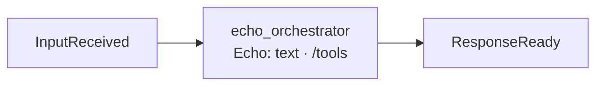

# echo_orchestrator: architecture

## Interface

| | |
|---|---|
| Menu | `echo.say(text)`: `ok("Echo: <text>")`, the smallest example of a menu ([Tools](tools.md)) |
| Handles · Calls | none |
| Publishes | [`ResponseReady`](../../../../../docs/api/messaging.md#responseready) |
| Listens to | [`InputReceived`](../../../../../docs/api/messaging.md#inputreceived) |

## Owns and launches

Nothing.

## Inner workings

## Planned

Nothing specific.
