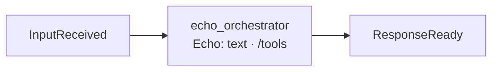

# echo_orchestrator: architecture

## Interface

| | |
|---|---|
| Menu | `echo.say(text)`: `ok("Echo: <text>")`, the smallest example of a menu ([Tools](tools.md)) |
| Handles | nothing |
| Calls | [`ListModules`](../../../../../docs/api/control.md#listmodules) and [`GetMenu`](../../../../../docs/api/control.md#getmenu) for `/tools`: every active module's menu and the core's (`core`), plus any module that provides `IToolProvider` itself (`get_all`). Menus aren't in the container since 2026-11-13, so the directory is the way to list them |
| Publishes | [`ResponseReady`](../../../../../docs/api/messaging.md#responseready) |
| Listens to | [`InputReceived`](../../../../../docs/api/messaging.md#inputreceived) |

## Owns and launches

Nothing.

## Inner workings

## Planned

Nothing specific.
