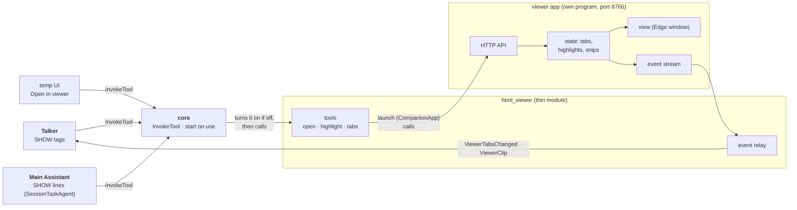

# html_viewer: architecture

## Interface

| | |
|---|---|
| Menu | `viewer.open` (open a file in a tab), `viewer.highlight` (open it and highlight a quoted part), `viewer.tabs` (open files and highlights): [tools offered today](../../../../../docs/api/tools.md#tools-offered-today). The core links it and routes [`InvokeTool`](../../../../../docs/api/tools.md#invoketool) to it, checking the arguments first |
| Handles | nothing |
| Calls | nothing |
| Publishes | [`ViewerTabsChanged`](../../../../../docs/api/messaging.md#viewertabschanged), [`ViewerClip`](../../../../../docs/api/messaging.md#viewerclip) (a snip, image copied into the launch's log folder) |
| Listens to | nothing |
| To the app | the viewer's local HTTP API (module → app) and its event stream (app → module) |

## Owns and launches

- **Launches the viewer app** on the first show request, through [`CompanionApp`](../../../../../docs/api/app_kit.md#companionapp) (`python -m html_viewer`, port 8766), and quits it when the module stops. A viewer you started yourself is left running. **On a reload** the running viewer is handed to the new copy (its window and tabs stay), unless the viewer's own code changed: then it's quit, even one you started, and the next page shown launches the new code.
- **The app owns** the tabs, highlights, snips, editing and saving, including writing text edits back to a generated page's Markdown source (`generated` folders).

## Inner workings

The app is built as state, commands and a view ([architecture](viewer-app.md#architecture-state-commands-view)); the module only translates between the core's messages and the app's API.

