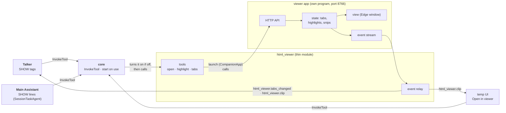

# html_viewer: architecture

## Interface

| | |
|---|---|
| Menu | `viewer.open` (open a file in a tab), `viewer.highlight` (open it and highlight a quoted part), `viewer.tabs` (open files and highlights): [tools offered today](../../../../../docs/api/tools.md#tools-offered-today). The core links it and routes [`InvokeTool`](../../../../../docs/api/tools.md#invoketool) to it, checking the arguments first |
| Handles | nothing |
| Calls | nothing |
| Publishes | its named events `html_viewer.tabs_changed` and `html_viewer.clip` (a snip, image copied into the launch's log folder): [events](#events) |
| Listens to | nothing |
| To the app | the viewer's local HTTP API (module → app) and its event stream (app → module) |

## Events

Both are [`ModuleEvent`](../../../../../docs/api/messaging.md#moduleevent)s, published with `ctx.publish_named` and declared in the manifest's `publishes_named`. A listener subscribes by name (`ctx.subscribe_named`) and reads the plain JSON `data`, so no type of the viewer's is in the core's contracts, and a listener needs no import of this module (moved out of the contracts 2026-11-13; they were `ViewerTabsChanged` and `ViewerClip`).

| Name | When | Data | Heard by |
|------|------|------|----------|
| `html_viewer.tabs_changed` | the open tabs or highlights changed: a tab opened, closed or was switched to, a highlight added, cleared or dropped | `tabs` (the open files' full paths, in tab order), `active` (the one showing, or null), `highlights` (`[path, quoted text]` pairs) | `talker`: keeps the latest and tells it, as `[Viewer] open: ...; highlighted: ...`, with your next message |
| `html_viewer.clip` | you snipped part of a page | `id`, `image_path` (the PNG, in the launch's log folder, `snips/`), `file` (the page), `heading` (the nearest heading above the box, or null) | `talker`: up to `MAX_SNIPS` (3) sent as images with your next message; `temp_ui`: thumbnails above the input until then |

A snip dropped before it's sent (the × on its thumbnail) is the temp UI's own event, `temp_ui.clip_dropped`, and an image pasted into the chat box is `temp_ui.clip`, with the same data as `html_viewer.clip` ([temp_ui](../../temp_ui/docs/architecture.md)).

## Owns and launches

- **Launches the viewer app** on the first show request, through [`CompanionApp`](../../../../../docs/api/app_kit.md#companionapp) (`python -m html_viewer`, port 8766), and quits it when the module stops. The app is `app/html_viewer/` in this module's folder: the core puts that `app/` folder on the import path ([`add_app_folders`](../../../../../docs/api/core.md#loader)), and the launch passes it on as the first `PYTHONPATH` entry ([`launch_env`](../../../../../docs/api/app_kit.md#companionapp)). A viewer you started yourself is left running. **On a reload** the running viewer is handed to the new copy (its window and tabs stay), unless the viewer's own code changed: then it's quit, even one you started, and the next page shown launches the new code.
- **The app owns** the tabs, highlights, snips, editing and saving, including writing text edits back to a generated page's Markdown source (`generated` folders).

## Inner workings

The app is built as state, commands and a view ([architecture](viewer-app.md#architecture-state-commands-view)); the module only translates between the core's messages and the app's API.
