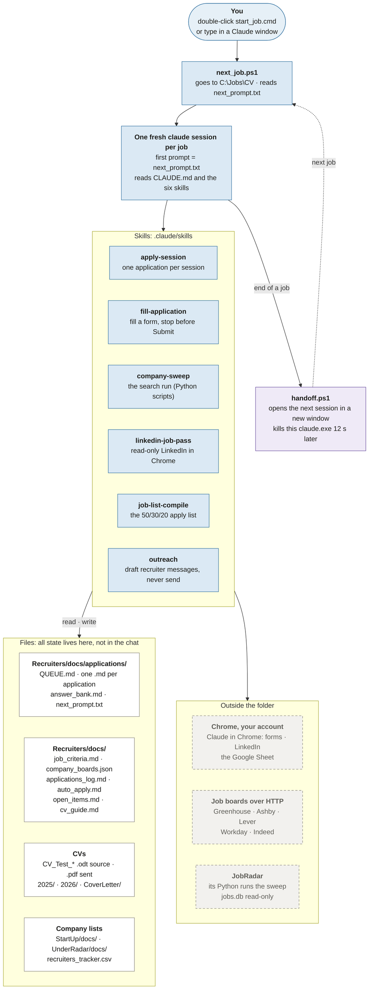

# Job project

The job project is a Claude Code project: a `CLAUDE.md`, six skills in its `.claude` folder, scripts, and files that hold all its state. It applies to jobs, one per Claude session, and runs job searches. This page describes how it's shaped (read 2026-11-04; the move below 2026-11-13).

## Where it lives (since 2026-11-13)

The job agent works in the module's own folder, `src/assistant/modules/job_search/workspace/` (gitignored, never committed; pytest skips it). It was **copied** there from `C:\Jobs\CV` (module folders item 18), and the old folder was left as it was:

| In the workspace | Left in your documents folder (`C:\Jobs\CV`) |
|---|---|
| `CLAUDE.md`, `.claude/skills/` (the six skills and their scripts), `Recruiters/scripts/` (the live scripts and their tests), `Recruiters/docs/` (all job state: the queue, applications, keywords, the company registry, the job UI's pages and state), `recruiters_tracker.csv`, `outreach_messages.md` | Your CVs (`.pdf`, `.odt`), `2025/`, `2026/`, `CoverLetter/`, `StartUp/`, `UnderRadar/`, `_upload/`, the old history (`Recruiters/docs/archive`, `backups`, `cv_drafts`), the one-off `tmp_*` scripts and `backups`, `handoff.ps1`, `next_job.ps1`, the launchers |

- **One paths file.** Every copied script reads the folders outside the workspace from `workspace/job_paths.json` through a small helper beside it, `job_paths.py` (`documents`: your CV folder; `jobs`; `jobradar` and `jobradar_python`: JobRadar and its Python; `cv_output`: the tailored CV PDFs the job UI shows, by default `../../cv/workspace/out`, the cv module's own output folder, where cv writes new CV PDFs when its `output_dir` is unset). A relative path is from the workspace. Any key may point anywhere, outside the repo too: put it in `job_paths.local.json` beside the file (gitignored), which overrides it. Paths inside the workspace (`Recruiters/docs`, the scripts) come from the helper's own place. Change a path there, never in a script.
- **Your documents** stay outside the repo (decision 5): job_search's `documents` key names the folder, read and write, set in the gitignored `config/local.toml`.
- **JobRadar's Python** still runs the scripts (decision 6); nothing new is installed.
- **The job UI:** `job.open_ui` runs the workspace's `Recruiters/scripts/job_ui.py` (`ui.py`'s default).
- **`cv.task`:** the job descriptions saved by `save_jd.py` now sit in the workspace, which cv doesn't read, so the apply-session skill sends `jd_text` rather than `jd_file`.
- **Memory:** the job agent's memory notes were copied to the workspace's own key (`~/.claude/projects/C--Projects-AI-Assistant-src-assistant-modules-job-search-workspace/memory`).

The sections below describe the project as it ran from `C:\Jobs\CV`, before the module ran it; inside the app, the job prompt replaces `handoff.ps1` with a final report (or a `HANDOFF:` line).

## The project in one picture

**Blue:** the session and its skills. **White:** files in the folder. **Dashed:** outside the folder. **Purple:** the hand-off to the next job.

## What starts a job

`start_job.cmd` runs `Recruiters\scripts\next_job.ps1`. That script goes to `C:\Jobs\CV`, reads `Recruiters\docs\applications\next_prompt.txt` (if it's missing, a fixed "Next job…" prompt) and starts an interactive `claude.exe` with that text as the first prompt. There is no loop: each job is one session, and the session itself starts the next one.

## One fresh session per job, and the handoff

At the end of a job, the `apply-session` skill rewrites the "Next session" note in `QUEUE.md` and `next_prompt.txt`, then runs `handoff.ps1`. That script opens a new window running `next_job.ps1`, so the next job starts in a fresh session, and kills the old `claude.exe` 12 seconds later. Nothing is carried over in the chat: the next session learns where things stand from the files.

## Inputs and outputs

| | What |
|---|---|
| **Inputs** | The first prompt (`next_prompt.txt`); the top row of `QUEUE.md` and its "Next session" note (38 jobs waiting on 2026-11-04, ExampleCorp next); the job's own `.md` if it's half done; the form defaults in `auto_apply.md`; `answer_bank.md`; the CV made for that company (`.odt` for the text, `.pdf` to upload); the posting in your logged-in Chrome; the cap of 3 applications per company, from the log and the Sheet |
| **Work** | `apply-session` with `fill-application`: Claude fills every field in Chrome. You tick consent boxes and CAPTCHAs and press Submit |
| **Outputs** | One application file (`<date>_<company>_<role>.md`), a row in the Google Sheet (the source of truth for applications), a line in `applications_log.md`, the Done table in `auto_apply.md`, an updated `QUEUE.md` and a new `next_prompt.txt` |

Claude fills the form; you submit. The project never submits or sends anything itself.

## The skills

The `.claude` folder holds only `skills/`: no settings, agents, commands or MCP config, and the folder isn't a git repo. Permissions come from your user-level Claude settings.

| Skill | What it does |
|---|---|
| `apply-session` | One application per session: picks the job, runs the form, logs it, writes the next prompt and runs `handoff.ps1` |
| `fill-application` | Fills one application form in Chrome and stops before Submit. Has a script for the CV's bullets (`odt_bullets.py`) |
| `company-sweep` | The search run over the job boards. Has the scripts `sweep.py`, `detect_ats.py` and `discover.py` |
| `linkedin-job-pass` | Goes through LinkedIn in Chrome, read-only |
| `job-list-compile` | Turns search results into the 50/30/20 apply list, which becomes new `QUEUE.md` rows |
| `outreach` | Drafts messages to recruiters; never sends them |

## The folders

| Folder | What it holds |
|---|---|
| Top level | `CLAUDE.md`, `start_job.cmd`, the base `CV_Test.pdf` and the CVs made for each company (`CV_Test_<Company>`, `.odt` and `.pdf`) |
| `Recruiters/` | Everything else: the queue and application files (`docs/applications/`), the criteria, logs and registry (`docs/`), the scripts (`scripts/`), `recruiters_tracker.csv` |
| `2025/`, `2026/` | Older CVs |
| `CoverLetter/` | Cover letters |
| `StartUp/` | Startup companies to search, with their funding rounds (`docs/`) |
| `UnderRadar/` | A map of established companies to search (`docs/`) |

The parent folder, `C:\Jobs`, holds the rest of the job material (cover letters, interviews, transcripts, info, pictures, prize proof); the job project reads it as needed.

## How a search runs

`CLAUDE.md`'s rule: Claude confirms with you before running any search.

1. **`company-sweep`:** syncs the registry (`company_boards.json`) from the StartUp and UnderRadar docs, then runs `sweep.py --days 14` with JobRadar's Python (10 to 15 minutes). It covers every tracked board, Indeed and keyword searches. Then it fixes boards that failed, runs web searches, checks the boards that only work in Chrome (Meta, Google, Apple…), and finds new companies with `detect_ats.py` and `discover.py`.
2. **`linkedin-job-pass`:** the recommended feed and keyword searches on LinkedIn, read-only, under 10 minutes, 8 to 20 seconds between pages.
3. **Screening and the list:** the results are checked against `job_criteria.md` (H-1B sponsorship, mid level, no contract roles, the caps), then `job-list-compile` builds the list, split 50/30/20 between startups, big tech and safer bets, as new `QUEUE.md` rows.
4. **Log:** the run is logged in `job_criteria.md` §6.

A search run is long, mostly HTTP and web searches, and needs Chrome only for some boards and LinkedIn. Applying is short per job but needs Chrome on your logged-in profile and your hand on Submit.

## JobRadar

JobRadar (`C:\Projects\Resume`) is a separate code project: a Streamlit app for finding jobs and scoring how well they fit, with its own `CLAUDE.md` and docs. The job project only borrows its Python environment (`.venv`, which has jobspy) to run the sweep scripts, and reads its `data\jobs.db` as leads. It never changes either. JobRadar is a data source, not part of the per-job flow.
