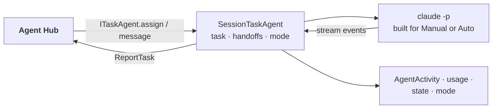

# main_assistant: architecture

## Interface

| | |
|---|---|
| Tools | none |
| Handles | nothing: it is called through `ITaskAgent` (`assign`, `message`, `cancel`, `answer_permission`, `set_permission_mode`, `note`) |
| Calls | [`ReportTask`](../../../../../docs/api/agents.md#reporttask) (`progress`, `milestone` from its `STATUS:` lines, `reply`, `need`, `permission`, `done`, `failed`); the [Hub's menu](../../../../../docs/api/agents.md#the-hubs-menu) through the door |
| Publishes | [`AgentActivity`](../../../../../docs/api/agents.md#agentactivity), [`AgentStateChanged`](../../../../../docs/api/agents.md#agentstatechanged), [`SessionUsage`](../../../../../docs/api/agents.md#sessionusage), [`PermissionModeChanged`](../../../../../docs/api/agents.md#permissionmodechanged) |
| Listens to | [`ResetRequested`](../../../../../docs/api/agents.md#resetrequested) |

## Owns and launches

- **A `claude -p` process** per task (`fresh_sessions`), through the shared [`SessionTaskAgent`](../../../../../docs/api/infra.md#sessiontaskagent) and [`ClaudeSession`](../../../../../docs/api/infra.md#claudesession). It starts with the module and stops with it.
- **Its transcript** in the launch's log folder.
- **Its setup** through the shared [`ProfileAgent`](../../../../../docs/api/infra.md#profileagent) (like every big agent) and its [`AgentProfile`](../../../../../docs/api/infra.md#agentprofile) (`coordinator=True`): folders (`write_folders`, for the Hub's folder check), rules, command line, and the prompt with the shared block on `STATUS:` and `NEED:`. Its id `main_assistant` is claimed from the Hub on start ([agent names](../../../../../docs/architecture/agents.md#agent-names)); as its module's own id, it's allowed.
- **Launching helpers** (built 2026-11-05): the coordinator's block tells it to use `agents.kinds` / `agents.launch` / `agents.close` on `task_agents`' menu, only when you asked for a helper, naming it from the task. `agents.launch` puts the question to you as the permission card on its task (`request_approval`); it ends its turn and gets the outcome as its next message ([launching a helper](../../../../../docs/architecture/agents.md#launching-a-helper)).
- **The module door** in each new session (built 2026-11-05): `IModuleDoor.mcp_config("main_assistant")`, read at each session start, becomes `--mcp-config`. Its tools `list_modules` and `show_menu` are allowed; `use_item` asks with the card in Manual. The prompt tells it to use them. `door = false` in its config turns it off. It doesn't list `IModuleDoor` as `optional` (the Hub lists `ITaskAgent`, and the two would be circular), so its first session may start before the door is up; the next task's fresh session has it.

## Inner workings

Each session's command line and prompt are built for the permission mode at that moment: Manual at every launch, Auto only from the UI button. A `HANDOFF:` line starts a fresh session from a note ([fresh sessions and handoffs](../../../../../docs/agents/runtime.md#fresh-sessions-and-handoffs)).

## Planned

From the module-shape refactor: it calls module tools through the **directory and menu** (its SHOW lines are sent as `InvokeTool` by its `SessionTaskAgent`), and module control becomes core tools it can use with your approval.
