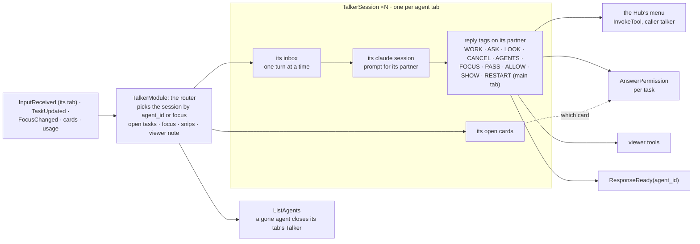

# talker: architecture

## Interface

| | |
|---|---|
| Tools | its own menu ([Tools](tools.md)): `talker.reset(session)` starts a Talker session fresh (`talker`, or `talker:<agent>`); only for a `you` caller ([`IAgentNames.is_you`](../../../../../docs/api/agents.md#iagentnames), today temp_ui's Reset button), refused for anyone else |
| Handles | nothing |
| Uses | [`IPageOpener`](../../../../../docs/api/modules.md#ipageopener) (its SHOW tags, looked up at each tag: whichever add-on opens pages; none on: it says `No page viewer is on`); [`IAgentNames`](../../../../../docs/api/agents.md#iagentnames) (the core's Callers: who is you, for `talker.reset`); optional [`IModuleDoor`](../../../../../docs/api/tools.md#imoduledoor) (the core's door) |
| Calls | [`InvokeTool`](../../../../../docs/api/tools.md#invoketool): the [Hub's menu](../../../../../docs/api/agents.md#the-hubs-menu) (`hub.start`, `hub.send`, `hub.status`, `hub.cancel`, `hub.agents`, `hub.focus`, `hub.answer` (a task's permission card), `hub.mode` (Manual only); the core fills in the caller `talker`); [`StartProvider`](../../../../../docs/api/control.md#startprovider) (a SHOW tag with no page opener on, through [`show_page`](../../../../../docs/api/infra.md#show_page)); [`AnswerPermissionRequest`](../../../../../docs/api/messaging.md#answerpermissionrequest) (an access card, whole), [`ListAgents`](../../../../../docs/api/agents.md#listagents) (which tabs still have their agent); [`ResetRequested`](../../../../../docs/api/agents.md#resetrequested) (a RESET of its partner, a command the Hub handles); [`ShutdownRequested`](../../../../../docs/api/messaging.md#shutdownrequested) (`restart=True`, a command the core handles, after your Allow on the restart's confirm card); `ctx.permissions.confirm` (the restart's card) |
| Publishes | [`ResponseReady`](../../../../../docs/api/messaging.md#responseready) (with its tab, `agent_id`), [`SessionUsage`](../../../../../docs/api/agents.md#sessionusage), [`SessionTheme`](../../../../../docs/api/messaging.md#sessiontheme) |
| Listens to | [`InputReceived`](../../../../../docs/api/messaging.md#inputreceived), [`TaskUpdated`](../../../../../docs/api/agents.md#taskupdated), [`SessionUsage`](../../../../../docs/api/agents.md#sessionusage), [`PermissionModeChanged`](../../../../../docs/api/agents.md#permissionmodechanged), [`FocusChanged`](../../../../../docs/api/agents.md#focuschanged), [`FocusSuggested`](../../../../../docs/api/agents.md#focussuggested), [`PermissionRequested`](../../../../../docs/api/messaging.md#permissionrequested), [`PermissionChanged`](../../../../../docs/api/messaging.md#permissionchanged), [`AgentStateChanged`](../../../../../docs/api/agents.md#agentstatechanged), [`ModuleStateChanged`](../../../../../docs/api/control.md#modulestatechanged); by name ([`ModuleEvent`](../../../../../docs/api/messaging.md#moduleevent), no import of their modules): `html_viewer.tabs_changed`, `html_viewer.clip` ([html_viewer's events](../../html_viewer/docs/architecture.md#events)), `temp_ui.clip` (a pasted image), `temp_ui.clip_dropped` |

## Owns and launches

- **One `claude -p` process per open tab** ([`ClaudeSession`](../../../../../docs/api/infra.md#claudesession)), each started fresh by the Talker's own `reset_session` (`talker` for the main tab, `talker:<agent>` for a helper's): from a `<<RESET: talker>>` tag in that tab, or `talker.reset` from you (the temp UI's Reset button). A `ResetRequested` is for task agents only; the Hub handles it. The main tab's starts with the module and is kept warm; a helper's starts on its first turn (its tab opened with something to say, a message for it) and closes when its agent leaves `ListAgents` (the tab's ×, `agents.close`, its module turned off). No idle timeout.
- **A transcript per tab** in the launch's log folder (`talker.jsonl`, `talker-<agent>.jsonl`), and the **restart note** kept across a `<<RESTART>>`.
- **The module door** (built 2026-11-05; the core's since 2026-11-13): each session's command line is read at its start, with `IModuleDoor.mcp_config()` from the core as `--mcp-config` and all three door tools (`list_modules`, `show_menu`, `use_item`) allowed, since it has no permission cards. Its `use_item` goes door → `InvokeTool` → the core's one gate, like any caller's: items marked to ask (`modules.add / remove / reload`, `modules.off` with dependents, any `risky` item) open a confirm card for it. The Talker is never in Auto. Its prompt says to use them for quick things and to hand real work to its agent. SHOW tags stay a shorthand for opening a page, through the page-opener slot (`IPageOpener`), never a viewer's tools. `door = false` in its config turns it off.

## Inner workings

`TalkerModule` (`module.py`) is the router and keeps what the tabs share; each tab's conversation is a `TalkerSession` (`session.py`) with its prompt from `talker_prompt` (`prompt.py`). Everything that should make a tab's Talker speak goes into that session's inbox, so it never talks over itself and event handlers return at once.

- **One with its worker:** every tab's prompt has the shared `ONE_PAIR` block right after its head. Everything you say, "you" or a request like "look over the files", is aimed at the Talker and its worker together; only naming one side ("the talker", "the worker", "the agent", its name) targets that side. The Talker never answers "I can't, but the agent can": it hands the work over with WORK, LOOK or ASK (2026-11-10).

- **Routing:** your input goes to the session of `InputReceived.agent_id` (the temp UI's chat box sets it), else the focused tab's (voice, terminal 1). A `TaskUpdated` goes to its agent's session, and its updates there carry no name (`[Task update: reply]`). Access cards, suggestions and snips go to the focused tab. Every reply carries its tab (`ResponseReady.agent_id`).
- **One road to the Hub:** its tags are a shorthand (like SHOW for opening a page); every Hub tag runs through the Hub's menu with `InvokeTool`, with no MCP round-trip. They act on the session's partner: WORK starts a task on it (the main tab's partner is the coordinator); ASK / PAUSE send to its task; LOOK and CANCEL take an agent (its partner by default); AGENTS lists names and marks; FOCUS: agent moves the focus; PASS sends your own words to its partner word for word (`hub.send(agent_id=partner)`); MODE sets its partner's mode.
- **Only the main tab:** `<<RESTART>>`, the session theme, the reset of the worker by name. A RESTART in a helper's tab is refused with "ask in the Main Assistant's tab". A RESTART never runs at once: it opens a `confirm` card (`ctx.permissions.confirm("restart the app", …)`, "talker asks to restart the app"), in Auto too, and the restart runs only after your Allow (Deny runs nothing). After the Allow, the restart (`RestartFlow`, `restart.py`) never refuses because questions are open (since 2026-11-10 there's no `RESTART: anyway`): it asks the worker for reset instructions in the task it holds, or in a small task of its own when its task only holds a question for you (the question stays open). The app's state section of the note lists each open task with its question, `(behind its tab's !)` when held, and `(context: <key>)` when it has a context key.
- **Open cards per tab:** ALLOW / DENY [agent] picks a card from the session's own cards, so a bare yes answers that tab's card; with more than one open there, it's refused with a question asking which.
- **Access cards:** a `PermissionRequested` from the core's permissions handler becomes an `[Access card]` in the focused tab's inbox, in words from `access_card_text(event)`: who asks and why, the items, the warnings, and "not reviewed" when the review didn't run. It's kept among that tab's open cards (key `access:<request_id>`), so `<<ALLOW>>` / `<<DENY>>` answer it whole with `AnswerPermissionRequest`; to untick single items you use the card in the app. A message card (one agent wants to message another) is said as such; `<<ALLOW>>` allows it once (`remember=False`), and Always allow is only the app's button. The matching `PermissionChanged` closes it.
- **Snips:** each snip (`html_viewer.clip`, or `temp_ui.clip` for an image pasted into the temp UI's chat box, `file="(pasted)"`) waits in the router's list (up to 3, oldest dropped beyond) until your next message in any tab, which takes them as images with a `[Viewer] snip` note each (`[Pasted] image` for a pasted one); `temp_ui.clip_dropped` (the × in the temp UI) removes one. A snip sent alone comes as the text `(snip)`. Each step is logged at info level: received, dropped (by × or the limit), and per message how many were attached (0 included). The viewer note and mode notes are told once per tab with your next message there.
- **Who speaks:** the Hub holds an out-of-focus agent's questions, replies and ends behind its tab's **!**; milestones are never said. Opening a tab releases them (`FocusChanged.released`) into that tab's session as `[Focus] the user opened this tab.` plus the lines; nothing is said when nothing was released. A `FocusSuggested` becomes a yes / no question to you in the tab you're in.
- **Usage and context:** each session publishes its own `SessionUsage` (`talker`, or `talker:<agent>` with `parent=<agent>`, so the usage dropdown nests it under its agent). The `[Usage]` line before your message shows that tab's worker and that tab's Talker. Each session is warned once when its own context or its partner's passes `context_warning`.
- **Reload:** `export_state` hands every tab's history, the focus and the open tasks to the new copy, which reopens the tabs; a closed tab's history is kept and comes back if its agent does.

## Planned

From the module-shape refactor: it finds modules through the **directory and menu** (the core's door, built) beside its tag shorthands, and can ask the core to turn modules on and off.
