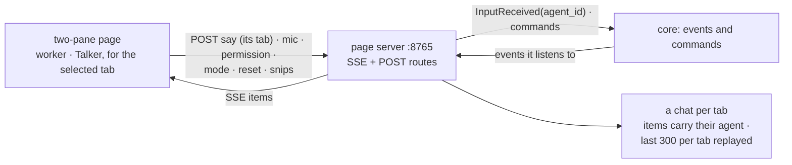

# temp_ui: architecture

## Interface

| | |
|---|---|
| Tools | none |
| Handles | nothing |
| Uses | [`IPageOpener`](../../../../../docs/api/modules.md#ipageopener) (the Open in viewer button, looked up at each click: whichever add-on opens pages; none on: `No page viewer is on`) |
| Calls | [`ListModules`](../../../../../docs/api/control.md#listmodules), [`ListAgents`](../../../../../docs/api/agents.md#listagents), [`SetFocus`](../../../../../docs/api/agents.md#setfocus), [`StartListening`](../../../../../docs/api/messaging.md#startlistening), [`StopListening`](../../../../../docs/api/messaging.md#stoplistening), [`AnswerPermission`](../../../../../docs/api/agents.md#answerpermission), [`AnswerPermissionRequest`](../../../../../docs/api/messaging.md#answerpermissionrequest), [`SetPermissionMode`](../../../../../docs/api/agents.md#setpermissionmode), [`GetTaskStatus`](../../../../../docs/api/agents.md#gettaskstatus), [`CancelTask`](../../../../../docs/api/agents.md#canceltask), [`StartProvider`](../../../../../docs/api/control.md#startprovider) (through [`open_page`](../../../../../docs/api/infra.md#show_page)), [`InvokeTool`](../../../../../docs/api/tools.md#invoketool) `permissions.grants`, `permissions.revoke`, `agents.kinds`, `agents.launch`, `agents.close`, `modules.on`, `modules.off` (as `temp_ui`, which is you) |
| Publishes | [`InputReceived`](../../../../../docs/api/messaging.md#inputreceived), [`ResetRequested`](../../../../../docs/api/agents.md#resetrequested); its own named events ([`ModuleEvent`](../../../../../docs/api/messaging.md#moduleevent)): `temp_ui.clip` (a pasted image: `id`, `image_path`, `file="(pasted)"`, `heading` null, the same data as `html_viewer.clip`) and `temp_ui.clip_dropped` (`id`: the × on a thumbnail) |
| Listens to | [`InputReceived`](../../../../../docs/api/messaging.md#inputreceived), [`ResponseReady`](../../../../../docs/api/messaging.md#responseready), [`TaskUpdated`](../../../../../docs/api/agents.md#taskupdated), [`AgentActivity`](../../../../../docs/api/agents.md#agentactivity), [`AgentStateChanged`](../../../../../docs/api/agents.md#agentstatechanged), [`PermissionModeChanged`](../../../../../docs/api/agents.md#permissionmodechanged), [`SessionUsage`](../../../../../docs/api/agents.md#sessionusage), by name `html_viewer.clip` ([html_viewer's events](../../html_viewer/docs/architecture.md#events), no import of it) and its own `temp_ui.clip`, [`VoiceState`](../../../../../docs/api/messaging.md#voicestate), [`VoiceTranscript`](../../../../../docs/api/messaging.md#voicetranscript), [`ModuleStateChanged`](../../../../../docs/api/control.md#modulestatechanged), [`FocusChanged`](../../../../../docs/api/agents.md#focuschanged), [`PermissionRequested`](../../../../../docs/api/messaging.md#permissionrequested), [`PermissionChanged`](../../../../../docs/api/messaging.md#permissionchanged) |

## Owns and launches

- **A page server** on `127.0.0.1:8765` (standard library): `GET /events` (Server-Sent Events), `GET /grants.js`, `GET /agent-tabs.js`, and `POST` `/say`, `/permission`, `/access-answer`, `/grants`, `/agent-tabs`, `/permission-mode`, `/reset`, `/focus`, `/mic`, `/paste-image`, `/drop-snip`, `/open-in-viewer`, `/open-logs`.
- **An Edge app window** for the page (`window = "app"`). **Its taskbar button flashes** (built 2026-11-10, `flash_window` from [`app_kit.window`](../../../../../docs/api/app_kit.md#window)) when something needs you while the window isn't in front: any agent's task is done or failed (helpers included, and a task the Hub failed), an agent asks you something (`TaskUpdated` kind `need` or `permission`, held behind a **!** too), or a permissions card arrives (`PermissionRequested`). It keeps flashing until you bring the window forward. Progress, milestones, replies and a cancelled task don't flash. The flash runs in a background thread, so the panes' items keep their order; `_flash` is swappable for tests.
- **The Reset buttons** reset the pair of the tab you're in: `POST /reset` `{"agent": "worker" | "talker", "tab"}` publishes `ResetRequested` for that tab's worker (its agent id) or its Talker (`talker`, or `talker:<agent>` in a helper's tab), through `reset_target`.

## Inner workings

**A chat per tab** (agent talkers, built 2026-11-05): every chat item carries its agent (`ResponseReady.agent_id`, the cards' agent, else the focus), and the Talker pane shows only the selected tab's chat, as the worker pane does, under a "Talker · <agent>" header in the tab's colour. The chat box sends with the tab you're in (`/say` takes `{"text", "agent"}` → `InputReceived.agent_id`). Each tab keeps its last 300 chat items (`CHAT_HISTORY`), replayed on connect after the worker lines; nothing is saved across a relaunch. Voice and terminal 1 go to the focused tab.

**Big agents:** every worker-pane item carries its `agent`. An `agents` item (the focus, the coordinator, and per agent its `state`, `active` or `idle`, and its held count) is rebuilt from `ListAgents` at start, at each page connect, and on module, agent, task and focus changes. The header's state pill says "working" while the tab's agent is active and "idle" otherwise (from `AgentStateChanged.state`); an agent that asked you something and ended its turn is idle. With two or more big agents the page shows one tab each above the worker feed: a state dot, a **!** while a question is held, the focused tab filled, the Main Assistant's in the accent colour. A click posts `/focus` (`SetFocus`) and shows only that agent's lines. Each tab remembers, per pane, whether you were at the bottom and where you were (built 2026-11-06): back in a tab you're at the bottom, unless you'd scrolled up there, then the block (message or activity row) nearest the middle of the view is put back in the same place, even if lines came in or the pane's height changed. The bottom is set again after the lines are laid out and when late images load; a closed tab's place is forgotten. A held permission card isn't pushed until `FocusChanged.released` brings it; cards say "{agent} asks permission". **The header's usage follows the selected tab:** each agent's own `SessionUsage` is kept by its id (sub-agents and tools left out), and the header shows the tab's worker (`<id>`) and Talker (`talker` for the Main Assistant's tab, `talker:<id>` for a helper's) with their context, plus **Used**: the tokens that pair has used since launch, with their sub-agents, from the `usage` module's rows. It redraws on a tab change, on new usage and on each new tally.

**The tabs' + and ×** (built 2026-11-05; the page part in `static/agent_tabs.js`, the server part in `agent_tabs.py`, both through `POST /agent-tabs`):
- **+**, always shown after the tabs, opens a small panel: kind (from `agents.kinds`, with its description), name (filled with the kind's free name), optional first task, Open / Cancel. Open calls `agents.launch` as you: no launch card, and the kind's access card shows in the Talker pane unless its grant is saved. A refused name shows the reason and fills in the free name the refusal suggests. When the new agent appears in `ListAgents`, the page's worker pane says "… opened" and `SetFocus` moves you to it. With `task_agents` off, the panel says so and offers to turn it on (`modules.on`).
- **×**, on every tab but the Main Assistant's, asks first: "Close this agent?", naming it and saying any running task will be cancelled, with Close / Cancel. Close cancels its open task (`GetTaskStatus`, `CancelTask`), then closes it by its owner (from `IAgentNames.taken()`): a launched helper with `agents.close` (after it goes idle), a module's agent by `modules.off` of its module (the job agent: `job_search`), and an autostarted helper not at all (it says to turn `task_agents` off). Closing the focused agent focuses the Main Assistant.

**Access cards:** a `PermissionRequested` becomes an `access` item in the Talker pane: who asks, the items with a tick box each (not the working folder), the warnings, "not reviewed" when the review didn't run, and the fixed rules. Allow sends the ticked items (`POST /access-answer` → `AnswerPermissionRequest` with `keep`); Deny sends `allow=false`. The `PermissionChanged` with that `request_id` closes the card. A **message card** (`action` `message`, built 2026-11-10) heads "X wants to message Y" and has three buttons: **Allow once** (`remember=false`), **Always allow** (`remember=true`) and **Deny**, all through `/access-answer`.

**Grants screen (rough, throwaway):** all of it in `static/grants.js`, with its own header button and panel and one marked `<script>` tag in the page. It lists the saved grants and takes back a whole grant or single items through `POST /grants` (`list` → `permissions.grants`, `revoke` → `permissions.revoke`). It holds no logic and goes away with the temp UI.

**Snips:** a snip (`html_viewer.clip`, or this module's own `temp_ui.clip`) shows as a thumbnail above the input (up to 3; × posts `/drop-snip` → `temp_ui.clip_dropped`). Send works with nothing typed while a snip is waiting: `/say` publishes the text `(snip)`. When a message goes out, typed or spoken, the waiting snips move into its "you" bubble at the same thumbnail size, as confirmation; the last 30 sent stay served by `GET /snip/<id>`. The Talker attaches the images from its own list. Each step (shown, dropped by × or the limit, moved into a sent message) is logged at info level.

**The typing box's height** (built 2026-11-08): a drag handle on the input area's top edge (`#grip`) sets the box's height, from 40 px up to 60 % of the window while the chat keeps at least 120 px. One size for every tab, kept in the page's `localStorage` across sends and refreshes; double-click the handle for one line again.

**Pasted images:** Ctrl+V of an image in the chat box (a clipboard holding only an image; text pastes stay text) makes it a snip. The page converts it to PNG and posts it to `/paste-image`; the server refuses anything over 10 MB or not a PNG (logged, and the box's placeholder says why for a few seconds), saves it as `<launch log folder>/snips/paste-<id>.png` (`ctx.logs.folder()`), and publishes `temp_ui.clip` with `file="(pasted)"`. From there it is the snip path above. It goes to the Talker of the tab your next message is in, not to its agent.

The mic follows only sessions the page started (by the `StartListening` id), like [voice_notes](../../voice_notes/docs/README.md). A stop names the tab it was pressed in (`POST /mic {"on": false, "agent"}` → `StopListening(agent_id)`), so the final text goes to that tab. The Manual | Auto toggle sets and shows the agent of the tab you're in (`POST /permission-mode {mode, agent}`; one mode state item per agent). Both built 2026-11-06.

## Planned

Replaced by the UI handler and the chat window ([decisions](../../../../../docs/architecture/decisions.md#open-decisions)); not designed yet.
