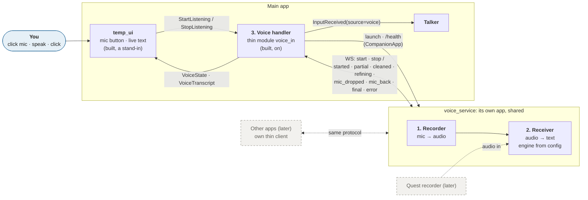
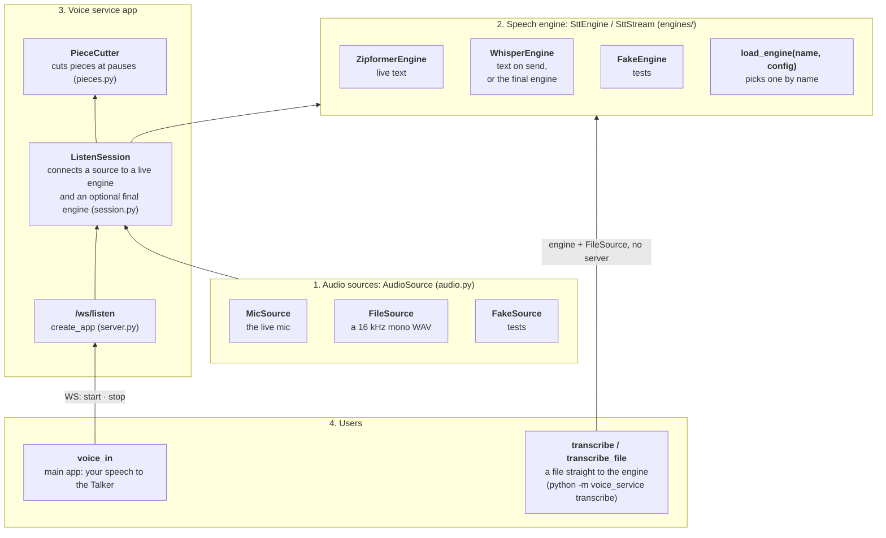
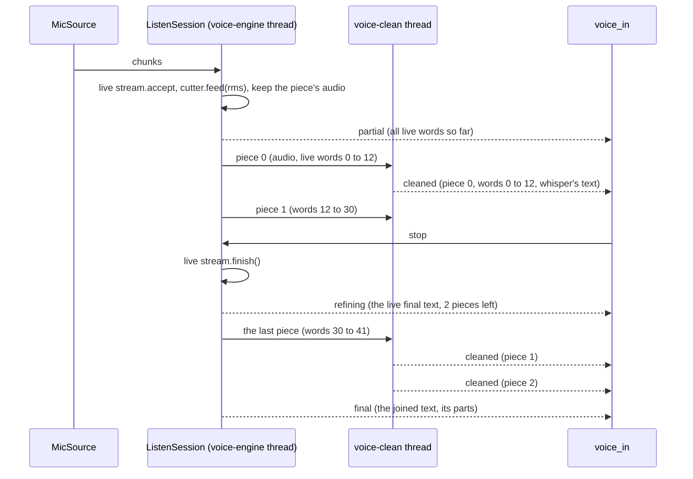
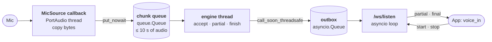
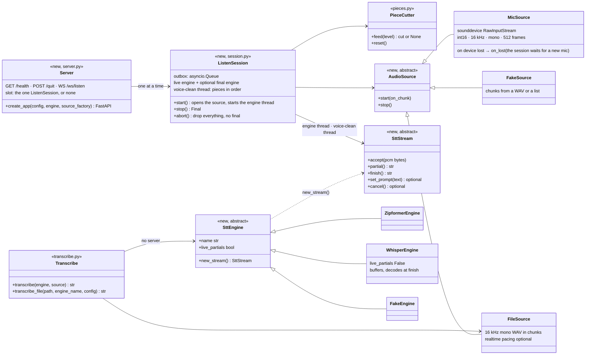

# Voice

Speech to text, so you can talk to the assistant instead of typing. It's **Voice in** in the [overview](../../../../../docs/architecture/README.md). Voice out (the Talker speaking back) is a separate, later part.

> **Status: being built (designed 2026-10-28; code design added and approved 2026-11-02).** Phase 1 below is built in steps, listed in the next-steps list. The code-level design is under [Code design (phase 1)](#code-design-phase-1).
>
> **Built: step 1, the contracts** (2026-11-03): `StartListening`, `StopListening`, `ListeningState`, `VoiceState`, `VoiceTranscript` in `contracts/voice.py`, and the protocol's messages in `voice_service/protocol.py`, which `voice_in` will import ([API](../../../../../docs/api/messaging.md#voice)). `voice_in` is next.
>
> **Built: step 2, the voice service** (2026-11-03): `src/voice_service/` as designed below, run alone with `python -m voice_service` (or `voice-service`); `python -m voice_service download zipformer` fetched the model (310 MB) into `%LOCALAPPDATA%\AI_Assistant\voice_models`, outside the repo. Tested with the fake engine and fake sources ([API](../../../../../docs/api/messaging.md#the-voice-services-parts)). On the model's own test recordings, fed at the speed of speech through the whole service, int8 matched both reference texts word for word, with the final 46 to 78 ms after `stop`. The first partial came about 1.1 s after `start`; that includes the recording's lead-in, so the real check is your own mic (step 6). The full-precision files gave the same text (only *dishonored* for *dishonoured*) and were slower (62 to 93 ms), so int8 stays the default.
>
> **Built: step 3, the `voice_in` module** (2026-11-03): `src/assistant/modules/voice_in/`, off by default, as designed in [the voice_in module](#the-voice_in-module), plus two additions you asked for. **A dropped mic is waited for:** the service keeps the session and tries to reopen the mic for `mic_recovery_seconds` (15 s), sending `mic_dropped` and then `mic_back`. If the mic doesn't come back, the session ends and its text is dropped. **A quick `/health` check** runs before reusing a service that's already running. Tested against the real service app with its fake engine and fake mic on a local port. Your own mic is step 6.
>
> **Built: step 4, the temp UI's mic button** (2026-11-03): the button sends `StartListening` / `StopListening` and shows `VoiceState`; a grey line shows the live text, the dropped mic's countdown and word count, or the failure's reason; spoken messages show in the chat as yours. `voice_in` is now in `[modules] enabled`. Details: [runtime: temp UI](../../../../../docs/agents/runtime.md#temp-ui). **Clear button** (2026-11-03): a ✕ next to the mic throws away what was heard (`StopListening(discard=True)`) and keeps listening in a new session; the voice service is unchanged.
>
> **Built: step 6, the real mic on this laptop** (2026-11-03). **`python -m voice_service check`** tells whether this machine is ready. It checks the voice extra, Windows' mic privacy switches (read only), the input devices, the model's load time, and a few seconds of the real mic through `MicSource`, and it transcribes anything said during the check. Two fixes came out of it:
> - **An unreported unplug counts as a drop.** No chunks at all for `[audio] stall_seconds` (2 s) starts the same recovery as a reported unplug. Silence and a muted mic still send chunks, so they don't trip it.
> - **The device list is reloaded after a drop.** PortAudio reads it only once, so a replugged or other mic couldn't open. `MicSource` now reloads it on the next open after a lost or stalled mic.
>
> Measured on this laptop, without speech: privacy allows desktop apps, and the default mic is the Realtek array (MME). The model loads in 1.9 s. The mic opens in 12 ms and the first audio arrives at 50 ms. `started` comes 283 ms after `start`, the final 78 ms after `stop`, and decoding runs at 0.03× real time. A live mic ran 5 s without a false drop. The room read almost silent on every device and audio API (rms 0 to 1), so the next check is you speaking. Delays with real speech, and a real unplug, are yours to try.
>
> **Built: the layers and whisper** (2026-11-03): a `FileSource`, `transcribe` / `transcribe_file` (an engine with no server), the `live_partials` flag, `WhisperEngine` on faster-whisper, the protocol's `partials` fields, the level-based silence stop, and the swap by config ([Layers](#layers), [Hot-swappable engines](#hot-swappable-engines)). `voice_in` gained `live_text` and `final_timeout_on_send`; its cleanup keeps text that comes cased. The wait after you stop, measured with `transcribe` on CPU int8:
>
> | Engine | 6.6 s of speech | 16.7 s | 46.7 s | Load |
> |---|---|---|---|---|
> | zipformer (live text; only `finish` is left at the stop) | 0.03 s | 0.03 s | 0.03 s | 2.1 s |
> | whisper `base.en` | 0.42 s | 0.56 s | 1.83 s | 0.5 s |
> | **whisper `small.en`** (default) | **1.19 s** | **1.62 s** | **5.17 s** | 1.0 s |
> | whisper `distil-large-v3.5` | 3.72 s | 3.85 s | 8.28 s | 2.8 s |
>
> Whisper's text was correct, cased and punctuated; the Zipformer's correct, in capitals. The swap was tried by hand on the real service: an `[audio]` change left it running; changing `[engine] name` logged "engine changed: fake → zipformer; restarting" and exited in 1.2 s, and the relaunch came up with the new engine. Your check after an app restart: set `[engine] name = "whisper"` in `voice_service.local.toml` (beside the service's `voice_service.toml`), talk, stop, and see the text arrive on send.
>
> **Built: two passes, chunked whisper** (2026-11-03): the Zipformer fills the live line while you talk; at each pause the audio so far becomes a piece that whisper cleans in the background, and its text replaces the rough words. On stop only the last piece is left, and whisper's joined text is sent. It's now the default (`[engine] final = "whisper"`). Design: [Two passes](#two-passes-live-text-cleaned-piece-by-piece). Measured with both real models over the test recordings fed at speech speed: on 49.8 s of speech in 4 pieces, CPU averaged 3.5 of 24 cores (2.8 with the Zipformer alone), peaking near 11; live words came at most 47 ms later than without whisper; never more than one piece waited; the wait after stop was **1.7 s** on `small.en` (0.7 s on `base.en`). Pass.

## Rules

- **English only.** Local, with no cloud APIs and no internet needed.
- **Real time:** you see partial text while you speak. Targets: first partial under 500 ms; final under 500 ms after you stop. Neither engine has run on this PC yet, so the targets are checked in the first build, not assumed. **Refined 2026-11-03:** live text only with an engine that gives partials; with one that doesn't (whisper), or with the force-on-send setting, the text appears on send ([decided](#hot-swappable-engines)).
- **A button first:** click to turn the mic on, click again to turn it off. Hands-free comes later.
- **One message to the Talker when the mic turns off.** Everything said while the mic was on goes out as one message, so the Talker never answers half a thought and each message is one paid turn.
- **Swappable engine:** the engine is a config value. Nothing outside the engine knows which model runs.

## The voice handler: three parts

Voice input is one **voice handler**, like the [log handler](../../../../../docs/architecture/core.md#logging) and the [permissions handler](../../../../../docs/architecture/permissions.md). Its three parts talk only through messages, so each can be swapped on its own.



**Built (2026-11-03):** the service (recorder and receiver), `voice_in` (on), and the temp UI's mic button and live line (a stand-in until the [UI handler](../../../../../docs/architecture/decisions.md#open-decisions)). **Dashed:** later.

| Part | Where it runs | Owns | Receives | Sends |
|------|---------------|------|----------|-------|
| **1. Recorder** | `voice_service`, its own app | The microphone | `start` / `stop` from a client | Audio to the receiver: PCM16, 16 kHz mono, chunks of about 32 ms (about 32 KB/s) |
| **2. Receiver** | `voice_service` | The speech engine (sherpa-onnx or faster-whisper, chosen in config) | Audio from the recorder, or later from a remote recorder | Partial text while you speak; final text when the mic stops |
| **3. Voice handler** | Main app: the thin module `voice_in` | Launching the service, the mic permission, what reaches this app | `StartListening` / `StopListening`; text from the service | Live text to the UI; the final message as [`InputReceived`](../../../../../docs/api/messaging.md#inputreceived)`(source="voice")` to the Talker |

**Why this split:**
- **The service never knows the assistant.** It runs alone (`python -m voice_service`) and doesn't import the assistant, like the [HTML viewer](../../html_viewer/docs/viewer-app.md). This follows the decided rule that a part useful on its own becomes its own app, launched by a thin module ([decisions](../../../../../docs/architecture/decisions.md#decided)).
- **Clients never know the engine.** The protocol names no models, so the engine can be swapped, given a second pass, or moved off the PC without changing any client.
- **The rest of this app sees only messages.** The Talker gets `InputReceived`, the same event typed text uses. The Talker, the Agent Hub, and the logs don't change.

## Layers

> **Built 2026-11-03**: all four layers, with the file source, whisper, the file utility (`transcribe`), and the engine swap.

`voice_service` stays one package, arranged in four layers. Each layer uses only the one below it, so the engine works without a mic or a server.



| Layer | What it is | Built |
|-------|------------|-------|
| **1. Audio sources** | Anything that gives PCM16, 16 kHz mono chunks, behind `AudioSource` | `MicSource`, `FakeSource`, `FileSource` (a 16 kHz mono WAV; other formats refused; `FakeSource.from_wav` reads through it) |
| **2. Speech engine** | The model, behind `SttEngine` / `SttStream`, picked by name in config through `load_engine`. Usable by itself, with no mic and no server. `live_partials` says whether it gives text while you speak | `ZipformerEngine` (live), `WhisperEngine` (on send), `FakeEngine` |
| **3. Voice service app** | `/ws/listen` from `create_app`; `ListenSession` connects one source to the live engine and, with [two passes](#two-passes-live-text-cleaned-piece-by-piece), a final engine fed pieces cut by `PieceCutter`; the config watch restarts the service on an engine change | Built |
| **4. Users** | Whoever wants text | `voice_in` (your speech to the Talker); `transcribe` / `transcribe_file` in `transcribe.py`, which import neither the server nor sounddevice, and the `transcribe` command. The engine comparison (step 7) reuses them |

**The rule:**
- **The engine never depends on the mic or the server.** It takes PCM bytes and gives text; where the bytes come from is the source's job.
- **`voice_in` and the Talker know nothing about which engine is used.** They see only the protocol and `InputReceived`. This is the page's [swappable engine](#rules) rule, kept per layer.

### Hot-swappable engines

> **Built 2026-11-03**. The service checks its config file and its `.local` override every 2 s. When the `[engine]` section differs from the running one, it waits until nothing is listening, logs "engine changed: A → B; restarting", and quits through the `/quit` path. The next mic click relaunches it through `CompanionApp`. Other config changes don't restart it; a file that can't be read is logged and looked at again on the next save.

- **The engine is chosen by name in config** (`[engine] name`, through `load_engine`) and can change **between listening sessions** without restarting the app. A session in progress keeps its engine to the end.
- **`voice_in` and the Talker don't notice.** The protocol names no models, so nothing above layer 3 changes.

**Decided (2026-11-03, by you):**
1. **A swap restarts the voice service**, and only while nothing is listening. `voice_in` already recovers when the service goes away: the next click relaunches it through `CompanionApp`. Restarting is simpler and cleaner than loading a big model inside a running service. A clean in-place reload may replace it later without changing anything else, since nothing above layer 3 sees the difference.
2. **Switching models on the fly uses the same mechanism.** Change the engine name in config (a picker later), and the service restarts with the new model. Trying whisper and then going back to another engine is one config change each way.
3. **While the new model loads,** the existing rule applies: the model loads in the background at service start, and a `start` during the load opens the mic and buffers the audio, so nothing said is lost ([threads](#the-voice-service-threads-and-audio-flow)).
4. **Whisper is used for now, for the live mic too, with the text on send.** Whisper gives no live partial text, so with it the text appears when you stop the mic, not while you talk. This refines the earlier "no Whisper" decision ([engines](#engines)): that decision was about live partial text, and the capability flag below now covers it. **Revised 2026-11-03 ([two passes](#two-passes-live-text-cleaned-piece-by-piece)):** the live engine listens, and the final engine (`[engine] final`, whisper by default) cleans each piece and writes the text you send. One engine is still one line away (`final = ""`), and `final` is part of the swap: changing it restarts an idle service, as `name` does.
5. **Each engine declares whether it gives live partial text** (a capability flag on the engine). If it does, the live line updates as you talk. If not (whisper), the text appears on send. **A setting forces on-send** even for a live engine. Clients still don't know which engine runs: they see partials or they don't.

6. **The config file is the only swap trigger for now.** A picker, a command from the main app, or a service endpoint is a possible later option; nothing is built for it.
7. **Whisper runs on faster-whisper**, `small.en` on the CPU (int8) now and the GPU later. It's the exception to "every engine through sherpa-onnx" ([engines](#engines)).
8. **The force-on-send setting lives in `voice_in`** (`live_text`), sent with each session. **The file source reads 16 kHz mono WAV only** for now. ~~No background decoding while you talk~~ (revised 2026-11-03: whisper now cleans pieces while you talk, [below](#two-passes-live-text-cleaned-piece-by-piece)).

### Two passes: live text cleaned piece by piece

> **Built 2026-11-03** (all its recommendations approved). The default.

| `[engine] name` | `final` | What you get |
|---|---|---|
| `zipformer` | `whisper` | **Two passes** (default): live line, cleaned piece by piece; whisper's text is sent |
| `zipformer` | `""` | Live mode: the Zipformer's text is sent |
| `whisper` | `""` | On-send mode: no live line, whisper's text |
| same as `name` | | One engine |
| `whisper` | `zipformer` | Run as one engine, with a log line: an engine with no live text can't be the live one |

- **Pieces** (`PieceCutter`, `pieces.py`, from each chunk's level, the same `rms` and `speech_rms` the silence stop uses): a piece ends after `[pieces] pause_seconds` (0.7 s) of quiet once it's `min_seconds` (4 s) long. With no pause by `max_seconds` (20 s after its first speech, so a piece is always within whisper's 30 s window) it's cut at the quietest chunk of the last `cut_search_seconds` (3 s). A mic drop and the stop also end a piece. Quiet with no speech never cuts. No overlap at cuts.
- **Matching live words to a piece:** at each cut the session notes how many live words there are, so piece *k* covers live words `[start, end)`, back to back from word 0. A word the Zipformer gives just after a cut shows twice on the line until the next piece is cleaned, never in the sent text (that's whisper's).
- **The `voice-clean` thread**, one per session, cleans pieces in order, one at a time (`new_stream`, `accept`, `finish`), with the previous piece's text as the prompt (`[pieces] prompt_previous`, `SttStream.set_prompt`), and posts `cleaned`. Pieces queue while the final engine loads or if it falls behind; nothing is dropped. Each piece's audio is freed once it's read.
- **On stop:** the live stream finishes as before, `refining` goes out, the last piece is queued, and the session waits up to `[engine] final_timeout_seconds` (20 s) from the stop, then sends `final` with its `parts`. A silence stop does the same. A session that ended early (`complete: false`) drops the queue.
- **Fallbacks, per piece:** the final engine raises → `failed`; it gives nothing where there were live words → `empty`; not done by the timeout → `timed_out` (its text is thrown away with `cancel()`; whisper decodes its window in one call, so the call itself finishes in the background, at most one 20 s piece). Each keeps its live words. One exception (added 2026-11-04): a piece with no speech (the last piece after a stop, or a mic-drop piece, with no chunk at or above `speech_rms`) that the final engine gives nothing for is settled as cleaned with empty text. Its live words are only the live engine catching up on the piece before (Zipformer lags the audio by about a word), so keeping them doubled the last word ("right? Write."). A final engine that doesn't load leaves the service as one engine: `clean_pieces: false`, `/health` `final_ready: false` with the error.
- **Force-on-send** (`live_text = false`): no `partial` or `cleaned` go out, but pieces are still cleaned inside, so the wait after stop is still only the last piece.
- **The clear button (✕)**, while talking or finishing: the socket closes, the session aborts, the queue is dropped and the running piece's text thrown away.



**In `voice_in`:** `LiveLine` (`voice_in/line.py`, internal) builds the line from the latest live words and the cleaned spans; the settled start (whisper's text, or a fallback's live words) and the rough tail. It publishes `VoiceTranscript(settled_chars=…)` on each `partial` and `cleaned`, and `VoiceState(finishing, "cleaning up…")` on `refining`. The final's parts are cleaned one by one (whisper's kept as they are; fallbacks as all-caps text; a part that carries on a sentence keeps a small first letter, `clean_text(capitalize=False)`), joined, and the last gets its end mark. The wait for the final is `final_timeout_on_send` (90 s) with `clean_pieces`; the service's 20 s comes first. The temp UI shows the settled part in normal text and the rest dimmed; while finishing, the button pulses and ignores clicks.

**Measured** (2026-11-03, `scripts/voice_two_pass_check.py`: the service in-process with the real models, the test recordings fed at speech speed, config overrides in memory). Pass test: live words on time (within about 100 ms), at most one piece waiting, wait after stop under 2 s.

| Run (49.8 s of speech, 4 pieces) | CPU avg / peak (cores of 24) | Live-word lag, max | Whisper per piece | Most waiting | Wait after stop | Text vs whisper on the whole |
|---|---|---|---|---|---|---|
| Zipformer alone | 2.84 / 3.25 | | | | 0.08 s | |
| `small.en`, prompt on (default) | 3.54 / 10.6 | 47 ms | 1.14 to 1.80 s | 1 | **1.74 s** | 0.977 |
| `small.en`, prompt off | 3.49 / 10.8 | 63 ms | 1.14 to 1.45 s | 1 | 1.48 s | 0.977 |
| `base.en`, prompt on | 3.11 / 10.9 | 32 ms | 0.44 to 0.59 s | 1 | 0.69 s | 1.000 |

One-piece recordings (6.7 s, 16.7 s) waited 1.17 to 1.48 s on `small.en`, 0.45 to 0.61 s on `base.en`. No fallbacks and no doubled words. The differences from whole-recording whisper were "for ever" for "forever" and one comma. The prompt made no difference here, but every cut fell at a sentence end, so its purpose (joins mid-sentence) is for your own check; the defaults stay. `base.en` is the fallback if the wait or the load is ever too much.

## A shared service

Voice to text is wanted in several apps, so `voice_service` is shared. Any app connects over the same WebSocket protocol and decides what to do with the text. This app sends the final message to the Talker; another might type it into a box.

- **Each app keeps only a thin client.** Everything specific to an app (here: the Talker, the UI events, the permission check) stays in that client, never in the service.
- **One listener at a time:** a second `start` gets `busy`. Several modules (the mic button, voice notes) share the one service through `voice_in`: the voice contract [`IVoice`](../../../../../docs/api/messaging.md#ivoice) (built 2026-11-05) gives each caller its own session id and destination, and the second press wins ([modules](../../../../../docs/architecture/modules.md#chaining-modules)).
- **Localhost only** at first, with no access control between apps.

## The protocol

Written down so other apps can use it. It names no models and nothing about the assistant.

**`/ws/listen`** (apps):

| Direction | Message | Meaning |
|-----------|---------|---------|
| app → service | `{"type": "start", "partials"}` | Open the mic and start transcribing. `partials: false` asks for the text on send only, even from a live engine (optional, default true; added 2026-11-03) |
| app → service | `{"type": "stop"}` | Close the mic; the final text follows. A `stop` with nothing listening gets an empty `final` |
| service → app | `{"type": "started", "partials", "clean_pieces"}` | The mic is open (added 2026-11-02, so the app knows `start` worked). `partials` says whether live text will come this session: false when the engine gives none or the app asked for none (optional, default true; added 2026-11-03). `clean_pieces`: [two passes](#two-passes-live-text-cleaned-piece-by-piece), so `cleaned` and `refining` come and the final is the final engine's (optional, default false; added 2026-11-03) |
| service → app | `{"type": "partial", "text"}` | The text so far; replaces the previous partial |
| service → app | `{"type": "cleaned", "piece", "start", "end", "text", "fallback"}` | Live words `[start, end)` (split on spaces, from the session's start) are replaced by `text`. With `fallback` (`failed`, `empty`, `timed_out`), `text` is empty and the span keeps its live words. In piece order; only with `clean_pieces` and `partials` (added 2026-11-03) |
| service → app | `{"type": "refining", "text", "pending"}` | After `stop`, with `clean_pieces`: the live engine's final text (empty with `partials` off) and the pieces still being cleaned; `final` follows (added 2026-11-03) |
| service → app | `{"type": "mic_dropped", "detail", "wait_seconds"}` | The mic went away mid-session. The session stays open with its text, and the service tries to reopen the mic for `wait_seconds` (added 2026-11-03; never sent with `mic_recovery_seconds = 0`) |
| service → app | `{"type": "mic_back"}` | A mic opened again; listening carries on with the same text (added 2026-11-03) |
| service → app | `{"type": "final", "text", "latency_ms", "complete", "ended_by"}` | The finished text after `stop`; empty if nothing was heard. `complete` is false when the session ended early (the mic was lost and didn't come back, or you stopped while it was dropped). `ended_by` is `"stop"` (the app sent `stop`) or `"silence"` (the service stopped itself after a long silence, see [config](#the-voice-service-config)); a silence stop needs no `stop` from the app. `parts` (two passes, added 2026-11-03): `[{text, cleaned, fallback}]`, one per piece in order; `text` is them joined with spaces. Empty with one engine |
| service → app | `{"type": "error", "reason", "detail"}` | `reason` is a fixed code (below); `detail` is a sentence for the log |

**Error codes:** `busy` (another app is listening), `mic_unavailable` (no mic, or it couldn't be opened), `mic_lost` (the mic went away mid-session and didn't come back within `mic_recovery_seconds`), `engine_failed` (the model didn't load), `bad_message` (unknown or malformed message). After any error except `bad_message` the session is over and the service is idle again.

**`/ws/audio`** (remote recorders, later): `start` (format `pcm16`, rate `16000`, mono), binary audio frames, `stop`; the replies are the same as above.

## The app side

- **Contracts** (built, Messaging group; fields in [the voice_in module](#the-voice_in-module)): commands `StartListening` and `StopListening`, handled by `voice_in`; events `VoiceState` (`idle`, `starting`, `listening`, `dropped`, `failed` with a reason) for the button, and `VoiceTranscript` (the live text). Any UI can send the commands: the temp UI today, the real [UI handler](../../../../../docs/architecture/decisions.md#open-decisions) or the Quest later.
- **The Event Bus is the stream** (decided 2026-11-02): no `Streamable` class. `VoiceTranscript` is the public output; any module that wants voice text calls `ctx.subscribe(VoiceTranscript, ...)`. `InputReceived` is only the Talker's way in.
- **`send_as_input: bool = True`** on `StartListening` (decided 2026-11-02): with `False` (dictating into a text box, say), the text goes only to `VoiceTranscript` subscribers, never to the Talker.
- **Where you see the text:** while you speak, a grey line above the input box in the temp UI shows the partials. When the mic turns off, the final text appears in the chat as your own message, exactly like typed text. If nothing was heard, nothing is sent.
- **Config:** `[modules.voice_in]` (`host`, `port`, `start_timeout`, `service_config`, `reply_timeout`, `live_text`, `final_timeout_on_send`), on (in `[modules] enabled` since step 4); the service has its own config file for the engine and model path, read with the shared [`app_kit.load_layered`](../../../../../docs/api/app_kit.md#load_layered) ([details](#the-voice-service-config)).
- **Dependencies** (FastAPI, Uvicorn, sherpa-onnx, faster-whisper, sounddevice) are listed in voice_in's `module.toml` (`packages`; until 2026-11-13 the optional `voice` extra), so the app installs without them. Model files download once.

## The mic permission

The **voice handler** asks, once, when you click the mic and before it sends `start`. The service never asks; it only needs Windows' mic access (*Settings → Privacy → Microphone → Let desktop apps access your microphone*).

- From day one, `voice_in` declares `microphone` as an optional permission in its manifest and asks `ctx.permissions` at that point (revised 2026-11-02).
- Until the [permissions handler](../../../../../docs/architecture/permissions.md) is built, the `ctx.permissions` stand-in applies its decided rule: allow and log a warning. Your click is the consent, each start is logged, and nothing listens in the background. When the handler arrives, `voice_in` doesn't change.
- Other apps do their own check in their own clients. On the Quest, the headset's mic permission applies too.

## Code design (phase 1)

> Added and approved 2026-11-02. Everything here fits the decisions above; the few small additions, and what you decided on each, are under [For you to check](#for-you-to-check).

### The voice service: threads and audio flow

**One asyncio loop for the network, two plain threads for audio and the engine.** The engine's decoding is CPU work that releases the GIL, so it gets its own thread instead of blocking the loop; the mic callback must never block, so it only copies and queues.

| Thread | Runs | Rule |
|--------|------|------|
| **Main** | Uvicorn's asyncio loop: `/health`, `/quit`, `/ws/listen`, the one-listener slot | Never decodes or touches the mic directly |
| **Mic callback** (PortAudio's own thread) | `MicSource`'s sounddevice callback, every 32 ms | Copies the chunk's bytes and `put_nowait`s them on the session's chunk queue. Nothing else: no locks, no logging, no engine calls |
| **Engine** (one per session, `voice-engine`) | `ListenSession._run`: takes chunks, `accept`s them, reads `partial()` | Hands results to the loop with `loop.call_soon_threadsafe`, never awaits anything |
| **Model load** (once, at service start) | `SttEngine.load` on a daemon thread, `voice-model-load` (built so instead of `asyncio.to_thread`, so a shutdown never waits on a load); a second one for the final engine | Sets the `ready` event, or records the load error |
| **Clean** (one per session with two passes, `voice-clean`, added 2026-11-03) | Takes pieces from its queue in order and runs the final engine on each | Posts `cleaned` through the loop like the engine thread; a dropped session drops its queue ([two passes](#two-passes-live-text-cleaned-piece-by-piece)) |



- **The chunk queue** is a bounded `queue.Queue` holding `audio.queue_seconds` of audio (10 s, about 312 chunks). If the engine falls that far behind, new chunks are dropped and counted, and the final's log line says how many milliseconds were lost. It should never happen with Zipformer; it's a guard, not a feature.
- **Partials** are sent only when the text changed, and at most every `engine.partial_interval_ms` (100 ms), and only if the engine has `live_partials` and the app didn't send `start` with `partials: false`. The final is always sent.
- **Silence stop:** the engine thread notes when the recognized text last changed (the clock starts at `started`). If it hasn't changed for `audio.silence_stop_seconds` (120 s), no speech was detected in that stretch, so the session stops itself exactly like a `stop` and the final carries `ended_by: "silence"`. While you keep talking the text keeps changing, so the session stays on with no time limit. Using the engine's own text means no separate voice-activity detector, and background noise that isn't words doesn't keep the mic on. **With an engine that gives no live text** (whisper, added 2026-11-03), a chunk counts as speech when its level (RMS, int16 scale) is at least `audio.speech_rms` (300). A live engine with `partials: false` still reads its partials inside the session, so it keeps the text rule.
- **Stop:** the loop gets `stop`, records the time, and calls `source.stop()` (sounddevice waits for its last callback). It puts an end marker on the queue; the engine thread drains what's left, calls `finish()` (which pads the tail and flushes the model), and posts the `final`. `latency_ms` is the time from `stop` received to final ready, which is the "final under 500 ms" target.
- **The model loads once**, in the background when the service starts; streams are per session. A `start` that comes while it's still loading opens the mic at once and buffers in the chunk queue, so nothing you say is lost; the engine catches up when the model is ready.
- **Later, `/ws/audio`** plugs in as a second `AudioSource` (`RemoteSource`) that fills the same queue from WebSocket frames. `ListenSession` doesn't change.

### The voice service: files and classes

```
src/assistant/modules/voice_in/app/voice_service/   # never imports assistant
├── __init__.py
├── __main__.py             # CLI: `python -m voice_service [--config F] [--host H] [--port P]`
│                           #      `python -m voice_service download <zipformer|whisper> [--model small.en]`
│                           #      `python -m voice_service transcribe <file.wav> [--engine E] [--model M]`
│                           #      `python -m voice_service check [--seconds S] [--no-model]`
├── check.py                # run_check: extra, mic privacy, devices, model, a real-mic level check (step 6)
├── config.py               # ServiceConfig from app_kit.load_layered(path, local), plus overrides
├── protocol.py             # message models (pydantic) and the error codes
├── server.py               # create_app(config, engine, source_factory, config_path) → FastAPI; the engine watch
├── session.py              # ListenSession: one mic session, its queue and engine thread; Piece, the voice-clean thread
├── pieces.py               # PieceCutter: where two-pass pieces end (pure)
├── audio.py                # AudioSource, MicSource (sounddevice), FileSource (a WAV), FakeSource (tests)
├── transcribe.py           # transcribe(engine, source), transcribe_file(path, engine_name, config): no server
├── download.py             # fetch model files once into models_dir
└── engines/
    ├── __init__.py         # SttEngine (live_partials), SttStream, load_engine(name, config)
    ├── zipformer.py        # ZipformerEngine (sherpa-onnx OnlineRecognizer), live text
    ├── whisper.py          # WhisperEngine (faster-whisper), text on send
    └── fake.py             # FakeEngine (tests): reveals a set text word by word
```



- **The engine interface's four calls** are split across two objects: `SttEngine.new_stream()` (the model, loaded once) gives an `SttStream` with `accept(pcm)`, `partial()`, and `finish()` (one per session). Engines take PCM16 bytes; converting to floats is each engine's job.
- **Tests** build the app with `create_app(config, FakeEngine(...), lambda: FakeSource(...))` and drive `/ws/listen` with FastAPI's test client. No mic, no model.
- **`/health`** answers `{"app": "voice_service", "engine": "zipformer", "ready": true|false, "error": null|"...", "final": "whisper"|"", "final_ready": true|false, "final_error": null|"..."}` (the `final` fields added 2026-11-03). `voice_in` uses it as its ping, like the viewer's `/api/ping`.
- **`/quit`** (POST, JSON body like the viewer's; anything else gets 415) ends the current session and shuts the server down.
- **Local only (2026-11-08):** the service refuses other hosts and other origins with [`app_kit.local_guard`](../../../../../docs/api/app_kit.md#local_guard): every request and WebSocket whose `Host` isn't this machine, or whose browser `Origin` is another site, gets 403 (a WebSocket is closed with 1008), so a web page you visit can't open the mic or quit the service. `python -m voice_service` refuses a non-local `--host`.

### The voice service: config

Its own TOML file, read with the shared [`app_kit.load_layered`](../../../../../docs/api/app_kit.md#load_layered) (revised 2026-11-02; no loader of its own, and still no `assistant` import): `voice_service.toml` beside its code (`voice_in/app/voice_service/`; in `config/` until 2026-11-13), overridden by `voice_service.local.toml` next to it (not committed), then by command-line flags. `--config` points at another file.

```toml
[server]
host = "127.0.0.1"
port = 8767                 # temp_ui is 8765, the HTML viewer 8766

[audio]
device = ""                 # "" = Windows' default mic; or a device name or index
chunk_ms = 32               # 512 frames at 16 kHz. Rate and format are fixed: 16 kHz mono PCM16
queue_seconds = 10          # how far the engine may fall behind before audio is dropped
silence_stop_seconds = 120  # no speech detected for this long: the session stops itself, like a stop (a forgotten mic). No limit while you talk
mic_recovery_seconds = 15   # the mic drops mid-session: keep the session and try to reopen it this long (mic_dropped, then mic_back). 0 = end at once (mic_lost)
stall_seconds = 2           # no audio chunks at all for this long counts as a lost mic (an unplug Windows didn't report). Silence and a muted mic still send chunks. 0 = off
speech_rms = 300            # a chunk this loud (RMS, 0-32768) counts as speech for the silence stop, with an engine that gives no live text (whisper)

[engine]
name = "zipformer"          # the live engine: "zipformer" (live text), "whisper" (text when you stop) or "fake". Changing it restarts a running service once nothing is listening
final = "whisper"           # the final engine: cleans each piece while you talk and writes the text sent; "" = one engine (as before). Also restarts an idle service
final_timeout_seconds = 20.0  # after stop: pieces not cleaned by then keep their live words
models_dir = ""             # "" = %LOCALAPPDATA%\AI_Assistant\voice_models; env VOICE_SERVICE_MODELS overrides
partial_interval_ms = 100

[engine.zipformer]
model = "sherpa-onnx-streaming-zipformer-en-2023-06-26"   # folder under models_dir
num_threads = 2
decoding = "greedy_search"
int8 = true                 # false = the full-precision model files (slower on a CPU, slightly more accurate)

[engine.whisper]
model = "faster-whisper-small.en"  # folder under models_dir: python -m voice_service download whisper [--model base.en]
device = "cpu"              # "cuda" later
compute_type = "int8"
beam_size = 5
cpu_threads = 8

[engine.fake]
text = "hello from the fake engine"

[pieces]                    # two passes: where the audio is cut into pieces for the final engine (read per session)
pause_seconds = 0.7         # this long below speech_rms, after speech, ends a piece
min_seconds = 4.0           # a pause before this doesn't cut (a short piece costs whisper almost as much as a long one)
max_seconds = 20.0          # no pause by then: cut anyway, at the quietest chunk
cut_search_seconds = 3.0    # a forced cut looks this far back for the quietest chunk
prompt_previous = true      # give the final engine the previous piece's text, so the joins read on

[logging]
level = "INFO"
file = ""                   # "" = stderr only
```

- **Models are never downloaded while running** (local, no internet). `python -m voice_service download zipformer` (or `download whisper [--model small.en]`, a CTranslate2 model read with `local_files_only`) fetches them once. A missing model is `engine_failed`, and its detail names that command.

### The voice service: errors

| Case | What the service does | What you see |
|------|-----------------------|--------------|
| **No mic, or it can't be opened** (sounddevice raises on open; also Windows' mic privacy switch off) | `error mic_unavailable` with the device and the reason; session over, idle | The button shows *failed: no microphone* (or *mic blocked in Windows settings*). Nothing sent |
| **Mic busy** | Windows shares the mic in normal mode, so this is rare; if the open fails it's the same `mic_unavailable` | Same as above |
| **Mic lost mid-session** (unplugged: the stream's finished callback fires, or the callback reports an error) | Keeps the session and its text (revised 2026-11-03). It sends the last partial, then `mic_dropped`, and tries a fresh source from the factory about once a second (the silence timer is paused). If one opens: `mic_back`, and listening carries on. If none opens within `mic_recovery_seconds`, or the app sends `stop` meanwhile: `final` with `complete: false`, then `error mic_lost`. With `mic_recovery_seconds = 0`, it ends at once as before | *dropped*: the drop symbol and a countdown while it waits. If the mic doesn't come back: *failed: mic disconnected*, and the text heard so far is **dropped** (cleared from the live line, kept only as its length in the log, never sent to the Talker) |
| **Mic goes quiet without a report** (an unplug Windows doesn't signal: the stream stays open but no chunks come; added in step 6) | After `stall_seconds` (2 s) with no chunk at all, the same as a lost mic, with the detail "no audio from the mic for 2 s". `MicSource` reloads PortAudio's device list on the next open, so a replugged mic is found | The same as a lost mic |
| **Model didn't load** (missing files, bad model, sherpa-onnx missing) | The service still starts; `/health` shows `ready: false` and the error; every `start` gets `error engine_failed` | *failed: speech model not installed* (detail in the log) |
| **Client disconnects mid-session** | `abort()`: close the mic, stop the engine thread, drop the audio, free the slot. No final. Logged | — |
| **Stop with no speech**, or a stop with nothing listening | `final` with `text: ""` | The live line clears; nothing is sent |
| **Long silence** (no speech detected for `silence_stop_seconds`) | Stops itself like a `stop`: `final` with `ended_by: "silence"`, then idle | The text heard so far is sent to the Talker as usual (if any); the button goes idle with *mic turned off after 2 minutes of silence* |
| **Stop right after start** (before `started`) | Messages are handled in order: the mic opens, then stops; a normal (likely empty) final | Same as above |
| **A second app sends start** | `error busy` to that app; the first session carries on | — |
| **The final engine fails, gives nothing, or is too slow on a piece** (two passes) | That piece's `cleaned` carries `fallback` (`failed`, `empty`, `timed_out` at `final_timeout_seconds` after stop); later pieces are cleaned as usual | That part of the line and of the message keeps the live words, cleaned as all-caps text; the reason is in the log |
| **The final engine didn't load** | The service runs as one engine: `clean_pieces: false`; `/health` `final_ready: false` with the error, logged once | The live text is sent, as with one engine; the mic never fails because of it |
| **Engine thread crashes** (an exception in `accept` or `finish`) | `error engine_failed` with the exception; session over. The model stays loaded for the next try | *failed: speech engine error* |

### The voice_in module

**Manifest:**

```python
class VoiceInModule(ModuleProtocol):
    manifest = Manifest(id="voice_in", optional_permissions=("microphone",))
    # provides, requires, optional: none
```

- **Provides nothing, requires nothing, uses nothing optional.** It talks only through commands and events: it handles `StartListening` and `StopListening`, publishes `VoiceState`, `VoiceTranscript`, and `InputReceived`. The Talker already subscribes to `InputReceived`, so it needs no contract from it. Not an `IToolProvider`: agents don't turn on your mic.
- **Permissions, from day one:** `microphone`, declared **optional** (the module starts and shows its button without it), and asked in the moment with `ctx.permissions.request("microphone", reason="You clicked the mic")` on each `StartListening`. A denial returns `Status.FAILED` with "microphone not allowed" and `VoiceState(failed)`. The core's [permissions handler](../../../../../docs/architecture/permissions.md) doesn't check single names yet, so `ctx.permissions` allows it and logs the warning; `voice_in` logs none of its own.

**Commands** (Messaging group, `src/assistant/contracts/voice.py`):

| Command | Fields | Result |
|---------|--------|--------|
| `StartListening` | `send_as_input: bool = True` (with `False`, no `InputReceived`; the text goes only to `VoiceTranscript` subscribers) | `ok` once the service says `started` (value `{"session_id"}`). Already listening: `ok` with the same session. `not_available` (retryable) if the service couldn't start or answered `mic_unavailable` / `engine_failed`; `failed` for `busy` or a denied permission. Timeout: `core.command_timeouts.StartListening = 30`, since a first start may launch the service and load the model |
| `StopListening` | `discard` (default `False`) | `ok` after the final arrives, value `{"text", "latency_ms"}`. Nothing listening: `ok` with `None`. `failed` if the mic was lost (the text is dropped), the service stopped, or no final came within `reply_timeout` (`final_timeout_on_send`, 90 s, when `started.partials` was false or `started.clean_pieces` true; `core.command_timeouts.StopListening = 120`). With `discard=True` (the clear button): closes the socket (the service aborts, no final), an empty final `VoiceTranscript`, `idle` with reason `cleared`, nothing to the Talker; `ok` with `{"text": "", "discarded": true}`. A `busy` start within 2 s of a clear is retried once |

**Events:**

| Event | Fields | When |
|-------|--------|------|
| `VoiceState` | `state: ListeningState` (a `StrEnum`: `idle`, `starting`, `listening`, `dropped` (added 2026-11-03), `finishing` (two passes: the mic is off, the last piece is being cleaned; added 2026-11-03), `failed`; decided 2026-11-03), `reason: str \| None` (the service's error code; the app's own `not_allowed`, `service_unavailable`, `service_stopped`, `timed_out`; `"mic_dropped"` on `dropped`; or `"silence"` on an idle after a silence stop), `detail: str \| None` (a short sentence for the button) | Every change. `starting` from the click until `started` (the service may be launching). `dropped` from `mic_dropped` until `mic_back` (then `listening`) or the end (`failed`, `mic_lost`) |
| `VoiceTranscript` | `session_id: str`, `text: str`, `final: bool`, `settled_chars: int = 0` (two passes: how much of the line, from the start, is settled; added 2026-11-03) | Each partial and each `cleaned` (`final=False`), then once with the final text (`final=True`; empty clears the line). The text is cleaned (below) |
| `InputReceived` (existing) | `text`, `source="voice"`, `agent_id` | Once per session, when the final is non-empty and `complete`, and `send_as_input` is true. The Talker gets the cleaned text as `[Spoken] <text>` and reads it for what was meant. `agent_id` is the tab the stop was pressed in (`StopListening.agent_id`, built 2026-11-06), so switching tabs while whisper finishes doesn't move the text; `None` (a silence stop, a UI that doesn't say) means the tab in focus when it arrives |

**Text cleanup** (added 2026-11-03): the Zipformer gives all capitals and no punctuation, so `voice_in` runs `clean_text` (`voice_in/cleanup.py`, rules only, no model) on every partial and the final. It lowercases the text, capitalizes the first letter and the word "I" (with I'm, I'll, I've, I'd), and writes the configured `terms` back as given (whole words, longest first, in one pass). The final, and only the final, gets one end mark: `?` if its first word is a question word (what, how, can, is, …), `.` otherwise. No commas and no sentence splitting. **Text that comes cased** (whisper's, revised 2026-11-03) is left as it is, apart from the `terms`: case and the end mark are fixed only when the text has no lowercase letters. The rule looks at the text, not the engine. With two passes it runs per part, and a part that carries on a sentence keeps a small first letter (`capitalize=False`, added 2026-11-03). The service still sends the engine's raw text, and `voice_in` logs it beside the cleaned final, so an engine comparison can measure the raw text. It lives in the thin module because it's presentation, not recognition, so changing it needs only a reload.

All three carry `correlation_id = session_id` (the `StartListening` command's id), so a UI can drop a stale session's updates.

**Config** (`[modules.voice_in]`; the module is in `[modules] enabled` since step 4):

```toml
[modules.voice_in]
# Voice input: launches the voice service (its own app) on the first mic click.
host = "127.0.0.1"
port = 8767
start_timeout = 20.0      # seconds for the service to answer /health after launch
service_config = ""       # optional path passed as --config to the service
reply_timeout = 10.0      # seconds to wait for `started` after start, and for the final after stop (added 2026-11-03)
live_text = true          # false = the text on send even when the engine gives live text (sent as start.partials) (added 2026-11-03)
final_timeout_on_send = 90.0  # the wait for the final when the session has no live text, or with two passes (added 2026-11-03)
cleanup = true            # sentence case and one end mark per final (false = the raw text) (added 2026-11-03)
terms = ["Isaac Sim", "USD", "glTF", "Unity", "Unitree", "Zipformer"]  # written back as given; your own list in config/local.toml
```

The wait for a dropped mic is the service's setting (`[audio] mic_recovery_seconds`), since only the service can reopen the mic; `voice_in` gets it in `mic_dropped`'s `wait_seconds`.

**How it launches and watches the service** (the [companion app](../../../../../docs/architecture/reusable-parts.md#companion-app-checklist) pattern, through the shared [`CompanionApp`](../../../../../docs/api/app_kit.md#companionapp), revised 2026-11-02; no launch code of its own):

- **`CompanionApp.ensure_running`**, on each `StartListening`, under a lock: ping `/health`. If it answers, use it (a service you started yourself is used and left running). Otherwise launch `sys.executable -m voice_service --host --port [--config]` with no console, and poll `/health` every 100 ms until `start_timeout`, failing early if the process exits. `ready: false` with an error is `engine_failed`, not a timeout.
- **A quick health check when reusing a running service** (added 2026-11-03): when `ensure_running` didn't launch it just now, `GET /health` (2 s). `ready: false` with an error fails at once with `engine_failed`, without opening a WebSocket. Still loading: carry on, because the service buffers the audio. No answer: `ensure_running` again, which relaunches it. A fresh launch skips the check, since `CompanionApp` has just pinged it.
- **One WebSocket per mic session**, with the `websockets` client: connect, send `start` (with `partials` from `live_text`), and a reader task maps every message. `started` → `VoiceState(listening)`, with the detail "text appears when you stop" when `started.partials` is false; `partial` and `cleaned` → `VoiceTranscript` (through `LiveLine`, with `settled_chars`); `refining` → `VoiceState(finishing)`; `mic_dropped` → `VoiceState(dropped)`; `mic_back` → `VoiceState(listening)`; a `final` with `complete: false` → the text is dropped: `VoiceTranscript(final=True, text="")` clears the line, then `VoiceState(failed, "mic_lost")`; `final` → `VoiceTranscript(final=True)`, then `InputReceived` if non-empty, complete, and `send_as_input`, then `VoiceState(idle)` (with `reason="silence"` and a short `detail` when `ended_by` is `"silence"`), then close. A silence stop needs no `StopListening`; a later `StopListening` finds nothing listening; `error` → `VoiceState(failed)` and close.
- **Watching:** there's no separate watchdog in phase 1. A crash mid-session shows up as the socket closing without a final: `VoiceState(failed, "service_stopped")`, nothing sent. The next click runs `ensure_running` again, which relaunches it; that's the lazy launch, not the left-out auto-restart.
- **Logging:** each session logs its start (the stand-in logs the permission warning), the final's length, `latency_ms`, and how it ended, plus one line with the raw and the cleaned final (`raw: '…' -> clean: '…'`); the service's `detail` on every error. The service's own log has the audio length and the text (the protocol doesn't carry the audio length, so `voice_in` doesn't log it).
- **`stop()`** (app shutdown or deactivation): abort an open session (close the socket, no `InputReceived`), then `CompanionApp.stop()`: only if this module launched the service, `POST /quit`, wait 5 s, then kill.
- **Reload** ([`ReloadModule`](../../../../../docs/architecture/core.md#reloading-a-modules-code), built 2026-11-03): `export_state()` hands its `CompanionApp` and its key (service, host, port, args) to the new code, so `stop()` leaves the voice app running and the new `init` reuses it if the key matches. An open mic session still ends and its words are dropped; the chat and the Talker aren't touched. While it swaps, the temp UI's mic is crossed out with the reason.
- **The `websockets` client** is in voice_in's `packages` (`module.toml`) and imported in `init`; without it the module fails to start with "voice_in needs its packages: pip install the packages in voice_in's module.toml", and the rest of the app runs.

```mermaid
sequenceDiagram
    actor You
    participant U as temp_ui
    participant V as voice_in
    participant S as voice_service
    participant T as talker
    You->>U: click mic (POST /mic)
    U->>V: StartListening
    Note over V: one session at a time (a lock);<br/>already listening → ok, same session
    V-->>U: VoiceState(starting)
    V->>V: ctx.permissions.request("microphone")<br/>denied → failed, not_allowed
    alt service not running
        V->>S: CompanionApp: launch python -m voice_service, poll /health
    else already running (reused)
        V->>S: GET /health (2 s): ready:false + error → failed, engine_failed
    end
    V->>S: WS /ws/listen: start
    S-->>V: started (or error → failed with its code)
    V-->>U: VoiceState(listening)
    loop while you speak
        S-->>V: partial
        V-->>U: VoiceTranscript(final=False)
    end
    opt the mic drops (reported, or no chunks for stall_seconds)
        S-->>V: mic_dropped {wait_seconds}
        V-->>U: VoiceState(dropped): drop symbol, countdown
        alt a mic reopens within mic_recovery_seconds
            S-->>V: mic_back
            V-->>U: VoiceState(listening), the text carries on
        else it doesn't (or you stop meanwhile)
            S-->>V: final {complete: false}, error mic_lost
            V-->>U: VoiceTranscript(final=True, text="") clears the line
            V-->>U: VoiceState(failed, mic_lost): the text is dropped
        end
    end
    You->>U: click mic
    U->>V: StopListening
    V->>S: stop
    S-->>V: final {text, latency_ms, complete}
    V-->>U: VoiceTranscript(final=True)
    V->>T: InputReceived(source="voice") if text and send_as_input
    V-->>U: VoiceState(idle)
```

**The tests** (`voice_in/tests/test_voice_in.py`) run this flow against the real service app with `FakeEngine` and `FakeSource`, under Uvicorn on a free local port in a thread (no mic, no model). They cover every row of [the errors](#the-voice_in-module-how-errors-reach-the-button) and the mic drop. A small stub of `CompanionApp` checks which calls the health check makes.

#### The voice_in module: how errors reach the button

Every failure ends the session: `VoiceState(failed, reason, detail)`, the socket closed, the module ready for the next click, and nothing sent to the Talker.

| Case | `reason` | `detail` (the button) | `StartListening` result |
|------|----------|----------------------|-------------------------|
| Permission denied | `not_allowed` | microphone not allowed | `failed` |
| The service can't launch (the process exits) | `service_unavailable` | voice service didn't start | `not_available`, retryable |
| The service never answers `/health` within `start_timeout` | `service_unavailable` | voice service didn't answer | `not_available`, retryable |
| The WebSocket won't connect | `service_unavailable` | voice service didn't answer | `not_available`, retryable |
| No `started` within `reply_timeout` | `timed_out` | voice service didn't answer | `not_available`, retryable |
| `/health` on a reused service: `ready: false` with an error, or `error engine_failed` at start | `engine_failed` | speech model not installed | `not_available`, retryable |
| `error busy` | `busy` | another app is using the mic | `failed` |
| `error mic_unavailable` | `mic_unavailable` | no microphone (or blocked in Windows settings) | `not_available`, retryable |
| `error engine_failed` mid-session | `engine_failed` | speech engine error | (already `ok`) |
| The mic didn't come back (`final complete: false`) | `mic_lost` | mic disconnected; what you said was dropped | (already `ok`); a waiting `StopListening` → `failed` |
| The socket closes with no final | `service_stopped` | voice service stopped | a waiting `StopListening` → `failed`, retryable |
| No final within `reply_timeout` after stop (`final_timeout_on_send` without live text) | `timed_out` | voice service didn't answer | `StopListening` → `failed` |
| `error bad_message`, or a frame that won't parse | no change: logged, the session carries on | | |
| `stop()` (app shutdown) with a session open | `idle`, `service_stopped` | voice input stopped | |

### For you to check

Small additions to the agreed design, each needed by the error handling. **Decided by you, 2026-11-02:**

1. **A `started` reply** in the protocol, so the app knows the mic actually opened. **Approved.**
2. **A `starting` state** in `VoiceState`, for the seconds the first click may take to launch the service and load the model. **Approved** (with item 1).
3. **`detail` on errors and `complete` on the final.** On a lost mic, the text heard so far is shown and logged but not sent to the Talker. **Approved. Revised 2026-11-03:** a lost mic is waited for (`mic_dropped`, `mic_back`, `mic_recovery_seconds`); if it doesn't come back, the text is dropped.
4. **A silence stop** instead of the proposed flat two-minute cap: a session stops itself only after a long silence (`silence_stop_seconds`, default 120 s with no speech detected), and stays on with no limit while you talk. The final says `ended_by: "silence"` and the text is sent as usual. **Changed as you asked**: a flat cap would cut you off mid-sentence.
5. **Port 8767** for the service, and models in `%LOCALAPPDATA%\AI_Assistant\voice_models`, fetched once by a `download` command. **Approved.**

## Engines

Every engine runs through **sherpa-onnx**. It's mature and actively maintained, supports Python, Windows, and Android, and has official mic and streaming-server examples.

1. **Streaming Zipformer EN first.** It's small and fast, and proves the pipeline end to end. It's the same model family the standalone Quest would use.
2. **Nemotron Speech Streaming EN 0.6B INT8 second.** It's compared with Zipformer on the same recordings for latency, accuracy (word error rate), and CPU use.

**Postponed:** Parakeet Unified and other experimental conversions (no proven Python runtime). **Fallback:** Vosk. **Not used:** Whisper and whisper.cpp, which work on windows of audio and give no continuous partials. Parakeet TDT is out too: it's a batch model and loses accuracy when streamed in chunks.

**Refined 2026-11-03:** the "no Whisper" above was about live partial text. Whisper is now used as an on-send engine, for the live mic too: it declares no live partials, so its text appears when the mic stops ([decided](#hot-swappable-engines)). It runs on faster-whisper, not sherpa-onnx (decided 2026-11-03): faster-whisper handles long audio and skips silence, where sherpa-onnx's whisper takes 30 s per call. **Measured** (2026-11-03, CPU int8): `small.en`, the default, waits 1.2 s after 6.6 s of speech, 1.6 s after 17 s and 5.2 s after 47 s ([table](#voice)). `base.en` is about three times faster, `distil-large-v3.5` about twice as slow; either is one config change. The GPU is a later step. **Two passes** (2026-11-03): whisper is now also the default final engine, cleaning the Zipformer's live text piece by piece ([two passes](#two-passes-live-text-cleaned-piece-by-piece)).

## Roadmap

1. **Phase 1, PC prototype:** service and app client both on the PC, the button, live and final text, Zipformer, then Nemotron and the comparison.
2. **Phase 2, Quest 3 → PC:** a Unity client sends audio to `/ws/audio`; the PC does the inference.
3. **Phase 3, standalone Quest 3:** sherpa-onnx with Streaming Zipformer 20M INT8 on the headset.

**Later:** hands-free. The mic stays on, Silero VAD (included in sherpa-onnx) cuts at pauses, and each piece is sent as it comes. A `mode` setting (`toggle`, `hands_free`) on `voice_in` selects it. Also later: a wake word, not transcribing the assistant's own voice once voice out exists, and a floating mic widget that types into whatever window is focused.

## Open

- **Phase 2 and the gateway:** the Quest is meant to connect through the [gateway](../../../../../docs/architecture/remote-clients.md), but streaming audio straight to the service goes around it. The lean is: audio straight to the service, text through the gateway. Decide when phase 2 starts.
- **Several apps at once:** sharing one mic between listeners is left for when a second app exists.
- **Engine swapping and whisper:** decided and built 2026-11-03 under [Hot-swappable engines](#hot-swappable-engines). A swap trigger beyond the config file (a picker, say) is a possible later option; nothing is built for it.

## Decided (2026-10-28)

1. English only, local, real time.
2. A toggle button first; hands-free later.
3. One message to the Talker when the mic turns off, not one per pause.
4. One voice handler in three parts. The recorder and receiver live in `voice_service`, its own shared app. Each app keeps a thin client; in this app that's `voice_in`.
5. Engines through sherpa-onnx: Streaming Zipformer first, then Nemotron Speech Streaming EN 0.6B INT8. Parakeet Unified postponed, Vosk as the fallback, no Whisper. (Refined 2026-11-03: no Whisper *for live partial text*; whisper is used as an on-send engine, see [Hot-swappable engines](#hot-swappable-engines).)
